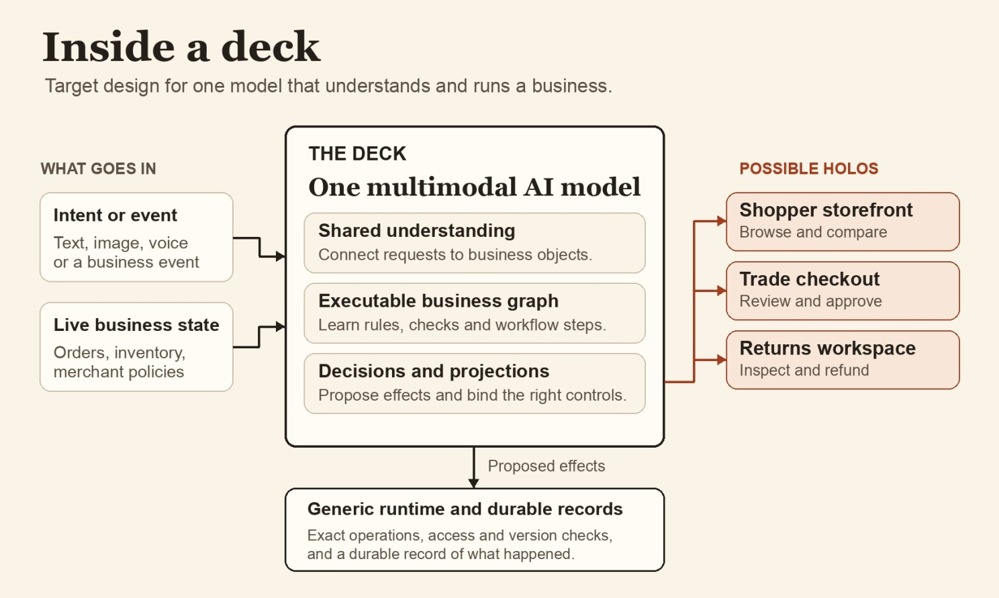
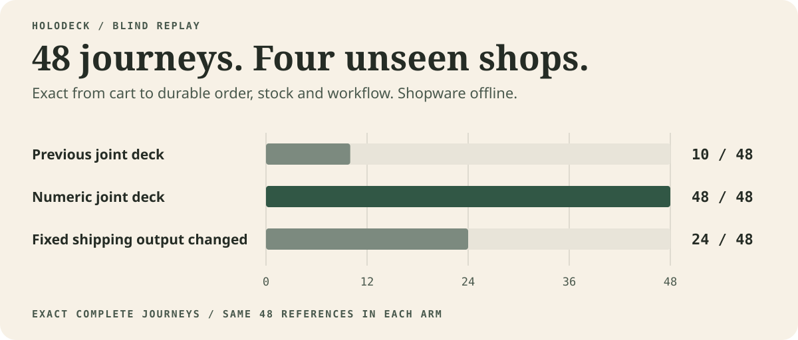

# Holodeck

**One multimodal model for the business. Working software for each moment.**

Today, intelligence sits on top of software. The application is the fixed part, and AI helps you use it. Now take that layer away. One multimodal model holds everything the application knows and creates whatever the moment needs. The things we build today as features, projects and plugins become properties of the architecture.



**Holoshop is the first experiment.** A shopper uses Holo Storefront and Holo Checkout. The merchant opens the same order in Holo Admin and asks for the view they need. The deck is responsible for the commerce decisions behind all three. Shopware teaches the deck during development. The delivered shop runs with its own records and the teacher offline.

[What runs today](#what-runs-today) · [Run Holoshop](#run-the-experiments) · [Architecture](docs/architecture.md) · [From Apps to Holos](docs/article.md)

## What runs today

The latest Holoshop checkpoint selects commerce programs, workflow transitions and UI components from the same learned cell vocabulary. A merchant import supplies products, prices, stock, shipping and tax settings. The same checkpoint handled four new shops, including one with an end total rounding interval it had never seen in training.


**48 of 48 full journeys matched the native Shopware reference**, up from 10 of 48 on the previous checkpoint. We compared the cart, promotion, persisted order, stock, state transitions, workflow effects and replayed checkout receipt. Changing one learned shipping output with the grammar and runtime held constant reduced the score to 24 of 48. The failures were exactly the cases with fixed shipping tax.



Chrome completed eight separate journeys through the generated storefront, checkout and Admin. The buyer and merchant worked on the same order with Shopware stopped. A separately tested service specialist matched all 16 held out return and refund status journeys. The checkout and status actions use synthetic data and simulated payments. [Experiment and limits](docs/joint-deck.md) · [Checkpoints, traces and recorded scores](experiments/shopware/evidence/joint-deck/)


The current model uses **frozen Qwen3.5 9B Base** to interpret Admin requests. A sparse trained decoder selects executable cells for both commerce and projection. The numeric cells come from candidate expressions informed by the Shopware source and checked against traces. A separate [Qwen LoRA experiment](experiments/shopware/qwen/README.md) tests direct generation and records where it fails. A jointly trained multimodal deck with complete Shopware semantics is the research target. [Open architecture questions and acceptance criteria](docs/shopware-absorption.md)

## Deck, holo and projected software

| Concept | What it does |
| --- | --- |
| **Deck** | Carries the executable knowledge of a business. It understands the situation, chooses the relevant facts and rules, and determines the next action and its effects. |
| **Holo** | Gives someone a working surface for the job at hand. It has live data and real controls. A storefront, an approval screen and an Admin grid can be holos from the same deck. |
| **Merchant package** | Supplies the facts and configuration of one business. Products, stock, negotiated prices, roles and brand settings can change independently of the learned domain model. |
| **Commit core** | Checks access and record versions, executes proposed effects atomically and keeps the receipt. Business records outlive every view. |

**Projected software** is the practice of creating these surfaces from the same learned business semantics. Holodeck is the research project. Holoshop is its commerce testbed. [Working definitions](docs/concepts.md)

## What becomes a property of the architecture

- **Every function thinks.** Search, pricing, checkout and service share an understanding of the business.
- **Personal is the only version.** The experience fits the person and situation. The merchant’s price rules still govern every quote.
- **Anything is input.** A photo of a worn part, a voice note or a tender can start the same job.
- **Every surface, without a project.** A storefront, another app, a voice interface or a business agent can work from the same deck.
- **Every business gets its own software.** A merchant can teach the deck the workflow, vocabulary and policies that make the business its own.
- **Features are imagined, then they exist.** Trade loyalty, rentals or a waiting list can become candidates the merchant can rehearse before using them.
- **You can ask the business.** “Which customers stopped reordering after the price change?” can lead to an answer and a view to work through those accounts.
- **It gets better by working.** A correction can become a tested, approved version of how the business runs.

Amazon already demonstrates some of this at scale. The bet is that a merchant with twelve people could get it from the architecture itself. [Article companion](docs/article.md)

## How a deck is made

1. **Observe the domain.** Vary Shopware configurations and record the state, action, result and continuation. Use source and documentation to propose mechanisms. Keep whole shops, configurations and journeys separate for evaluation.
2. **Learn executable decisions.** Fit the model to select operands, rules, operations, writes and bindings. Replay the resulting programs against the traces. A program needs to explain the effects as well as the initial decision.
3. **Load a merchant.** Import products, prices, orders and settings as typed records. The same model reads this package for a new shop. New facts become available on import. A new decision rule needs its own evidence and version.
4. **Prove what transferred.** Stop the teacher and compare full journeys, refusals, browser actions and durable receipts. Change only the learned choice in a control run to find out which effects depend on the model.
5. **Project, commit and improve.** Compose the views and bind the allowed actions. Save useful holos and rebind them to current data. Teach from confirmed corrections, test for regression and activate a new checkpoint at a defined point in the workflow.

[Learning design](docs/learning.md) · [Runtime contracts](docs/interfaces.md) · [Roadmap](docs/roadmap.md)

## Run the experiments

- **Current joint deck.** Reproduce the 48 journey comparison with the bundled synthetic traces and frozen checkpoints on Apple Silicon. Start the four shop browser demo with the pinned Qwen snapshot. [Commands and expected results](docs/joint-deck.md#replay-the-published-checkpoints)
- **Original portable replay.** Run the early rule transfer, native VM and local regression tests on macOS or Linux with Python 3.11 or newer and `clang`. [Experiment guide](experiments/shopware/README.md#reproduce-the-published-runs)

```sh
git clone https://github.com/sthamann/holodeck.git
cd holodeck
python3 -m venv .venv
. .venv/bin/activate
python -m pip install -r requirements.txt
python experiments/shopware/replay.py
```

[History of the Shopware experiments](experiments/shopware/README.md) · [Contributing](CONTRIBUTING.md) · [Artwork and capture credits](assets/README.md)

---

*Holodeck is a research project by Stefan Hamann and the technical companion to **The End of Software as We Know It: From Apps to Holos**.*
