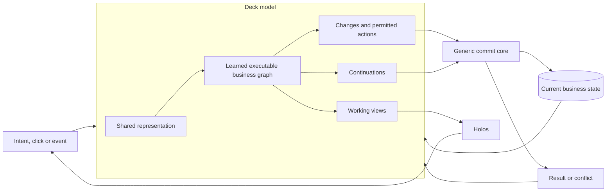
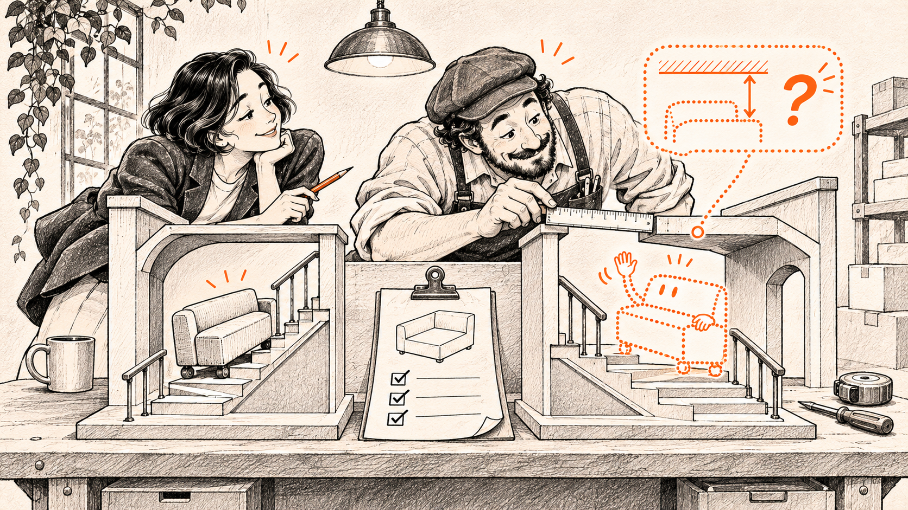

# Holodeck

**Business knowledge that becomes executable software.**

Holodeck explores a different foundation for business software: a model that learns the rules of a business, uses those rules to act, and projects the tools people need to do the work.

We call that executable understanding a **deck**. The working software it projects is a **holo**. A holo can be a storefront, a checkout inside another application, an operations workspace, or a tool someone needs for five minutes. The business keeps its records and what it learned after the view is gone.

[Concepts](docs/concepts.md) · [Architecture](docs/architecture.md) · [Model and learning](docs/learning.md) · [Shopware experiments](experiments/shopware/README.md) · [Roadmap](docs/roadmap.md)


*A research project by [Stefan Hamann](https://github.com/sthamann), accompanying [**The End of Software as We Know It: From Apps to Holos**](docs/article.md). The illustration shows the target architecture. The experiments below establish smaller parts of it.*

## The idea

A business knows how its work gets done. Much of that knowledge is written into software: what accepting an offer changes, when a payment permits fulfilment, or why a refund sometimes restores stock and sometimes does not.

A deck learns that meaning and its executable consequences. Its learned structure determines the calculation, the permitted next action and the state change. The interface is a projection of that same understanding. When a relevant fact changes, the deck can revisit the affected decisions while preserving what people already agreed to.

The architecture therefore has one source of business decisions: **the model itself**. Exact arithmetic, rendering, authorization and durable commits provide the machinery it runs on. They do not contain a second, independently maintained commerce application.

This is the central research question of Holodeck. Putting an agent and an existing business engine in the same package would not answer it.

## A vocabulary for projected software

| Term | Meaning |
|---|---|
| **Deck** | An executable model of a business: learned rules, operational meaning, decision structure and the ability to project working software. |
| **Holo** | A working projection of a deck: interface, workflow and rules bound to one context of work. It can be temporary or kept for years. |
| **Projected software** | Software whose form follows the work and the people doing it, while its business meaning remains coherent. |
| **Business memory** | Current facts, agreements, outcomes and learned structures, with an explicit distinction between records and model knowledge. |
| **Commit core** | The small technical boundary that checks access, versions and atomic changes, then records an effect durably. |
| **Holoshop** | The first commerce experiments used to investigate the deck architecture. |

These are the working definitions used in this project. [Read the concepts and their boundaries →](docs/concepts.md)

## One model, several ways to work



The proposed model is **neurosymbolic**. Learned parameters select and connect typed operations. Those operations execute arithmetic and state changes exactly. A stable learned subgraph can be compiled into a fast path; changing the merchant’s current price changes an input, not the model’s memory of how pricing works.

The design is domain independent. Commerce is the first place we test it because it offers a rich reference implementation and observable outcomes. The same questions apply to procurement, billing, service work and other business processes.

[Read the complete architecture →](docs/architecture.md)

## What runs today

The repository includes two small, runnable Shopware experiments and their synthetic reference data.

| Experiment | Observed result | What it establishes |
|---|---|---|
| Learn a readable rule | A service credit learned from three examples transfers to 12 new journeys in a second shop. Direct Qwen rule generation ties the additional numerical comparison. | A narrow instance of executable rule learning and transfer. |
| Compile the learned computation | 168 recorded transitions agree with the selected Shopware reference outcomes. | Exact execution of these learned programs in the interpreter and native backend. |
| Keep facts live | Versioned offers, checkout retries and concurrent access to the last unit are exercised by the included tests. | Durable state and transactional behaviour in the current prototype. |
| Project and reuse a view | Stored shopper and merchant compositions use live data. The original local run observed 108 warm requests with no large model calls. | Reusable interactive projections over a small catalog. |

The current implementation still has business decisions in its host code. It does **not** yet establish the complete fused deck. The next work moves ordinary commerce decisions into the learned model and tests that boundary directly. [Evidence, scope and reproduction →](experiments/shopware/README.md)


## Run the experiments

Python 3.11 or newer is recommended. The native experiment needs `clang` on macOS or Linux. Replaying and verifying the included checkpoints uses NumPy and Z3; it needs no GPU, Shopware server or model provider account.

```sh
git clone https://github.com/sthamann/holodeck.git
cd holodeck
python3 -m venv .venv
. .venv/bin/activate
python -m pip install -r requirements.txt
python experiments/shopware/replay.py
```

Open the existing local shop experiment:

```sh
python experiments/shopware/native/api.py
# Open http://127.0.0.1:18778
```

It contains synthetic products and test checkout. The server binds to the local machine. See [the experiment guide](experiments/shopware/README.md) for training the small rule model again, bounded rule verification, data provenance and the exact scope of the original live Shopware comparison.

## What we build next

The first target is **ordinary commerce**: catalog, cart, pricing, checkout, payment, fulfilment and a partial return. The same learned structure should determine the outcome, the allowed next action and the controls shown to the person doing the work.

We will test that claim by removing a learned part, changing a model checkpoint while keeping the host fixed, restoring a running process, and transferring a new policy to another merchant. A correct screenshot or a successful API call alone does not establish where the business logic lives.

The sofa in the article illustrates what this could eventually make possible. It is not the first implementation milestone. [Milestones and the concrete task plan →](docs/roadmap.md)



## Explore and contribute

Start with the [concepts](docs/concepts.md), follow the [technical contracts](docs/interfaces.md), or run the [experiments](experiments/shopware/README.md). The [learning design](docs/learning.md) explains what must change in the model and how we separate learning from retrieval, configuration and program generation.

Useful contributions include independently labelled business cases, failures of the proposed boundary, stronger baselines, and improvements that make the same learned semantics usable through different interfaces. [Contribution guide](CONTRIBUTING.md) · [Image and source credits](assets/README.md).

The point is to make the idea testable: **give a business a new job, let its model produce the software the job needs, and keep the knowledge when the job is done.**
