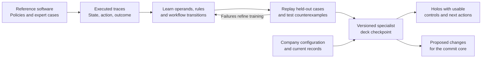

# Holodeck

**Teach a model how a business works. Run what it learns.**

A wholesale buyer orders 40 units. The warehouse ships 24. Then the buyer asks to reduce the order to 30. If the revision is accepted, six units remain due. The supplier has to work out which commitments can change, whether the contract price still applies and who can approve the revision.

That is the kind of work Holodeck explores. The aim is to turn a general AI model into a **B2B software expert** that learns the meaning and consequences of business decisions and can execute them. We call that executable specialist a **deck**. The working software it projects for each person is a **holo**.


[How a deck is made](#how-a-deck-is-made) · [What runs today](#what-runs-today) · [Architecture](docs/architecture.md) · [Roadmap](docs/roadmap.md) · [From Apps to Holos](docs/article.md)

## Deck, holo and projected software

| Concept | What it does |
|---|---|
| **Deck** | Carries learned business logic in an executable model. It interprets an event, applies the relevant rules, proposes changes and determines what can happen next. |
| **Holo** | Gives someone the tools to act on that decision. The buyer might see a revised order to accept. The account manager might see the price and approval impact. The warehouse sees what it can still ship. |
| **Projected software** | The practice of generating these working surfaces from the same business semantics. A holo can be a temporary approval screen, an embedded checkout or the workspace a team uses every day. |
| **Commit core** | Checks actual permissions and record versions, then commits the proposed changes together. It supplies the technical guarantees while the deck supplies the business decision. |

The three people in the example see different controls because they have different jobs. They work on the same order and its accepted commitments. The order, the approval and the shipment survive the closing of any view. [Concepts and definitions](docs/concepts.md)

## How a deck is made

Start with **one job a business already knows how to do**. For wholesale order changes, the teaching material is what actually happens when quantities, terms, shipments and approvals interact. For our first commerce experiments, Shopware supplies reference behaviour.



### 1. Record decisions and their consequences

Run the reference system with different configurations and capture the state before an action, the action itself, the effects and what happens next. Include complete journeys and refusals. Try the same order change before shipment, after partial shipment and with a contract that requires approval before any revision.

Documentation and expert examples help identify the rules. Executed results and independently specified outcomes give us something to check. Reserve entire companies and policy combinations for evaluation so that a replay tests more than recall.

### 2. Teach the model to execute the rule

The foundation model helps connect language and business terms to typed records. Trainable business heads learn **which fields matter, which conditions apply, which exact operations to use and which step follows**. The selected operations form an executable graph. A guard is the part of that graph that decides whether an action may proceed.

In the wholesale example, the graph could read the accepted order and completed shipments, calculate the open quantity, check the revision against the account's policy, and produce a pending approval with a continuation if one is needed. The learner evaluates candidate graphs by executing them against reference outcomes. Counterexamples expose a candidate that gets the arithmetic right and releases stock at the wrong time.

The proposed design starts with a shared foundation encoder and trained business heads. We can then measure what a trainable adapter adds. The graph runs exact operations on typed values. Stable learned paths can be compiled and checked against their original execution, including refusals and the next actions they expose. [Model and learning design](docs/learning.md)

### 3. Make it an expert for a specific business

A versioned **deck checkpoint** brings together the model reference, the trained parameters, their executable graph, the schema and primitive versions, and the evidence supporting its use. A company package supplies its products, customer contracts, approval configuration and other facts. A change to a configured approval limit is a data update. Teaching the deck when that limit applies is a change to executable knowledge.

This lets us test what transfers between companies. Two wholesalers may share the semantics of a partially shipped order and apply different terms or approval limits. A domain specialist earns its place by handling that shared work across configurations and learning the policy differences that matter.

### 4. Prove the specialist before it acts

Replay unseen journeys against independent outcomes. Compare the full sequence of allowed actions, exact effects, refusals and resumptions. Then change the model checkpoint while keeping the host fixed. If the business decision changes in the expected way, we have evidence about where the rule lives. Removing the relevant learned part gives us a second check.

We compare trained adaptation with the same base model given retrieved examples and with direct rule synthesis. A useful new rule and an improvement attributable to training are separate results. [Evaluation and adaptation plan](docs/learning.md#the-first-policy-adaptation)

### 5. Project the work and learn from use

At runtime the deck reads a typed snapshot and an event. It produces proposed changes, the allowed next actions, a continuation if the job is waiting, and a projection with real controls. The commit core checks the proposed effects. If a relevant record changes, the deck receives the updated state and revisits the decision.

An observed failure can become a new teaching case. A corrected checkpoint is tested on fresh cases before activation. Existing agreements and running work retain their references, so an improved policy has a defined point of adoption. [Runtime contracts](docs/interfaces.md)

## What runs today

**Holoshop** is the first testbed. It starts with ordinary commerce so we can follow the same decisions across catalog, cart, pricing, checkout, payment, fulfilment and returns. The published prototype exercises a narrower subset.

| Published experiment | Result |
|---|---|
| **Learn and transfer a rule** | Three examples teach a capped service credit. It transfers to 12 of 12 held-out journeys at a second merchant. Direct Qwen rule generation ties the learned rule on 1,000 additional numeric cases. |
| **Execute exactly** | The native backend matches all 168 recorded reference transitions. The local regression suite exercises quote freshness, checkout retries and contention for the last unit. |
| **Project reusable views** | Stored shopper and merchant compositions bind to current data. The original local run observed 108 warm requests with no large model calls. |

The prototype trains small categorical selection heads. Some commercial decisions still live in host code. The next milestone moves cart and pricing decisions into the learned model. The first end-to-end target goes through a partial return and tests where each decision lives through replay, transfer and ablation. [Experiment evidence](experiments/shopware/README.md) · [Milestones and tasks](docs/roadmap.md)


## Run the experiments

Use Python 3.11 or newer and `clang` on macOS or Linux. The replay uses the included checkpoints and synthetic traces, so it runs locally without a GPU or a live Shopware instance.

```sh
git clone https://github.com/sthamann/holodeck.git
cd holodeck
python3 -m venv .venv
. .venv/bin/activate
python -m pip install -r requirements.txt
python experiments/shopware/replay.py
```

Start the local demo with `python experiments/shopware/native/api.py` and open [localhost:18778](http://127.0.0.1:18778). The experiment guide includes the refitting command, the evidence behind each result and the scope of the original Shopware comparison. [Reproduction guide](experiments/shopware/README.md)

---

*Holodeck is a research project by Stefan Hamann and the technical companion to **The End of Software as We Know It: From Apps to Holos**.* [Article companion](docs/article.md) · [Contributing](CONTRIBUTING.md) · [Illustration credits](assets/README.md)
