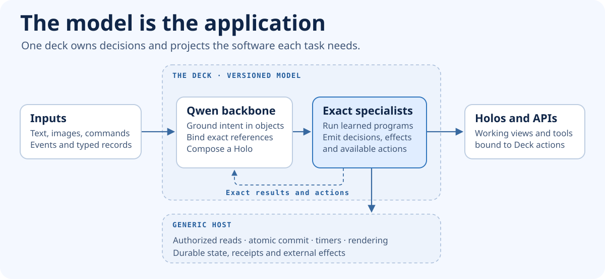
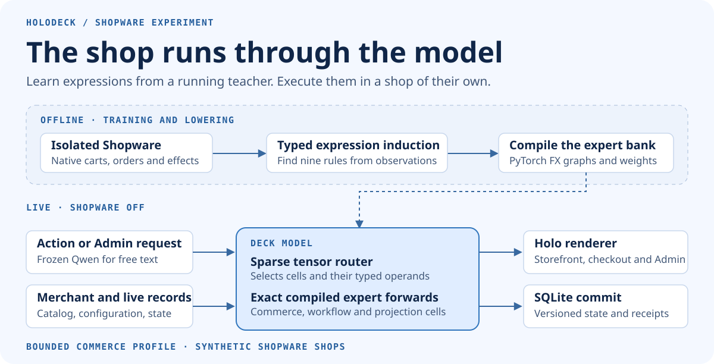
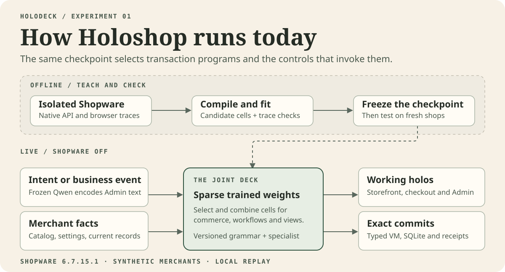
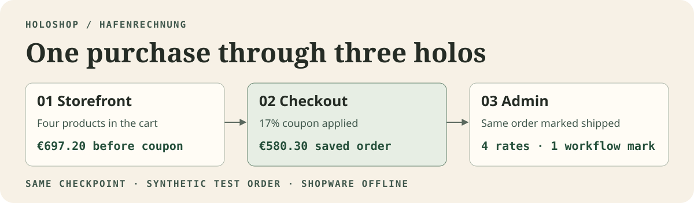
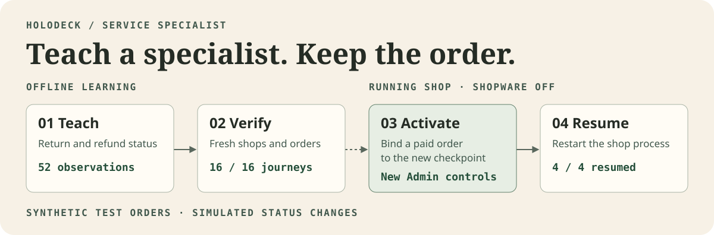
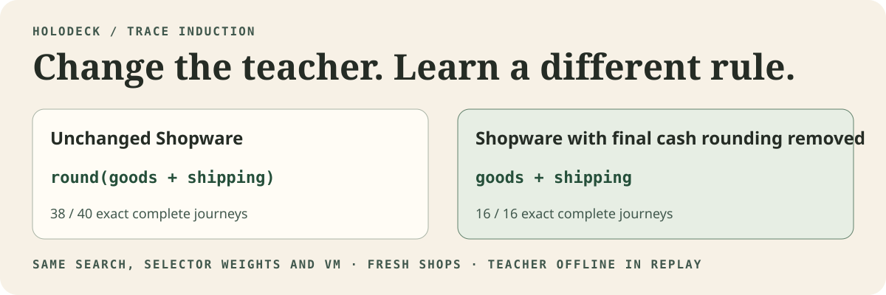
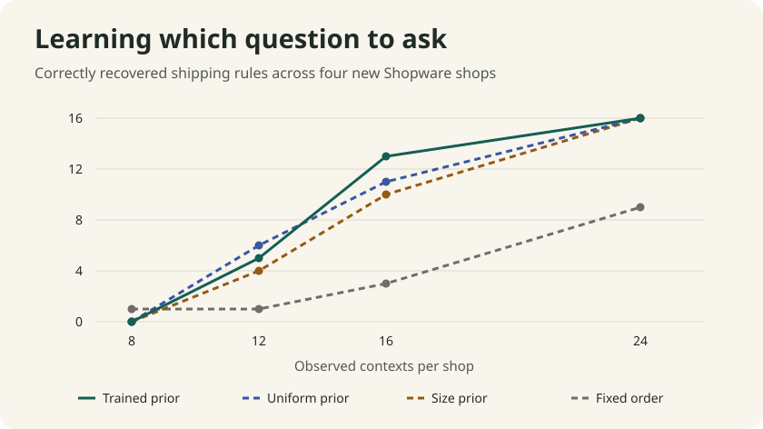
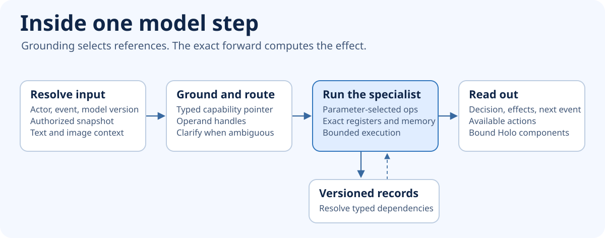
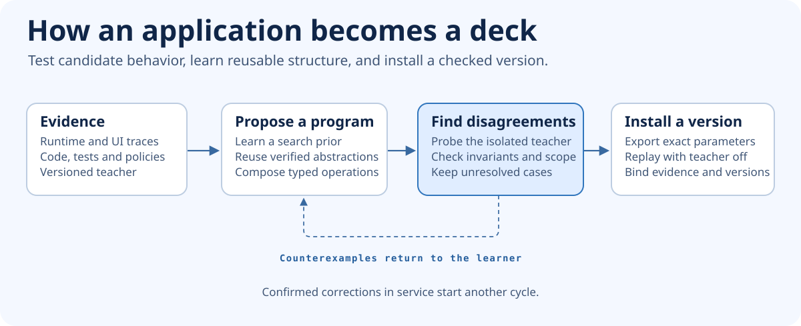

# Holodeck

**A model that learns and runs the application. An interface for each moment.**

A **Deck** learns executable software behavior and applies it to live, versioned records. A **Holo** is the working interface the Deck composes for a person and task. Its controls bind the same capabilities as an API. The long-term goal is to fuse arbitrary software with a foundation model such as Qwen, with one generic runtime for execution and persistence.

[](docs/architecture.md)

[Current research status](docs/research-status.md) · [Recurrent workflow acquisition](docs/recurrent-workflow-acquisition.md) · [Learning an application](docs/learning-application-semantics.md) · [Target architecture](docs/architecture.md) · [Experiments and acceptance](docs/roadmap.md) · [Fable 5.2 challenge](docs/architecture-review.md) · [The original article](https://www.linkedin.com/pulse/end-software-we-know-stefan-hamann-z81he/)

Holoshop is the commerce testbed. Shopware teaches the Deck during development. The existing prototype runs selected shopper and merchant journeys on its own records with the teacher offline. [Run Holoshop](#run-the-experiments)

## Watch the film

[](https://github.com/sthamann/holodeck/releases/tag/holodeck-explainer)

[MP4](https://github.com/sthamann/holodeck/releases/download/holodeck-explainer/Holodeck-From-Software-to-a-Deck-EN.mp4) · [English subtitles](https://github.com/sthamann/holodeck/releases/download/holodeck-explainer/Holodeck-From-Software-to-a-Deck-EN.en.srt) · [Run the interactive demo](docs/showcase.md)

The film illustrates the vision and its original Shopware experiment and shows a test purchase through checkout and a saved return with Shopware switched off. The browser sequence uses the optional Strands heads.

## What runs today

### An independent model core

The Rust experiment learns exact transitions from a separate teacher. Three bounded behaviors matched **15,024 held-out inputs each** after 9–11 queries apiece. Changing the teacher's boundary caused 536 mismatches with the old checkpoint. The refitted checkpoint changed the corresponding operator selector and passed the same offline evaluation. This is a bounded discrete execution result. The roadmap tests whether a learned prior, Qwen and reusable composition improve on equivalent symbolic and code-generation baselines. [Reproduce the Rust experiment](experiments/model-core/README.md)

### Transfer a connected application outside commerce

The standalone MyNotes Deck creates, edits, tags, links and splits notes through an exact parameter graph. Its generated browser workspace and HTTP API share the same operations and durable records. With the teacher switched off and no original code in the runtime, it matched **26 reference HTTP responses and the persisted workspace**. Three teacher traces selected three parameters from eight candidates. Changing one parameter changed both the split preview and the notes saved by that control. [Run the Deck and reproduce the comparison](experiments/mynotes/deck/README.md)

The Qwen follow up used native browser traces to fit intent grounding. Its mixed checkpoint matched **78 of 78 API interactions** and ran a browser workflow with MyNotes off. It contains generated tag operations and a generated Holo with human corrections. The remaining note operations use the earlier authored graph. The attempt to synthesize the whole graph did not pass compilation. [What was learned and what failed](docs/research-status.md)

The recurrent experiment runs splitting and publication through one checkpoint. Publication inferred its states from native API, database and browser observations. The learned behavior controls which publication actions appear, which public copy is served and what gets written. With MyNotes off, six reserved workflows matched the native reference. [Architecture, diagrams and reproduction](docs/recurrent-workflow-acquisition.md)

### Learn Shopware's API and UI together

The [absorption pipeline](docs/absorption-pipeline.md) reads the installed OpenAPI inventory, records native HTTP and browser behavior, fits a model candidate and replays it with Shopware stopped before installing it. In the first catalog profile, the generated Admin **Stock → Save** control issues the same native Sync API request and reopens the saved value at the original Shopware URL. Four operation profiles passed **96 of 96** held-out HTTP checks and two native-to-Holo browser journeys. The ledger tracks the other **1,232** installed operations as unmeasured.

The [product mask experiment](docs/product-mask.md) compiles eight observed Admin tabs from native browser traces. It fits request and state change programs for base prices, variant creation and JPEG assignment from 21 Shopware writes. With Shopware off, Chrome ran 14 writes across two new Papierwerft products and verified the saved results after a Deck restart. [Native Shopware and the Holo side by side](assets/experiments/product-mask/actions-variants-side-by-side.png)

### Execute commerce inside the model

The new **forward-pass shop** runs commerce, workflow and projection cells in compiled PyTorch subgraphs. Nine expressions were learned from Shopware observations and lowered into the model. The interpreter baseline, the same program bank in the model and the trace-induced model each matched **36 of 36 full journeys across four fresh shops** with Shopware switched off. [How it works, what was learned and how to run it](docs/forward-pass.md)

[](docs/forward-pass.md)

**See the same order in Lichtwerft.** A 21% test coupon brings the checkout to €202.90. A generated Admin workspace shows the order and saves its delivery status. [Storefront](assets/experiments/forward-pass/lichtwerft-storefront.png) · [Checkout](assets/experiments/forward-pass/lichtwerft-checkout.png) · [Admin](assets/experiments/forward-pass/lichtwerft-admin.png) · [Three-way comparison](docs/forward-pass.md#compare-the-three-paths)

### The earlier joint deck

The joint checkpoint selects commerce programs, workflow transitions and UI components from the same learned cell vocabulary. A merchant import supplies products, prices, stock, shipping and tax settings. The checkpoint handled four new shops, including one with an end total rounding interval it had never seen in training.



**48 of 48 full journeys matched the native Shopware reference**, up from 10 of 48 on the previous checkpoint. We compared the cart, promotion, persisted order, stock, state transitions, workflow effects and replayed checkout receipt. Changing one learned shipping output with the grammar and runtime held constant reduced the score to 24 of 48. The failures were exactly the cases with fixed shipping tax.


Chrome completed eight separate journeys through the generated storefront, checkout and Admin. The buyer and merchant worked on the same order with Shopware stopped. A separately tested service specialist matched all 16 held out return and refund status journeys. The checkout and status actions use synthetic data and simulated payments. [Experiment and limits](docs/joint-deck.md) · [Checkpoints, traces and recorded scores](experiments/shopware/evidence/joint-deck/)

The current model uses **frozen Qwen3.5 9B Base** to interpret Admin requests. A sparse trained decoder selects executable cells for both commerce and projection. The numeric cells come from candidate expressions informed by the Shopware source and checked against traces. A separate [Qwen LoRA experiment](experiments/shopware/qwen/README.md) tests direct generation and records where it fails. A jointly trained multimodal deck with complete Shopware semantics is the research target. [Open architecture questions and acceptance criteria](docs/shopware-absorption.md)

### One purchase through three holos

In Hafenrechnung, four products go into the cart. A 17% coupon brings the rounded order total to €580.30. The merchant opens that order in Admin, asks for delivery status and the tax breakdown, then marks it shipped.

[](docs/joint-deck.md#one-order-in-the-browser)

[Storefront](assets/experiments/joint-deck/hafenrechnung-storefront.png) · [Checkout](assets/experiments/joint-deck/hafenrechnung-checkout.png) · [Admin](assets/experiments/joint-deck/hafenrechnung-admin.png) · [Walk through the browser captures](docs/joint-deck.md#one-order-in-the-browser)

### Interactive demo in Birkenkai and Sandfracht

Follow one checkout from the storefront into Admin. Ask for service actions, activate the specialist and run the same request again. The live inspector shows the order revision, checkpoint and action bindings. [Run the demo and see the browser captures](docs/showcase.md)

### A new capability on an existing order

A service specialist learned which return and refund status changes Shopware accepts. In the browser, the same paid order gains the permitted Admin controls when the checked specialist is activated. All four test orders resume on that version after a restart.

[](docs/learning.md#one-specialist-from-training-to-activation)

[See the before and after captures and reproduce the activation](docs/learning.md#one-specialist-from-training-to-activation)

### What Strands learns

Two optional heads share a frozen Qwen3.5 2B Strands backbone. The fitted service head chose the correct result on **80 of 80** reserved commands. The released head scored **44 of 80**. The fitted head and the existing sparse specialist both matched all **16 complete service journeys**. The fitted Strands Admin readout was faster in the local comparison and matched **8 of 14** requested facet sets. The existing readout matched **11 of 14** and remains the default. [Training, comparison and run instructions](docs/strands.md)

### Discover expressions from Shopware traces

The next experiment recovers nine executable expressions without providing formula labels. On four fresh shops, deliberately varied observations yield **38 of 40** exact journeys, compared with **6 of 40** from the same number of earlier passive observations. A separately fitted checkpoint follows a deliberately changed Shopware teacher in **16 of 16** fresh journeys. The sparse selector weights stay identical. The acquired knowledge is the executable expression grammar.

[](docs/trace-induction.md#the-teacher-changes-one-rule)

[Read the Fable 5.2 challenge, results and reproduction](docs/trace-induction.md)

### One learned rule powers a control and a write

The deck learned a quantity policy from Cart API outcomes alone. It reproduced all 16 native Storefront option sets and all 220 persisted quantity decisions in four unseen shops. Removing the stock dependency impaired both readouts. The reverse fit from UI observations identified the same allowed quantities but left 161 of the 220 request corrections ambiguous. [See Nordufer, the control and reproduction](docs/quantity-transfer.md)

### Recover a rule missing from the merchant import

Four more shops supplied only product facts and stock. Targeted Cart API probes recovered the missing quantity policy for 12 of 16 products. One additional observation per unresolved product made all 16 identifiable. The resulting program supplied the generated controls and persisted quantities through checkout in all four shops with Shopware stopped. [See the browser capture, the baselines and the Fable 5.2 review](docs/hidden-quantity.md)

### Learn a shipping rule from the way it behaves

The next trial hides nested Shopware availability rules and price tiers. A trained prior identifies 13 of 16 supported rules after 16 observed carts per shop, compared with 11 for a uniform prior. At 24 contexts both recover all 16 and withhold four incompatible methods. An early false offer shows why the model needs an independent check before a rule can serve checkout. [Read the comparison and replay the orders](docs/shipping-rules.md)

[](docs/shipping-rules.md)

## Deck, holo and projected software

[](docs/architecture.md#2-the-forward-owns-application-behavior)

| Concept | What it does |
| --- | --- |
| **Deck** | Carries the executable knowledge of a business. It understands the situation, chooses the relevant facts and rules, and determines the next action and its effects. |
| **Holo** | Gives someone a working surface for the job at hand. It has live data and real controls. A storefront, an approval screen and an Admin grid can be holos from the same deck. |
| **Merchant package** | Supplies the facts and configuration of one business. Products, stock, negotiated prices, roles and brand settings can change independently of the learned domain model. |
| **Commit core** | Checks access and record versions, executes proposed effects atomically and keeps the receipt. Business records outlive every view. |

**Projected software** is the practice of creating these surfaces from the same learned business semantics. Holodeck is the research project. Holoshop is its commerce testbed. [Working definitions](docs/concepts.md)

## What becomes a property of the architecture

- **Every function thinks.** Search, pricing, checkout and service share an understanding of the business.
- **Personal is the only version.** The experience fits the person and situation. The merchant’s price rules still govern every quote.
- **Anything is input.** A photo of a worn part, a voice note or a tender can start the same job.
- **Every surface, without a project.** A storefront, another app, a voice interface or a business agent can work from the same deck.
- **Every business gets its own software.** A merchant can teach the deck the workflow, vocabulary and policies that make the business its own.
- **Features are imagined, then they exist.** Trade loyalty, rentals or a waiting list can become candidates the merchant can rehearse before using them.
- **You can ask the business.** “Which customers stopped reordering after the price change?” can lead to an answer and a view to work through those accounts.
- **It gets better by working.** A correction can become a tested, approved version of how the business runs.

The bet is that a small merchant can get these capabilities from the architecture itself. [Article companion](docs/article.md)

## How a deck is made

[](docs/architecture.md#4-how-a-deck-learns-an-application)

The learner combines traces, source, tests and explicit policies. It proposes reusable program structure, asks the teacher about cases that distinguish candidates, and verifies the selected behavior before installing it. A live deployment uses the resulting model and its own records. Confirmed corrections can teach a later version.

[Learning design](docs/architecture.md#4-how-a-deck-learns-an-application) · [Runtime contracts](docs/interfaces.md) · [Validation plan](docs/roadmap.md)

## Run the experiments

- **Independent model core.** Run the compiled Rust teacher, learner and offline Deck. [Commands and evidence](experiments/model-core/README.md)
- **Current joint deck.** Reproduce the 48 journey comparison with the bundled synthetic traces and frozen checkpoints on Apple Silicon. Start the four shop browser demo with the pinned Qwen snapshot. [Commands and expected results](docs/joint-deck.md#replay-the-published-checkpoints)
- **Original portable replay.** Run the early rule transfer, native VM and local regression tests on macOS or Linux with Python 3.11 or newer and `clang`. [Experiment guide](experiments/shopware/README.md#reproduce-the-published-runs)

```sh
git clone https://github.com/sthamann/holodeck.git
cd holodeck
python3 -m venv .venv
. .venv/bin/activate
python -m pip install -r requirements.txt
python experiments/shopware/replay.py
```

[History of the Shopware experiments](experiments/shopware/README.md) · [Contributing](CONTRIBUTING.md) · [Artwork and capture credits](assets/README.md)

---

*Holodeck is a research project by Stefan Hamann and the technical companion to **The End of Software as We Know It: From Apps to Holos**.*
