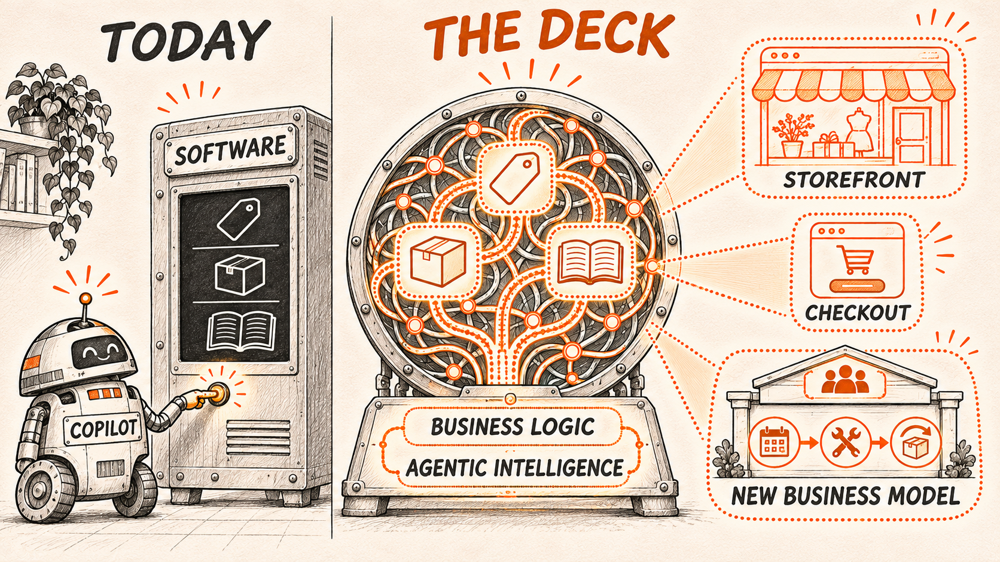
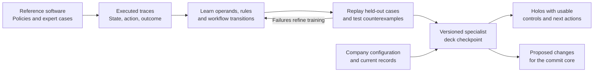

# Holodeck

**One multimodal model for the business. Working software for each moment.**

Today, intelligence sits on top of software. The application is the fixed part, and AI helps you use it. Now take that layer away. One multimodal model holds everything the application knows and creates whatever the moment needs. The things we build today as features, projects and plugins become properties of the architecture.

That is the vision. **Holoshop is the first experiment.** It learns and transfers a small commerce rule, executes recorded Shopware transitions and binds saved views to live demo data. The broader architecture is the research target. [What runs today](#what-runs-today)



[How a deck is made](#how-a-deck-is-made) · [Architecture](docs/architecture.md) · [Roadmap](docs/roadmap.md) · [From Apps to Holos](docs/article.md)

## What becomes a property of the architecture

- **Every function thinks.** Search, pricing, checkout and service share an understanding of products, commitments and business rules.
- **Personal is the only version.** A first-time buyer sees a guided choice while a repeat buyer gets straight to the order they came for. Both get prices under the merchant’s declared rules.
- **Anything is input.** A photo of a worn part, a voice note from the van or a forty-page tender can start the same job.
- **Every surface, without a project.** A storefront, a panel inside another app, a voice in the car or another company’s agent can work from the same deck.
- **Every business gets its own software.** A merchant describes how the team works and can teach the deck the workflow, terminology and policies that make the business its own.
- **Features are imagined, then they exist.** A merchant can describe trade loyalty, a rental or a one-time waiting list and get a working candidate to rehearse and verify.
- **You can ask the business.** “Which customers stopped reordering after the price change?” can return a grounded answer and a view for working through those accounts.
- **It gets better by working.** What the team teaches it on Tuesday can become an approved version of how it works on Wednesday.

Amazon already demonstrates some of these experiences at scale. The bet is to make them a property of the architecture for a merchant with twelve people. [Article companion and comparison](docs/article.md#today-a-project-in-a-deck-a-property)

## Deck, holo and projected software

| Concept | What it does |
|---|---|
| **Deck** | Carries learned business logic in an executable model. It interprets an event, applies the relevant rules, proposes changes and determines what can happen next. |
| **Holo** | Gives a person or another system the tools for a specific job. It carries the relevant workflow, live bindings and available actions into the surface they use. |
| **Projected software** | The practice of generating these working surfaces from the same business semantics. A holo can be a temporary approval screen, an embedded checkout or the workspace a team uses every day. |
| **Commit core** | Checks actual permissions and record versions, then commits the proposed changes together. It supplies the technical guarantees while the deck supplies the business decision. |

**Holodeck** is the research project behind this architecture. A deck is the executable specialist. A holo is the working software it projects. Commitments and business records survive the closing of any view. [Concepts and definitions](docs/concepts.md)

## Trust and speed

The model learns the semantics of business decisions. Exact typed operations execute them. Durable records hold live facts and agreements, and the commit core enforces authority, current versions and atomic changes. A generated checkout and a saved checkout use the same pricing rules. Presentation may adapt to a person and situation. Contract prices, tiers and discounts change only through the merchant’s explicit policies.

Useful holos can be saved, reopened and rebound to current records. A warehouse can start every morning with the same view. A request for a new kind of work can justify fresh composition, while routine actions can reuse saved views and compiled parts of the learned graph. We measure first projection and repeat use separately. [Architecture of fast paths and projections](docs/architecture.md#7-exact-fast-paths)

## How a deck is made

Start with a business domain and learn from how its software and people actually work. Shopware is the first curriculum because we can vary commerce configurations and observe which decisions follow and which records change.



### 1. Record decisions and their consequences

Run the reference system with different configurations and capture the state before an action, the action itself, the effects and what happens next. Include complete journeys, refusals and cases where a decision has to wait for another person or event.

Documentation and expert examples help identify the rules. Executed results and independently specified outcomes give us something to check. Reserve entire companies and policy combinations for evaluation so that a replay tests more than recall.

### 2. Teach the model to execute the rule

The foundation model helps connect language and business terms to typed records. Trainable business heads learn **which fields matter, which conditions apply, which exact operations to use and which step follows**. The selected operations form an executable graph. A guard is the part of that graph that decides whether an action may proceed.

The learner executes candidate graphs against reference outcomes. A graph has to account for both the decision and its consequences. A counterexample can reveal a missing condition even when every calculated amount is correct.

The proposed design starts with a shared foundation encoder and trained business heads. We can then measure what a trainable adapter adds. The graph runs exact operations on typed values. Stable learned paths can be compiled and checked against their original execution, including refusals and the next actions they expose. [Model and learning design](docs/learning.md)

### 3. Make it an expert for a specific business

A versioned **deck checkpoint** brings together the model reference, the trained parameters, their executable graph, the schema and primitive versions, and the evidence supporting its use. A company package supplies its products, customer contracts, approval configuration and other facts. A change to a configured approval limit is a data update. Teaching the deck when that limit applies is a change to executable knowledge.

This lets us test what transfers between companies. A domain specialist can bring shared business semantics to a second company, use its configuration and learn the policies specific to that business.

### 4. Prove the specialist before it acts

Replay unseen journeys against independent outcomes. Compare the full sequence of allowed actions, exact effects, refusals and resumptions. Then change the model checkpoint while keeping the host fixed. If the business decision changes in the expected way, we have evidence about where the rule lives. Removing the relevant learned part gives us a second check.

We compare trained adaptation with the same base model given retrieved examples and with direct rule synthesis. A useful new rule and an improvement attributable to training are separate results. [Evaluation and adaptation plan](docs/learning.md#the-first-policy-adaptation)

### 5. Project the work and learn from use

At runtime the deck reads a typed snapshot and an event. It produces proposed changes, the allowed next actions, a continuation if the job is waiting, and a projection with real controls. The commit core checks the proposed effects. If a relevant record changes, the deck receives the updated state and revisits the decision.

An observed failure can become a new teaching case. A corrected checkpoint is tested on fresh cases before activation. Existing agreements and running work retain their references, so an improved policy has a defined point of adoption. [Runtime contracts](docs/interfaces.md)

## What runs today

**Holoshop** is the first testbed. It starts with ordinary commerce so we can follow the same decisions across catalog, cart, pricing, checkout, payment, fulfilment and returns. The published prototype exercises a narrower subset.

| Published experiment | Result |
|---|---|
| **Learn and transfer a rule** | Three examples teach a capped service credit. It transfers to 12 of 12 held-out journeys at a second merchant. Direct Qwen rule generation ties the learned rule on 1,000 additional numeric cases. |
| **Execute exactly** | The native backend matches all 168 recorded reference transitions. The local regression suite exercises quote freshness, checkout retries and contention for the last unit. |
| **Project reusable views** | Stored shopper and merchant compositions bind to current data. The original local run observed 108 warm requests with no large model calls. |

The prototype trains small categorical selection heads. Some commercial decisions still live in host code. The planned experiments move a standard commerce journey into the learned model and test where its decisions live through replay, transfer and ablation. [Experiment evidence](experiments/shopware/README.md) · [Milestones and tasks](docs/roadmap.md)


## Run the experiments

Use Python 3.11 or newer and `clang` on macOS or Linux. The replay uses the included checkpoints and synthetic traces, so it runs locally without a GPU or a live Shopware instance.

```sh
git clone https://github.com/sthamann/holodeck.git
cd holodeck
python3 -m venv .venv
. .venv/bin/activate
python -m pip install -r requirements.txt
python experiments/shopware/replay.py
```

Start the local demo with `python experiments/shopware/native/api.py` and open [localhost:18778](http://127.0.0.1:18778). The experiment guide includes the refitting command, the evidence behind each result and the scope of the original Shopware comparison. [Reproduction guide](experiments/shopware/README.md)

---

*Holodeck is a research project by Stefan Hamann and the technical companion to **The End of Software as We Know It: From Apps to Holos**.* [Article companion](docs/article.md) · [Contributing](CONTRIBUTING.md) · [Illustration credits](assets/README.md)
