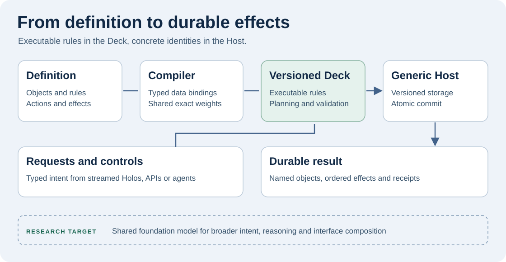
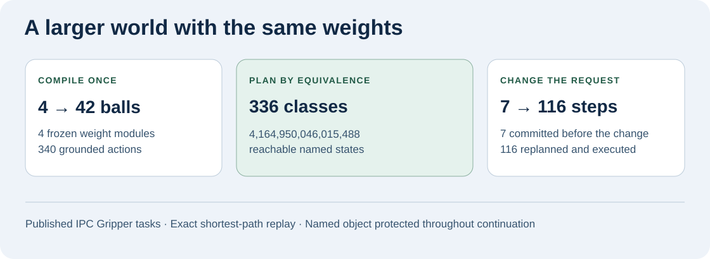

# Holodeck

**Define an application. Compile it into an AI model. Stream every interface from that model.**

Holodeck investigates a different unit of software. Define the objects, rules, rights and effects, then compile the definition into a **Deck**. A Deck packages executable semantics, evidence and the bindings needed by people and agents. The current compiler runs independently authored formal planning definitions using reusable affine and threshold modules. A shared foundation model for broader intent, composition and presentation is the research target.

A **Holo** is a live, streamed interface. It may be a document, a visual workspace, a spreadsheet, a spatial control surface or an interface nobody drew beforehand. The model streams typed changes to that surface. A click, a direct API call and an agent instruction can invoke the same capability, with the same rights, versions and effects. The **Host** supplies configurable storage, transactions, time and external connections. A storage migration preserves the application's commitments under its declared consistency contract.

[Research roadmap](docs/roadmap.md) · [Next architecture](docs/next-architecture.md) · [TodoMVC experiment](experiments/todomvc/README.md) · [The application as a modality](docs/deck-modality-plan.md) · [Mathematical and model architecture](docs/model-application-architecture.md) · [Experiments](experiments/model-applications/README.md) · [Research and prior art](docs/model-application-research.md) · [Original article](https://www.linkedin.com/pulse/end-software-we-know-stefan-hamann-z81he/)

## Foundation Intelligence

The proposed foundation layer grounds intent, inspects exact outcomes and generates controls bound to Deck actions. The current experiments use frozen language models to read objectives and an exact compiler to select and validate plans. Routing equivalent information internally and externally tied in the measured comparison. The next architecture comparison will need a causal task-level gain at matched correctness and cost.

The primary research path starts with a definition and deploys a Deck on a generic Host. Formal contracts already compile in the measured fragment. Natural language, examples and existing software can supply evidence about a definition. The experiments below test whether the resulting meanings are specific enough to authorize an action.

## What would establish the vision

| Research claim | Decisive evidence |
| --- | --- |
| **The application is a model artifact** | Compile an independently written definition to a Deck. Deploy with a frozen generic host and renderer. A targeted artifact change alters a decision and the persisted result. The same qualification applies across API, agents and streamed Holos. |
| **Intelligence and execution benefit from coupling** | At equal information and cost, internal semantic feedback improves exact authorized task completion over the same backbone with equally powerful external execution. Cutting that feedback removes the measured gain. |
| **Interfaces and persistence are projections of one semantics** | Stream new workspaces for unseen tasks. Replay equivalent intents across surfaces, swap between qualified storage backends and resume open work. Verify receipts, visible actions and effects under faults and revision changes. |
| **Learning compounds across applications** | Freeze the runtime and reusable abstractions before an independent team brings a structurally new definition. Show a measured gain in authoring, qualification or execution at matched correctness. |

The target is open ended across effectively specified application domains with declared resource and effect contracts. Initial proofs and benchmarks name their scope. A finite trace match cannot establish arbitrary black box equivalence, and natural language alone may leave multiple legitimate applications.

## Evidence today

| Result | Evidence |
| --- | --- |
| **External formal definitions** | Seven original tasks across Gripper, Blocks and Miconic compile through one pipeline. The weight modules from four balls execute all 340 grounded actions in the 42-ball task. Its 4,164,950,046,015,488 reachable named states form exactly 336 classes under the certified quotient. [Structural replay](experiments/model-applications/structural/README.md) |
| **A live change of scope** | After seven durable steps, a named ball becomes protected. The planner keeps its identity, lifts a new 116-step plan, and verifies the constraint across commit, migration and restart. [Retargeting](experiments/model-applications/structural/README.md#reproduced-results) |
| **An ambiguous request** | A bounded English grammar keeps both readings of “leave” alive. Holodeck commits when a single plan is shortest under each reading. It asks for clarification when a shared plan would take three steps for a reading with a two-step optimum. [Language to plan replay](experiments/model-applications/intent/README.md) |
| **When the model omits a requirement** | With the same calibrated model outputs, checking for a common optimum increased correct commits from 3 to 15 across 144 decisions. It also exposed six false commits, all on requests outside the compiled scope. [Scope grounding replay](experiments/model-applications/intent/scope.md) |
| **Objective discovery** | Three separately authored synthetic targets resolve from two to four calibration comparisons. The fourth exposes two indistinguishable compatible rules with different target optima. [Discovery and refusal proofs](experiments/model-applications/elicitation/README.md) |
| **Deployment and language** | Two pilot contracts exercise streamed browser controls and atomic writes across journal and SQLite. A frozen model readout with an exact optimizer made 248 of 288 decisions on a 24-utterance synthetic suite. [Deployment](experiments/model-applications/README.md#executable-vertical-development-run) · [Foundation comparison](experiments/model-applications/foundation/README.md) |

[Research status and limitations](docs/research-status.md) · [Reproduce the experiment series](experiments/model-applications/README.md)

[Contributing](CONTRIBUTING.md) · [Demonstration and film](docs/showcase.md) · [Artwork and capture credits](assets/README.md)

## Watch the film

The film explains how a Deck is built and shows an early commerce run with the teacher switched off. It is silent, with English subtitles. [Download the MP4](https://github.com/sthamann/holodeck/releases/download/holodeck-explainer/Holodeck-From-Software-to-a-Deck-EN.mp4) · [English subtitles](https://github.com/sthamann/holodeck/releases/download/holodeck-explainer/Holodeck-From-Software-to-a-Deck-EN.en.srt) · [Run the interactive demo](docs/showcase.md#start-the-interactive-demo)

---

Holodeck is a research project by Stefan Hamann and the technical companion to *The End of Software as We Know It: From Apps to Holos*. [Contributing](CONTRIBUTING.md) · [Artwork and capture credits](assets/README.md)

## Author

Built by [Stefan Hamann](https://stefan-hamann.de/), co-founder of Shopware and author of the handbook [Agentic Commerce](https://www.agentic-commerce.sh/). More about this project: [Holodeck on agentic-commerce.sh](https://www.agentic-commerce.sh/en/lab/holodeck/).
