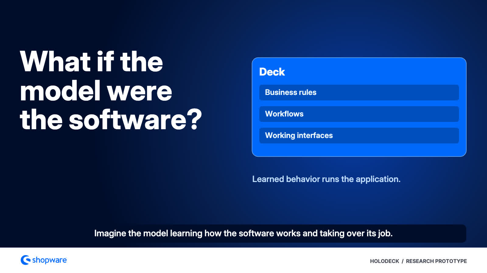

# Holodeck

**Define an application. Compile it into an AI model. Stream every interface from that model.**

Holodeck is a research project about a new form of software. Describe what an application must do: its objects, rules, rights, commitments, time and external effects. A compiler turns that definition into a **Deck**, a deployable application model built on a shared foundation model. Its exact executable semantics determine what happens. Its learned intelligence understands what people mean, reasons over live alternatives and builds an interface for the work at hand.

A **Holo** is a live, streamed interface. It may be a document, a visual workspace, a spreadsheet, a spatial control surface or an interface nobody drew beforehand. The model streams typed changes to that surface. A click, a direct API call and an agent instruction can invoke the same capability, with the same rights, versions and effects. The **Host** supplies configurable storage, transactions, time and external connections. A storage migration preserves the application's commitments under its declared consistency contract.

[Research roadmap](docs/roadmap.md) · [Mathematical and model architecture](docs/model-application-architecture.md) · [Experiments](experiments/model-applications/README.md) · [Research and prior art](docs/model-application-research.md) · [Original article](https://www.linkedin.com/pulse/end-software-we-know-stefan-hamann-z81he/)

## Foundation Intelligence

The same foundation model serves new Decks without retraining the whole backbone for each application. Holodeck aims to teach it reusable executable abstractions. Within inference, it can inspect the exact consequences of a proposed action, reason about what to do next and generate the controls that let a person act. A qualified change to the Deck's rules should alter the model's reasoning, the Holo's actionable controls and the committed outcome in a predictable way. The interface adapts to the user. The rules remain exact.

Application definitions can start in natural language and include examples, invariants, diagrams and data contracts. Before compilation, ambiguity that changes observable outcomes becomes a specific choice or an explicit policy range. Existing software is an optional source of definition evidence. The primary path starts with a definition and runs the resulting model without a separate implementation of that application.

## What would establish the vision

| Research claim | Decisive evidence |
| --- | --- |
| **The application is a model artifact** | Compile an independently written definition to a Deck. Deploy with a frozen generic host and renderer. A targeted artifact change alters a decision and the persisted result. The same qualification applies across API, agents and streamed Holos. |
| **Intelligence and execution benefit from coupling** | At equal information and cost, internal semantic feedback improves exact authorized task completion over the same backbone with equally powerful external execution. Cutting that feedback removes the measured gain. |
| **Interfaces and persistence are projections of one semantics** | Stream new workspaces for unseen tasks. Replay equivalent intents across surfaces, swap between qualified storage backends and resume open work. Verify receipts, visible actions and effects under faults and revision changes. |
| **Learning compounds across applications** | Freeze the runtime and reusable abstractions before an independent team brings a structurally new definition. Show a measured gain in authoring, qualification or execution at matched correctness. |

The target is open ended across effectively specified application domains with declared resource and effect contracts. Initial proofs and benchmarks name their scope. A finite trace match cannot establish arbitrary black box equivalence, and natural language alone may leave multiple legitimate applications.

## Evidence today

The existing research establishes bounded exact execution, finite causal state discovery, shared effects across API and browser, and some model internal computations. Those are ingredients and controls for the program above. The first new executable experiment checks what a model would lose by merging histories based on their current screen. Complete definition to model compilation, learned generalization and an advantage from internal coupling remain research questions. [Published results](docs/research-status.md) · [Run the new experiment](experiments/model-applications/README.md)

[Contributing](CONTRIBUTING.md) · [Demonstration and film](docs/showcase.md) · [Artwork and capture credits](assets/README.md)

## Watch the film

The film explains how a Deck is built and shows an early commerce run with the teacher switched off. It is silent, with English subtitles. [Download the MP4](https://github.com/sthamann/holodeck/releases/download/holodeck-explainer/Holodeck-From-Software-to-a-Deck-EN.mp4) · [English subtitles](https://github.com/sthamann/holodeck/releases/download/holodeck-explainer/Holodeck-From-Software-to-a-Deck-EN.en.srt) · [Run the interactive demo](docs/showcase.md#start-the-interactive-demo)

---

Holodeck is a research project by Stefan Hamann and the technical companion to *The End of Software as We Know It: From Apps to Holos*. [Contributing](CONTRIBUTING.md) · [Artwork and capture credits](assets/README.md)
