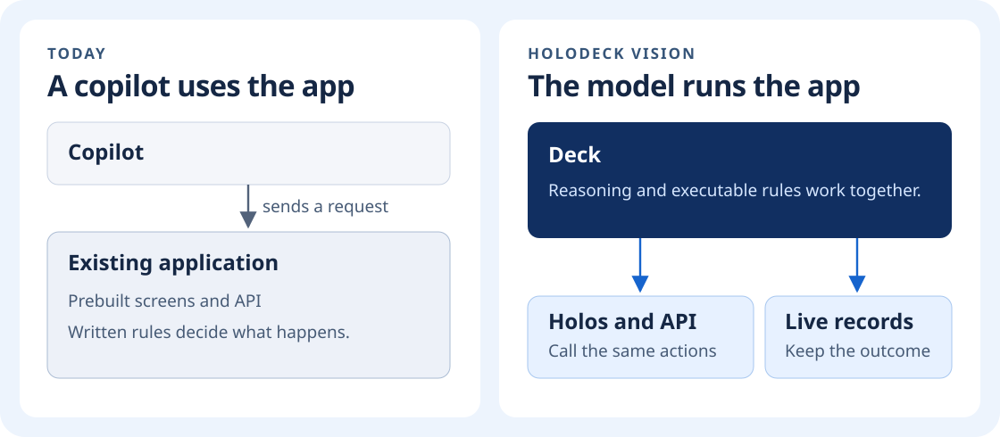
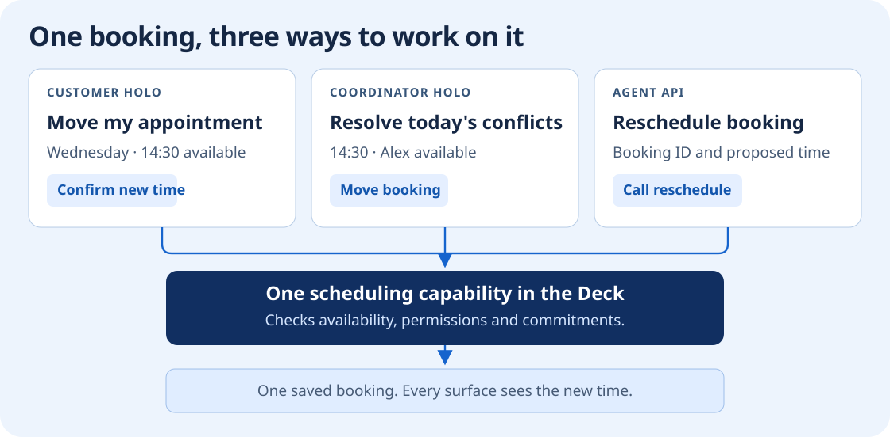
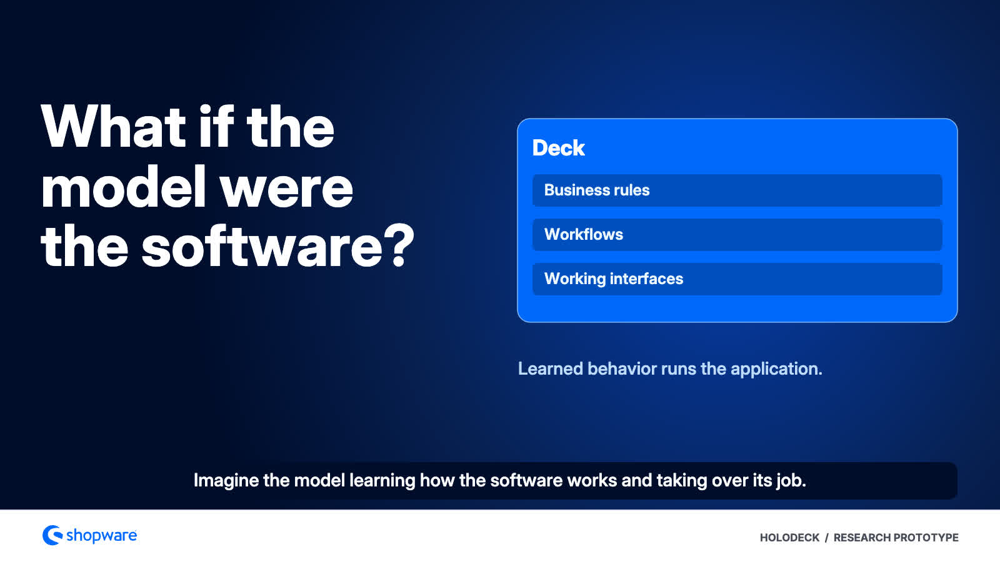

# Holodeck

**What if the AI model itself were the application?**

Software decides what can happen and gives people a way to make it happen. Today, those decisions live in code and people work through screens somebody built in advance. A copilot can use the application on your behalf. The application still makes the decisions.

Holodeck explores a different way to build software. Teach a model how an application works, from its rules and calculations to its workflows and interface actions. Give it the live records it needs. The resulting model runs the application and creates the interface the situation calls for. We call the model a **Deck** and the interfaces it creates **Holos**.

This is the research goal. We have run parts of real applications this way with the originals switched off. The next challenge is to learn and verify enough behavior to replace an entire application, then repeat that with a different kind of software.

[The original article](https://www.linkedin.com/pulse/end-software-we-know-stefan-hamann-z81he/) · [Architecture](docs/architecture.md) · [Research roadmap](docs/roadmap.md) · [Watch the film](#watch-the-film)

## What changes when the model runs the application

Imagine a scheduling system that knows what a customer booked, what the team promised and which changes the contract allows. A customer who needs to reschedule gets the available times and can confirm one. The person coordinating the team gets a workspace for resolving conflicts across the whole day. An agent can make the same authorized change through the API. All three use the same scheduling capability, and a change made in any of them shows up everywhere.

A **Holo** is the working interface for one of those situations. It can bring records, explanations and controls together for a job that nobody made a screen for. A frequently used Holo can be saved and reopened with fresh data. The rules and commitments continue to apply as the interfaces change. This is what we mean by **projected software**.

Reasoning is available wherever the application makes a decision. It can understand a vague request, find the relevant records, explain why a change is blocked and assemble the actions that are actually possible. A calculation, permission check or approved state transition still has precise semantics. The model can reason about what the situation calls for and execute the relevant capability as part of the same operation.

It also changes how software evolves. When the team teaches the Deck a new policy, it can rehearse it on past and invented cases, see the proposed effects and check whether existing commitments still hold. Once qualified, the change is available to the interface, API and other workflows that use it. Building a separate feature for each surface stops being the way a policy gets into the product.

[Decks, Holos and projected software](docs/concepts.md) · [The vision in more detail](docs/article.md)

## How a Deck is made

1. **Observe the original.** Record what happened before and after a real operation. Link the screen and the action to the API request, response and database changes. Source, tests and specifications provide additional evidence, including for behavior that is hard to observe.
2. **Learn how it works.** A foundation model such as Qwen connects language, images and user intent to the right objects and actions. Specialized parts of the Deck acquire precise decisions, transitions and effects as executable capabilities. The learner looks for structures it can reuse in other workflows. When two candidate rules explain the same evidence, it asks the original a question that would make them behave differently.
3. **Verify and package.** Check the model's behavior on reserved workflows, including failures and conflicting changes. Package the qualified capabilities and their interface bindings in the Deck. The application can then run on the generic runtime with the original switched off.
4. **Learn from use.** New records take effect as soon as they are committed. Confirmed corrections and new examples can teach the next version of the behavior. Replay and compare that version before activating it, with a way to preserve the rules for work already underway.

In the target design, the **Deck owns the application behavior**. Its model and specialists determine which action is possible, what it returns and which effects to propose. The **runtime** handles network and device I/O, enforces access and record versions, and commits changes atomically. Live prices, orders, documents and other records live in durable storage and enter the model when relevant. This allows the same Deck to work with fresh data and makes it possible to change the behavior while keeping the records.

[How the model executes a capability](docs/architecture.md#2-the-forward-owns-application-behavior) · [Training and verification](docs/architecture.md#4-how-a-deck-learns-an-application) · [Execution contracts](docs/interfaces.md)

## What we have to prove

| Question | Decisive test |
| --- | --- |
| **Did the model acquire the behavior?** | Hold the runtime and starting data fixed. Change only the relevant learned part and observe the predicted change in the API result, Holo action and durable effect. Inspect which parts were learned, compiled or supplied. |
| **Can it acquire the next application faster?** | Freeze the learned building blocks and test them on an independent application. Compare with ordinary code generation and symbolic synthesis at the same correctness, evidence access and query budget. |
| **Can it replace the original?** | Take a declared version and compatibility profile. Run complete workflows, existing API clients and browser journeys with the original off. Check roles, errors, recovery and performance as well as the happy path. |

The [research roadmap](docs/roadmap.md) starts with individual rules and interface actions, then moves to connected workflows, independent transfer and a full replacement profile. Performance is measured on that complete profile.

## What runs today

- **One learned workflow across a browser, API and database.** In a small document application, the learner inferred the publication states from native observations. With the original off, six reserved journeys matched 60 steps. Changing the fitted parameters changed both the Holo and the saved outcome. The experiment used a supplied execution vocabulary and existing document operations. [Document workflow experiment](docs/recurrent-workflow-acquisition.md)
- **One purchase across storefront, checkout and merchant workspace.** An interpreter and two model execution paths each matched 36 reserved journeys across four fresh shops with the reference system off. The tie shows that the model can execute the measured rules with the same results as the interpreter. A separate browser recording shows a purchase and a saved return using test payments. [Commerce comparison](docs/forward-pass.md) · [Browser demo](docs/showcase.md)

We use **MyNotes**, an open source document app, to test the architecture outside commerce. **Shopware**, an open source commerce platform, supplies a larger curriculum of pricing, shopping and merchant operations. Both provide reference behavior during development. The prototypes combine learned parts with authored or source informed ones. Independent transfer, complete application replacement and performance at that scale are still open.

[Research status, including failed candidates](docs/research-status.md) · [How we will test transfer](docs/learning-application-semantics.md) · [Reproduce the model core](experiments/model-core/README.md) · [Shopware experiment index](experiments/shopware/README.md)

## Watch the film

The film explains how a Deck is built and shows an early commerce run with the teacher switched off. It is silent, with English subtitles. [Download the MP4](https://github.com/sthamann/holodeck/releases/download/holodeck-explainer/Holodeck-From-Software-to-a-Deck-EN.mp4) · [English subtitles](https://github.com/sthamann/holodeck/releases/download/holodeck-explainer/Holodeck-From-Software-to-a-Deck-EN.en.srt) · [Run the interactive demo](docs/showcase.md#start-the-interactive-demo)

---

Holodeck is a research project by Stefan Hamann and the technical companion to *The End of Software as We Know It: From Apps to Holos*. [Contributing](CONTRIBUTING.md) · [Artwork and capture credits](assets/README.md)
