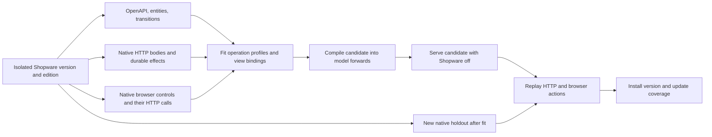

# Turning a Shopware installation into a deck

The conversion unit is a behavior that users or integrations can observe. For a product edit that means the original URL and request, the visible control that produced the request, the response and the persisted effect. A versioned inventory gives every operation a place in the plan. An operation only advances when an independent replay has exercised its published profile.



## One acquisition cycle

1. **Inventory.** Read the actual installation's Store API, Admin API, entity schema and transition definitions. The current profile uses Shopware Community Edition 6.7.15.1. Record the route, method and operation ID. In later profiles the denominator also includes feature-specific rules, flows, background jobs and UI journeys. Commercial modules and third-party extensions require reference installations with those capabilities enabled.
2. **Capture.** Run a native scenario over varied synthetic records. Record request, response and before and after state. Run the equivalent native browser workflow and capture its control, request and state after reload. Retain exact request bodies where the scope permits it. The released capture excludes credentials.
3. **Learn and compile.** Search for a structural program that explains all observations. A changed response leaf must bind to an input or a record slot. Stable observed values can become constants. For a write, infer the complete next record from the input and prior state. For a view, infer the record reference and the request template from the control and the native API traffic. Lower the programs to PyTorch FX forward graphs using the same compiler as the [forward-pass shop](forward-pass.md).
4. **Verify and install.** Freeze the candidate before recording a separate native cohort. Stop Shopware. Replay the same HTTP requests against the local deck and compare status and parsed JSON. Replay the browser flow at the original paths and compare headings, field/action bindings, actual request body and value after reload. `promote.py` emits the model and coverage ledger when both checks pass. The published inventory distinguishes tested profiles from operations that still need evidence.

## First profile

The catalog profile connects a Shopware Storefront product URL and the original Admin product-detail URL to one imported record. The native Admin uses the Sync API for **Stock → Save**. The generated Admin uses the learned Sync body, including the selected record ID and live version. Both interfaces reopen the saved value after reload. Direct Admin PATCH, Admin search and Store API product detail exercise the same data over HTTP.

The profile is limited to one-record product reads with the recorded `includes`, stock updates and one-record product upserts. The generated pages reproduce the observed controls and bindings on those paths. Pixel layout, surrounding native Administration navigation, arbitrary criteria, bulk writes and the rest of the Shopware UI are outside this profile. The lab uses fixed loopback credentials and a SQLite record store. The learner currently fits structural programs with a generic search over observed fields. It does not retrain a foundation model.

The [product mask experiment](product-mask.md) extends the projection to eight observed native tab layouts and retains this Sync contract for the verified write.

## Measured parity

The native installation exposes **1,236 OpenAPI operations, 230 entities and 98 state transitions**. The catalog driver recorded eight training episodes and then froze the candidate. Twelve fresh episodes in Papierwerft supplied **96 independent HTTP checks**. All 96 matched with Shopware stopped.

| Native contract | Exact status and JSON |
| --- | ---: |
| `POST /api/search/product` | 36/36 |
| `POST /store-api/product/{productId}` | 36/36 |
| `PATCH /api/product/{id}` | 12/12 |
| `POST /api/_action/sync` | 12/12 |

The two native browser journeys and their deck replays matched four view observations and two save actions. The recorded requests included the same Sync envelope, product ID, version ID and stock. Both reloaded values matched. The coverage ledger marks four operation profiles as scoped passes and 1,232 operations as unmeasured. [Raw observations, model and results](../experiments/shopware/evidence/absorption/)

| Shopware | Generated Holo |
| --- | --- |
| [Native Admin](../assets/experiments/absorption/native-admin.png) | [Generated Admin](../assets/experiments/absorption/deck-admin.png) |
| [Native Storefront](../assets/experiments/absorption/native-storefront.png) | [Generated Storefront](../assets/experiments/absorption/deck-storefront.png) |

## How coverage grows

Use the inventory to pick the next missing behavior and its dependent reads and writes. Capture real inputs that distinguish plausible programs. Append the new traces to the existing curriculum and keep an independent regression bank. Refit a candidate and promote it only after both its new profile and existing profiles pass. This makes the cycle repeatable across Shopware releases and configurations. The scenario recorder still needs a driver for each new workflow family. Different semantics such as totals, asynchronous flows and state-machine transitions also need the corresponding typed primitives, trace supervision and exact comparisons.

The next integration step is to route this learned API and UI layer to the existing cart and order experts and one shared merchant store. It will let the same native-compatible operations participate in an end-to-end checkout and merchant workflow. [Existing checkout and workflow experiment](forward-pass.md), [Full replacement acceptance plan](shopware-absorption.md)

## Run the cycle

Install the dependencies listed in the [forward-pass experiment](forward-pass.md) plus Playwright and Chrome. Start an isolated Shopware 6.7.15.1 container with port 80 bound to `127.0.0.1:55745` and a container name beginning with `holodeck-`. Then run from the repository root. The script stops that container before evaluation. The output directory must be new.

```sh
export HOLODECK_TEACHER_CONTAINER=holodeck-absorption-teacher
bash experiments/shopware/absorption/cycle.sh /tmp/holodeck-absorption-run
```

The result includes the native inventory, split traces, candidate, API and browser comparison, coverage ledger and installed model. You can override the local Python, Node, Chrome and Playwright paths with `HOLODECK_PYTHON`, `HOLODECK_NODE`, `HOLODECK_CHROME` and `HOLODECK_PLAYWRIGHT`. A new bounded workflow family can supply its own `HOLODECK_CAPTURE_DRIVER` and `HOLODECK_BROWSER_DRIVER` with the same argument and trace contracts. The fitter, HTTP runtime and promotion steps then operate on the new observations.

For an offline refit, run `learn.py INVENTORY TRAIN_HTTP OUTPUT --ui TRAIN_UI` with the bundled files. The resulting candidate matches the published `model.json` byte for byte. To replay it, import the `record` objects from `holdout-http.json` into a separate catalog file, start `serve.py MODEL CATALOG SQLITE`, then run `verify.py INVENTORY MODEL HOLDOUT_HTTP REPORT`. Use a fresh SQLite file for each replay. The browser replay runs after the HTTP replay so it sees the same persisted starting values as the native browser did.
