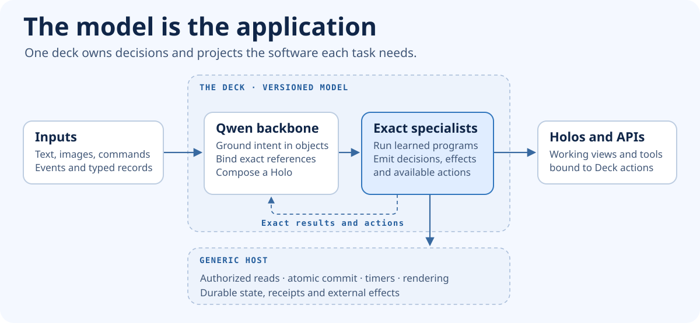
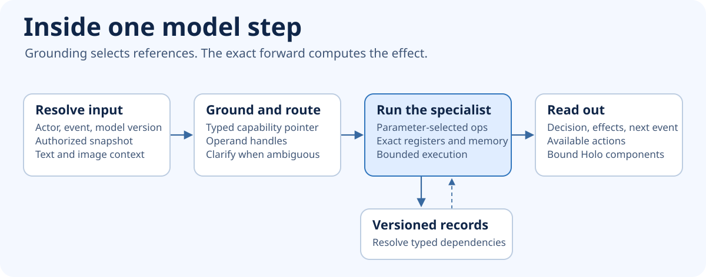
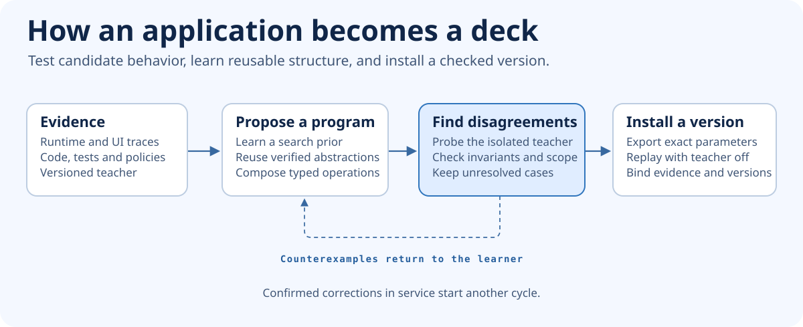

# The Holodeck target architecture

A **deck** is a deployable AI model that learns an application's behavior and runs it. It carries the rules, algorithms, transitions and interface bindings that make the application work. A **holo** is an interactive surface the deck composes for a person and task. The same application can appear as a browser workspace, a voice interaction or an API while operating on the same durable records.

The long-term goal is to fuse arbitrary software with a foundation model such as Qwen. The architecture must accommodate very different kinds of software through the same execution machinery. For each application, replacement means meeting a declared behavioral, compatibility and operational contract with the original application off. Learnability from limited evidence, access to external systems and achievable performance are separate questions. [Acceptance and experiment design](roadmap.md)



## 1. What belongs in a deck

| Part | Responsibility | Artifact |
| --- | --- | --- |
| **Multimodal backbone** | Interpret text and images, ground intent in typed objects, and provide context to learning, execution and presentation. | A pinned Qwen-family checkpoint and trainable adapters. Start with a frozen backbone to measure the value of each head. |
| **Grounding and routing heads** | Select capability and operand references from authorized candidates. Identify ambiguous or incomplete inputs. | Trained pointer and routing heads. The selected references remain auditable. |
| **Exact specialists** | Compute acceptance, results, effects, dependencies and continuations. Compose other learned routines. | Discrete executable parameter banks. A stable forward graph reads the parameters and computes their effects. |
| **Holo head** | Choose information, controls and composition for the current task. Bind them to the exact specialist's data and available actions. | Trained component and binding readouts. One versioned component vocabulary. |
| **Generic host** | Supply authorized reads, scheduling, atomic commit, durable receipts, external ports and rendering. | A compiled runtime, fixed operator vocabulary, record store and renderers. |
| **Application and tenant data** | Supply facts, media, configuration, agreements, schema and style. | Versioned, typed records and content references. |

The model may be physically partitioned into a backbone and sparse specialists. They form one release with one semantic interface and a shared representation of typed entities and capabilities. Integration is a causal claim. A test must show that an intervention in a trained component changes the relevant real behavior. A model that only formats a result establishes presentation capability.

A capability is an executable unit with typed inputs, outputs, admissible state and observable effects. It can be a pure function, a query, an incremental computation, an atomic update or a continuation that waits for an event. A legacy route can expose several capabilities. A newly generated view can combine several without introducing its own implementation.

## 2. The forward owns application behavior



### Grounding

The backbone reads the request and representations of the actor's authorized context. A typed pointer head selects a capability and refers to exact values by handle. The resolved record carries its type, identity, revision and provenance. A numeric operand comes from the record or a verified typed input. Approximate retrieval can find candidates. It does not establish an identity or make a paginated set complete.

The grounding head returns a typed candidate or a request for clarification. Direct API commands can already carry their typed bindings and enter the same exact execution path. Specialists emit read requests for dependencies they discover during execution. The host resolves those requests under the actor's scope, records the versions and resumes the model.

### Exact execution

The model uses a small programmable recurrent kernel. Generic operations provide typed load and store within scratch memory, checked integer and decimal arithmetic, comparisons, branches, calls and bounded iteration. A specialist contains learned selections over those operations, operands, branch targets and callable subroutines. For a simple dense encoding, one-hot program counter $p_t$ reads instruction $p_t^\top W_e$ from specialist parameters $W_e$. The kernel computes the next register state, program counter and pending effects. The reference implementation defines precision, overflow, ordering, limits and halt semantics explicitly.

The deployed forward consumes the model's parameters and runtime facts. A readable intermediate representation supports learning, proof and inspection. The execution test uses only the model export and authorized input. There is no application handler, rule engine or executable teacher on its call path. An operation named after a domain action is a learned subroutine. Adding a generic primitive is an explicit architecture change and invalidates comparisons that claim a frozen runtime.

The [Loom paper](https://arxiv.org/html/2604.08816v1) demonstrates a fixed-weight recurrent transformer that executes programs stored in its state tensor. We borrow its explicit machine-state and stepping model. Holodeck's stronger target places the *acquired structure* in model parameters and measures how the backbone learns, selects and composes it. Moving a hand-authored program into a parameter bank would demonstrate storage and execution only.

### Typed readout

```text
Deck.step(checkpoint, actor_scope, event, versioned_context, continuation?)
    -> read_request | clarification | decision

Decision = { outcome, value?, read_set, effects, continuation?,
             available_actions, projection?, provenance }
```

An effect can change records, schedule an event or request a declared external operation. A continuation names the expected event, data dependencies, version, execution budget and any commitments already made. A generated action references a capability and its argument schema. A diagnostic trace identifies the specialist, executed parameter bank and relevant input versions.

The exact specialist returns typed intermediate results and discovered dependencies to the shared Qwen context. The Holo head reads that context and the exact list of available actions. Multi-step tasks can use it to select the next learned subroutine before the model emits a final batch. Train the heads on capability and pointer selection, approved program structure, intermediate results and usable action bindings. Use executed effects to score discrete candidates. The first joint implementation uses supervised adapters and selected-program targets rather than differentiating through committed state. A presentation preference can change arrangement, wording and interaction. It can change the outcome only by submitting a valid action or providing an explicitly recognized fact. Training includes contrastive pairs that vary style while preserving the effect and vary a relevant fact while changing it.

## 3. Persistence, interfaces and performance

The runtime issues reads against a coherent snapshot. The read set includes range or collection versions where membership matters. The model proposes a typed batch. The host checks authenticated authority, capabilities, schema, resource budgets, versions and idempotency. It commits records, continuation, receipt and outbox together. Conflicts go back to the model for a new decision. Concurrent writers cannot both commit against the same stale revision. Externally visible requests use stable idempotency keys where the provider supports them. External responses are recorded as inputs, with explicit pending or uncertain states when delivery cannot be confirmed.

A release manifest binds foundation and tokenizer revision, adapters, exact parameters, schema, operator ABI, renderer vocabulary and evidence. Existing continuations retain their version and accepted agreements. Activation changes routing for new work. Migrating an open continuation requires a checked state mapping. Persisted effects stay bound to the version that produced them.

**Holos.** The Holo head emits a typed component tree, view state and data bindings. A generic renderer implements grids, sorting, filters, forms, drag interactions and accessibility. It evaluates generic bindings and forwards typed commands. The deck chooses which controls to use and what they mean. The same authenticated action executes through the API, a native-compatible surface or a new Holo. A saved composition can be reused with fresh bindings and authority checks. [Runtime and transport contracts](interfaces.md)

**Fast paths.** The reference path records individual exact model steps. The production candidate fuses static steps into tensor blocks derived from the same parameters. The comparison covers reads, refusals, effects and continuations within the declared bounds, including overflow and abort. Cache keys include the relevant model, permissions and dependency versions. Warm typed actions can bypass large-model grounding when the input already contains resolved references. Report separate cold projection, warm action, commit and end-to-end latency and throughput. Loom reports roughly 10 ms per step on one RTX 4080 configuration. Step-level performance remains a design risk. [Loom deployment measurements](https://arxiv.org/html/2604.08816v1#S11)

## 4. How a deck learns an application



1. **Record evidence.** Inventory behaviors, configuration, data types, events, interfaces, background work and external dependencies for a pinned version. Correlate initial state, input, interaction, request, result, persisted delta and subsequent events. Include refusals and side effects. Source and tests expose candidate structure and evidence of uncommon paths. Explicit specifications establish intended behavior when the teacher is missing, ambiguous or faulty.
2. **Learn a proposal distribution.** Qwen and small heads propose typed operators, references, control-flow edges and reusable subroutines. Train on accepted derivations and distinguishing counterexamples. Use exact state and observable behavior as supervision alongside semantic grounding and view/action binding. Start with supervised structural targets from independently verified candidates.
3. **Choose informative interventions.** Search the typed grammar under a fixed budget. Query the isolated teacher where surviving candidates disagree. Keep disagreements when evidence cannot distinguish them. A class of programs that matches a finite trace set can still disagree elsewhere.
4. **Learn abstractions.** Factor repeated verified subgraphs into callable units. Reward reuse that shortens independent solutions or reduces teacher calls. Train the proposal distribution again from verified executions and generated exercises, keeping holdout families separate. [DreamCoder](https://arxiv.org/abs/2006.08381)
5. **Check and install.** Use counterexamples to revise candidates. Prove properties only against explicit specifications and bounded semantics. Compare teacher observations independently. Verify the exported execution against the checked representation. Activate only the qualified behavior profile and record its scope. [Syntax-Guided Synthesis](https://www.cis.upenn.edu/~alur/SyGuS13.pdf)
6. **Learn from use.** Facts enter the live store immediately. Confirmed corrections and independent reference outcomes become teaching cases. A changed behavior runs as a candidate in replay or shadow mode, then receives a new version. In-use personalization, rule adaptation and weight updates each have separate evaluation.

### Training and deployment decisions

The first joint experiment pins a vision-capable Qwen release and processor. [Qwen3.5-9B-Base](https://huggingface.co/Qwen/Qwen3.5-9B-Base) is the starting candidate. The experiment uses a frozen backbone with adapters and starts with a compact specialist. A pure structured-input model and a frozen-Qwen router are controls. Joint training is justified when a learned grounding decision, intermediate result or dependency materially improves action or projection on independent evidence. The Mac covers reproducible acquisition, export and replay. Use the H200s for adapter training, candidate evaluation and inference comparisons after the CPU-scale causal tests pass. Report dataset size, compute, teacher calls, abstentions and first failures.

## 5. What full replacement means

A replacement profile lists the entire externally required behavior for a named application and version. Include functional, UI and API behavior, roles, error modes, extension contracts, schedules, data migration, consistency and performance. Give each row an independent oracle or specification, an observed execution path, and status. List unmeasured or unsupported requirements explicitly. Complete replacement is earned when all requirements of the declared profile pass and the original application can be removed from the deployment.

Start with a structured editing application such as Calc and an application with durable cross-actor obligations such as Shopware. For wider generality, add an algorithmic or interaction-heavy profile with distinct resource constraints. Universal computation in the model and successful acquisition of a particular application are separate results. A driver, sensor, payment network or device remains a declared external interface. Real-time or system-level software adds timing, memory, isolation or hardware requirements to the replacement contract.

## Properties and how to test them

| Property | Evidence required |
| --- | --- |
| **Model owns the application** | A controlled parameter change shifts an accepted action and its effects in the predicted way with runtime, inputs and teacher access fixed. |
| **Intelligence contributes to execution** | Removing or shuffling trained grounding or composition parameters degrades held-out decisions and bindings. Exact typed actions remain reproducible. |
| **One capability appears on multiple surfaces** | Independent Holo and API clients produce equivalent effects, refusals and receipts for the same authorized request. |
| **The application learns a new behavior** | It identifies a hidden rule family or an authorized change, activates it with open work and preserves prior commitments through rollback. |
| **The architecture transfers** | A second application class is learned and replayed with the same generic runtime and operator vocabulary, and with published coverage and costs. |
| **The approach earns its complexity** | At matched evidence and budget it improves on an ordinary code-generating model or a symbolic learner on a prespecified axis. |

[Detailed test gates and first delivery](roadmap.md) · [Fable 5.2 challenge and decisions](architecture-review.md)

## What has been measured

The [independent Rust core](../experiments/model-core/README.md) fitted three bounded integer behaviors with 9–11 teacher queries each. All three matched 15,024 held-out inputs apiece. The previous checkpoint missed 536 cases after the teacher changed. A single operator selector changed after refitting. This establishes causal execution from discrete parameters and a fixed forward for a bounded grammar. The test also exercises durable receipts, restart and competing revisions.

The [Shopware forward comparison](forward-pass.md) matched 36 journeys in each execution arm. The [product mask](product-mask.md) binds recorded layouts and scoped API effects. Its browser orchestration and some application validation are authored code. Those experiments provide teaching and comparison assets. The integrated Qwen target, general acquisition, fresh Holos with learned interactions and complete software replacement remain research milestones.
