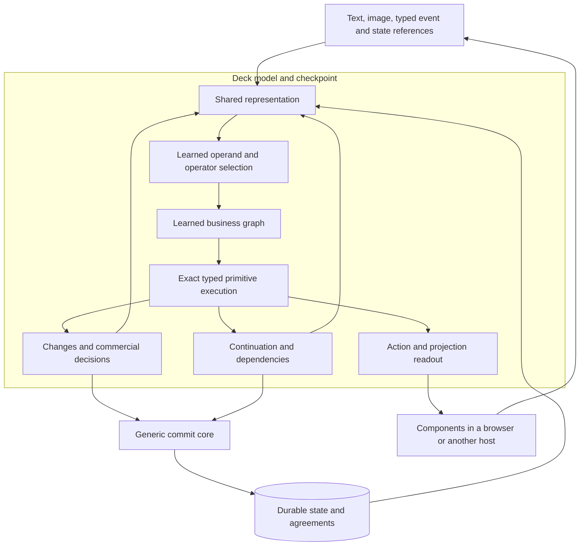

# The deck architecture

This page describes the target architecture. The [joint deck](joint-deck.md) documents the current implementation and replay. The complete model must carry commerce semantics across merchant configurations, actions and surfaces.

The target is one multimodal, executable model of the business. Search, pricing, checkout, service and analysis draw on the same learned business semantics. The model interprets what happened, determines the consequences, carries the process forward and projects the software needed for the work. Standard commerce supplies the first evidence. [The eight properties](../README.md#what-becomes-a-property-of-the-architecture)

The [Shopware absorption plan](shopware-absorption.md) specifies the teacher, execution boundary and experiments that distinguish learned acquisition from a learned decision in the live shop.

## Where the prototype stands


The current checkpoint has a shared sparse decoder for commerce, workflow and projection cells. A frozen Qwen encoder and separate language readouts interpret Admin requests. The model selects expressions from a versioned grammar and binds them to merchant inputs. A typed interpreter executes those expressions and a SQLite store commits the result. The working Storefront, Checkout and Admin use a bounded component set and the same available action programs.

The offline comparison reproduced 48 of 48 new journeys across four merchant configurations. The arithmetic expressions were designed from source and selected against traces. A shipping output intervention shows that the executed choice depends on the trained decoder. The current result covers those journeys. The target calls for a jointly trained multimodal representation, broader acquisition of business logic and a complete product profile. [Read the results and run the same checkpoint](joint-deck.md)

The [specialist activation test](learning.md#one-specialist-from-training-to-activation) verifies a version change on a live order with the published checkpoint. The old and new decks can run in one process. The order records its bound version, and the first projection after restart resolves that version from the record.

The [trace induction trial](trace-induction.md) replaces selected scalar expressions inside the checkpoint with programs learned from observations. It holds the renderer, executor and sparse selectors fixed and compares the result on fresh shops and a deliberately changed teacher.

## First delivery

The first accepted deck operates a complete standard shop. Its learned commerce specialists cover catalog and cart, prices and availability, checkout and payment, and order handling in the admin. These specialists are part of the versioned model. Shopware supplies teaching data and independent comparisons during development. At deployment, the deck reads and writes its own business records through the generic commit core. [First delivery and acceptance](roadmap.md#first-delivery-and-acceptance)

The first shopper and merchant journey starts with an empty projection store and Shopware offline. Storefront, checkout and admin are composed by the deck at request time. They bind the same records and call the same model entry point. Every commercial decision in the journey must be attributable to the executed model graph. The generic renderer renders components and sends actions. It has no shop-specific decision logic.

## 1. One source of business decisions

The proposed semantic entry point is:

```text
DeckModel.step(state, event, configuration, continuation, actor_scope)
    → proposed changes
    → permitted next actions
    → next continuation
    → bound projection
    → decision trace
```

The same learned structure determines which action is allowed, which effects belong together and which controls can be offered. Each decision is attributed to the model checkpoint and the executable graph that produced it.

The model runs on technical infrastructure. A database stores current facts. A renderer implements controls. A commit core enforces access, versions and atomicity. These remain necessary, but they contain no independent promotion engine, refund policy or order state machine.

The distinction is operational rather than cosmetic. A single service, repository or class does not establish fusion. We test the location and cause of each business decision.

“One model” means one versioned deck owns the business semantics across operations and surfaces. Its checkpoint can include a foundation model, trained adapters and an executable learned graph. Typed primitives, storage, access checks and rendering provide general execution machinery. Live facts and accepted agreements remain durable records with authority, provenance and versions.

## Properties and how to test them

| Target property | Mechanism | First convincing check |
|---|---|---|
| **Every function thinks** | Search, pricing, checkout and service resolve shared facts and commitments through the deck. | Trace how one learned policy change affects related decisions across functions. |
| **Personal is the only version** | Compose or reuse a projection for the current person, task and authorized context. Evaluate merchant pricing on declared inputs. | Different presentations of the same authorized pricing facts produce the same offer. A declared contract can change it through the pricing policy. |
| **Anything is input** | Bind text, image, speech and document evidence to typed facts and intents, preserving source and uncertainty. | Equivalent evidence leads to the same supported workflow. An ambiguous match requests evidence before the affected action proceeds. |
| **Every surface, without a project** | Use the same action and projection contracts through compatible browser, embedded, voice and agent adapters. | Complete the same journey through two surfaces and compare effects, receipts and access checks. |
| **Every business gets its own software** | Bind company data and configuration to a shared checkpoint and teach additional semantics through checked adaptation. | Transfer to a second business and measure configured differences and learned changes with a fixed runtime. |
| **Features are imagined, then they exist** | Express a described policy as a candidate graph and projection over typed primitives. Rehearse and verify its scope before activation. | Demonstrate a new feature against independent cases and activate the accepted version. |
| **You can ask the business** | Resolve a question against authorized records and project its evidence and available actions. | Reproduce an answer for a defined population and time window and verify access to its drill-down. |
| **It gets better by working** | Turn a failure or expert correction into a teaching case and evaluate the next checkpoint before adoption. | Measure improvement on fresh journeys and recover the preceding version with open agreements intact. |

## 2. Inside the model

We propose a neurosymbolic model with a shared representation and a learned executable business graph.



The representation connects language and images with typed entities, events, relations and merchant configuration. A foundation model such as Qwen can supply the language and image features. Exact amounts, quantities and identities remain referenced typed operands, not values reconstructed from embeddings.

Learned selections determine which operands, operations, conditions and transitions apply. The primitive executor evaluates those choices exactly. It supplies arithmetic, comparison, collections, typed object changes and continuation mechanics. It does not supply commerce formulas.

The learned graph chooses which records, conditions and operations are relevant to a business event. The primitive executor supplies exact subtraction, comparison and record operations. That distinction lets the same machinery run learned semantics from different parts of the business.

### Structured model state

Let the model be described by

\[
(\Delta_t,A_t,C_{t+1},U_t)
=D_{\theta,\Gamma_\theta}(S_t,e_t,c,C_t).
\]

The parameters `θ` determine learned selections and representations. `Γθ` is the associated learned or discretized executable structure. The outputs are the proposed delta, permitted actions, continuation and projection.

A node can select a typed primitive and its operands through learned categorical parameters; the chosen primitive then operates on exact values. A readable graph is an inspection or execution form of that learned structure. The binding between the parameters and the exported graph must be recorded and checked.

This does not claim that all knowledge is stored only in dense neural weights. It proposes a model with trainable and structured executable state. A separately authored rule engine cannot be relabelled as model memory to satisfy the claim.

Early experiments may freeze the foundation encoder and train the business part. The later joint experiment must demonstrate that language understanding, business decisions and action projection use the same learned semantics. The [learning design](learning.md) distinguishes those stages and their evidence.

## 3. The checkpoint and the merchant

A deck checkpoint contains the foundation model reference, adapters, learned selection parameters, executable graph, schema and primitive vocabulary versions, and the evidence supporting its use.

Each graph records its origin. A manually written seed is useful development material but is not evidence that the model absorbed business logic. A model-synthesized candidate is distinct from a parameter update. The comparison reports both.

A merchant package supplies products, media, conditions, style, organization and current facts. A new price is a data update. A new rule is a change to the deck’s executable knowledge. The same base checkpoint can operate under different merchant configurations without storing their current prices or inventory in weights.

The durable business graph distinguishes confirmed facts, accepted agreements, observations, inferred possibilities and learned structures. This separation matters when a visual search finds a similar product: similarity helps retrieval but cannot establish the selected variant, a current price or an entitlement.

## 4. The fixed boundary

| Generic infrastructure | Decision made by the model |
|---|---|
| Exact arithmetic and type checking | Which quantities and formulas apply |
| Authorized reads and writes | Which permitted commercial action is appropriate in this state |
| Version checks and atomic changes | Which records must change together |
| Generic quantity and capacity constraints | When stock should be reserved, consumed or restored |
| Idempotency and effect identity | Which business consequence follows an event |
| Durable events and timers | Which fact the process is waiting for |
| Component rendering | Which controls and data the work requires |

Authorization remains a real trust boundary. The model cannot grant itself access by proposing a more permissive role. Commercial eligibility remains a learned decision within that boundary.

The primitive vocabulary is frozen for a transfer experiment. Adding an operation named `apply_tax` or `process_return` would put business knowledge back into the fixed runtime. New entity schemas can be data; new operational semantics require a new runtime version and a new comparison.

## 5. State, agreement and commitment

The model reads a versioned snapshot and proposes changes. Its actual execution records the read set, including relevant query or collection versions. Required sets must be complete; a calculation cannot silently sum only the first page of order lines.

The commit core checks the actor, types, versions, generic resource conditions and effect identity. It stores local changes, the continuation, outgoing work and the command receipt together.

A retry of the same action returns the same receipt. Reusing an action key with different input is a conflict. A stable server-side effect identity prevents the same completed model step from being applied twice even if callers use different request keys.

A model call does not run while a database write lock is held. If a referenced fact changed, the proposal is rejected and the updated state returns to `DeckModel.step`. The model determines the commercial response. The host does not calculate a replacement price or select a new fulfilment policy.

Accepted agreements are durable objects. Changing a proposed price or promised service requires another agreement. A current catalog change does not retroactively rewrite a paid order.

## 6. The model stays involved

A deck continues to interpret events after it first projects a view. A payment result, quantity change, failed reservation or return inspection is another input to the same semantic model.

A continuation stores the active graph, bound inputs, expected events, deadlines, accepted agreements and completed effects. The scheduler delivers events and resumes that state. It does not contain a separate hand-authored commerce workflow.

Dependencies come from executed reads and typed nodes. When a fact changes, affected open decisions become stale. The next model step can preserve unaffected decisions, request missing evidence and update only the relevant parts of the interface.

Routine steps may use a compiled part of the model. Remaining involved does not require rerunning a large language model for every click. It requires that the same learned business semantics continue to govern the work.

A running process retains its model and agreement references. A new return can start under a later checkpoint while referring to an earlier order’s immutable facts. Changing the interpretation of an already running continuation requires an explicit, checked state transfer.

## 7. Exact fast paths

A stable learned graph can be specialized against merchant configuration and compiled. This is an optimization of the model’s execution, with the same decision semantics.

The cache identity includes the checkpoint, vocabulary, schema, compiler and relevant configuration. Live prices and quantities remain inputs. If a learned selection is dynamic, compilation must preserve it or leave that part in the normal model path.

We require interpreter and compiled execution to agree on rejection as well as success: amounts, writes, continuations, action availability and relevant dependencies. Replacing a learned decision with a handwritten approximation for speed would invalidate this comparison.

Projection has its own reuse path. Save the component structure, bindings and action references with the model, tenant, surface and access scope that make them valid. Reopen a compatible view with current authorized records. Recheck the action against current state at execution, including its consent and agreement references. A model or policy change can invalidate a saved projection or require it to be rebound.

Measure time and inference cost for initial composition, opening a saved holo and executing a routine action separately. Each result records which path ran and whether a large model was called. Personalization can happen through binding and selecting a saved view as well as composing one.

The existing native experiment validates a much narrower version of this idea for selected fixed-schema programs. It does not establish whole-model compilation.

## 8. Holos are grounded projections

The current prototype trains the projection head to emit a typed tree, field pointers and action bindings. Its interpreter restricts reads and writes to the current role and binds them to the same business state used by the commerce head. The two shop proof includes a comparison and cart combination withheld from training. [Implementation and observed results](neural-projection.md)

A projection contains components, data bindings and action references from the model’s permitted action set. The renderer supports familiar controls: product cards, comparison, editable grids, forms, totals, history and action bars.

Local input is draft state. Authoritative business data changes only through an accepted command. A stale button is not authorization; the current event is evaluated again on the server through the same model semantics.

Views can be saved and reopened with fresh data. A merchant’s familiar workspace and an on-demand customer view are both valid holos. Streaming should preserve focus, selection and entered values.

The first shop proves generation before reuse. On a cold request the deck emits the surface structure, live bindings and permitted actions for the work at hand. A compatible saved projection can later reuse that output. Both paths route actions back to the model for evaluation against current state.

Presentation can adapt to intent, language and authorized context. The merchant’s policy determines which facts can affect an offer, such as the customer’s contract, quantity or explicit tier. A person’s presentation context does not independently change a price. Each surface inherits the same separation between presentation context and commercial inputs.

MCP Apps is a possible delivery mechanism for an interactive view inside another host. A2UI is a possible representation for component and data updates. These protocols do not supply the deck’s business semantics or shared agreement model. See [projection and transport boundaries](interfaces.md#projection-and-transport).

## 9. Learning from software

An existing business system can serve as a teacher: vary its configuration, execute events and record relevant before and after states. Capture rejected actions, negative cases and complete trajectories as well as successful transitions.

Source code and tests help identify behaviours and candidate structures. Independent executed outcomes determine whether a candidate is commercially correct. A type-correct program may still implement the wrong policy.

The learner induces or selects executable graphs, learns their applicability and connects them to future actions and projections. Verified new knowledge becomes a versioned checkpoint. Observed failures can propose new learning work, but the triggering example becomes development data. Fresh cases are needed to establish improvement.

Updating a graph, retrieving another example and changing model weights are different interventions. The comparison must hold context, available primitives and verification opportunities constant when attributing an improvement to weight learning.

## 10. Generality and external effects

The initial implementation focuses on standard commerce: catalog, cart, pricing, checkout, payments, fulfilment and returns. That provides an observable test of many dependencies without building a special logistics application.

Later domains can reuse learned meanings such as an accepted offer, a reservation, a partial settlement or an inspection. New applications should arise through new model knowledge and configuration while the generic runtime remains stable.

External payments and partner systems do not share a local database transaction. Durable outbox and inbox records, stable operation identities, reconciliation and explicitly modelled compensation handle this boundary. The adapter performs a technical request and reports its result. The model determines its business consequence. The first commerce experiments use synthetic data and local test payment behaviour.

## 11. What would establish the claim?

- Complete business trajectories match independent reference outcomes, including refusal and recovery.
- Decision traces attribute commercial conditions, calculations and joint changes to the learned model.
- Removing a relevant learned part removes the corresponding capability; no host fallback rescues it.
- Changing only the model changes the intended rule while the host and primitives remain fixed.
- The same semantic decision governs the visible control and the executed action.
- Restoring the checkpoint and continuation preserves behaviour.
- Another merchant and unseen configurations work without a host patch.

These are the first acceptance criteria in the [roadmap](roadmap.md). Broad Shopware parity, general autonomous business redesign and production readiness remain separate future claims requiring their own evidence.
