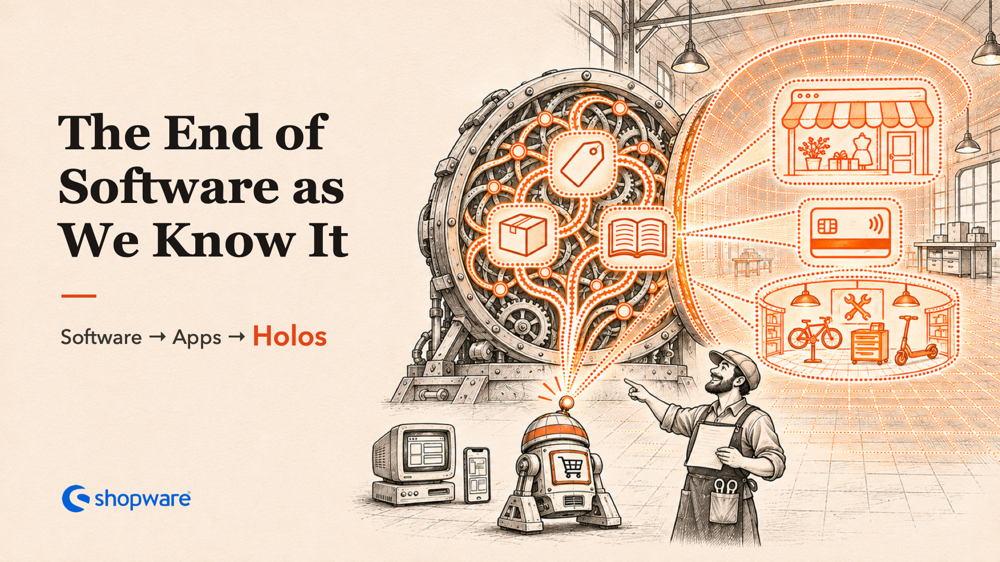
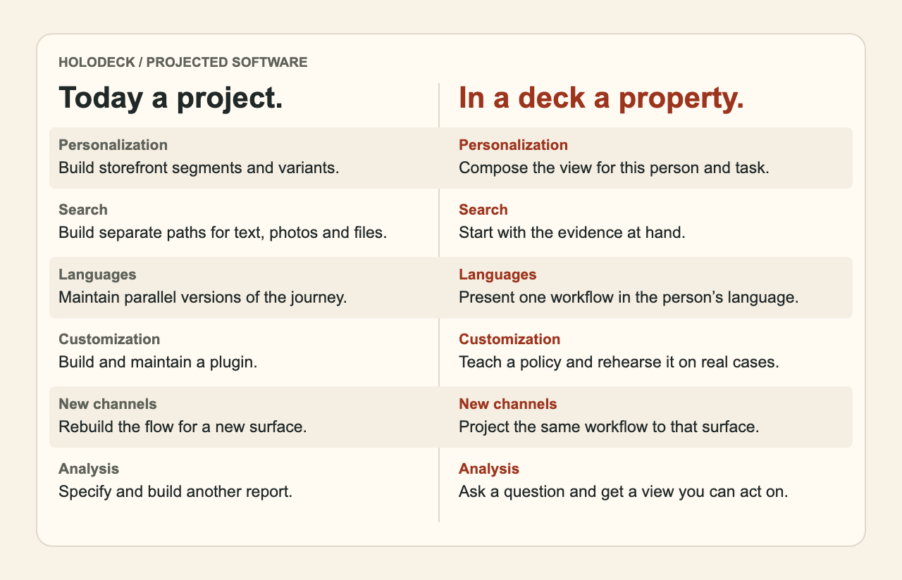

# From Apps to Holos

A spreadsheet lets a small team make a tool while the work is still in front of them. Imagine that freedom for commerce software, with orders, commitments and permissions that remain dependable. The first place we want to test that idea is Shopware.

*This is the vision behind Holodeck, the technical companion to Stefan Hamann’s* The End of Software as We Know It. *The published Holoshop experiments demonstrate selected parts of it.* [Experiment evidence](../experiments/shopware/README.md)

## The reversal

> Today, intelligence sits on top of software. The application is the fixed part, and AI helps you use it. Now take that layer away. One multimodal model holds everything the application knows and creates whatever the moment needs. The things we build today as features, projects and plugins become properties of the architecture.

## What follows

- **Every function thinks.** Search, pricing, checkout and service share one intelligence.
- **Personal is the only version.** The view fits the person and situation. Your A/B test is going to need a bigger alphabet. The merchant’s pricing policy still governs the offer.
- **Anything is input.** A photo of a worn part, a voice note from the van, a forty-page tender as a PDF.
- **Every surface, without a project.** A storefront, a panel inside someone else’s app, a voice in the car, another company’s agent.
- **Every business gets its own software.** A merchant describes how the team works, from its terminology to its rules and routines, then rehearses the resulting software.
- **Features are imagined, then they exist.** Trade loyalty, rentals, a pre-order with a waiting list or the thing you need exactly once. Describe it, try the resulting workflow and verify it before use.
- **You can ask the business.** “Which customers stopped reordering after the price change?” gets an answer and a view you can act on.
- **It gets better by working.** What the team teaches it on Tuesday can become a checked and approved change on Wednesday.

Amazon can build some of this today with dedicated engineering teams. The bet is that a deck makes it a property of the architecture for a merchant with twelve people. [Amazon’s example of personalized shopping](https://www.aboutamazon.com/news/retail/amazon-about-you-personalization-preferences)

## Today a project, in a deck a property

[Shareable PNG](../assets/illustrations/projects-to-properties.png) · [Vector version](../assets/illustrations/projects-to-properties.svg)

Read the comparison as a table

| Today · a project | In a deck · a property |
|---|---|
| **Personalization** · Add segments and variants to a storefront. | Compose the view for this person and this task. |
| **Search** · Build separate flows for terms, photos and documents. | Start with the evidence the person already has. |
| **Languages** · Maintain parallel versions of the same journey. | Present the same business decision in the person’s language. |
| **Customization** · Extend a fixed application and maintain the extension. | Teach a merchant’s policy and rehearse it against actual cases. |
| **New channels** · Rebuild a flow for another surface. | Project the same workflow into a compatible surface. |
| **Analysis** · Specify and build a report. | Ask a question and get a grounded view with authorized actions. |

## Deck, holo and Holodeck

A **deck** is the learned, executable specialist for a business. A **holo** is the working software it projects into a situation, with live data and real controls. **Holodeck** is the research project. Its namesake is a room that can become what the work requires. A buyer may get an approval screen for a minute, while a warehouse keeps a familiar workspace for years. [Working definitions](concepts.md)

## Trust and speed

The deck’s model holds learned business semantics. Current facts and accepted agreements have durable records. The commit core checks authority and record versions and makes the permitted changes atomic. An individually composed view follows the same merchant pricing policy as a saved view.

Fresh composition takes time and compute. Useful holos can be saved and reopened with current data. Exact learned paths can be compiled and reused. We will measure the cost of creating a view separately from opening it or taking a routine action. [Architecture](architecture.md)

## Shopware as a curriculum

We can teach from commerce software by varying its configuration, recording whole journeys and comparing what changes. The current joint deck reproduces 48 complete journeys across four fresh merchant configurations. Eight browser journeys carry the same order from storefront and checkout to a generated Admin workspace while Shopware is offline. This measures a defined part of commerce. The wider goal is to learn the full semantics of a standard shop. [Current Holoshop](joint-deck.md) · [How a deck is made](../README.md#how-a-deck-is-made) · [Learning design](learning.md)

The bet is that a small business can work this way once its software can learn how the business works. What would your team teach its deck first?
