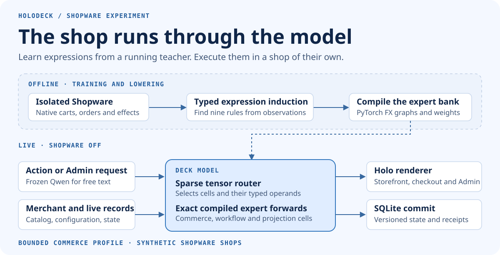
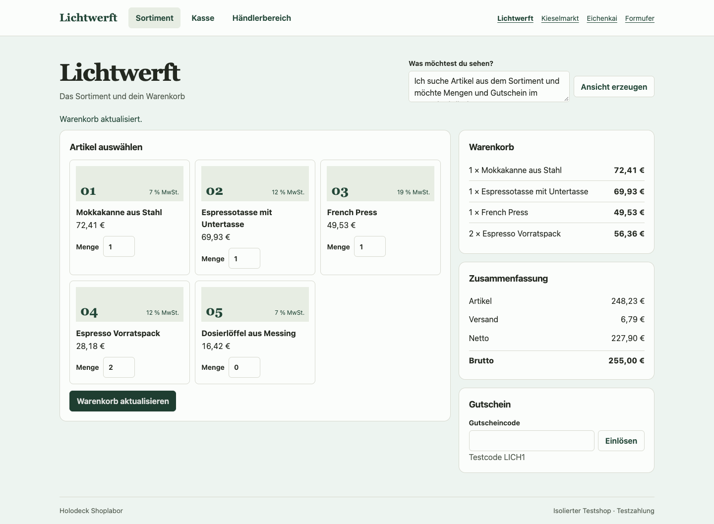
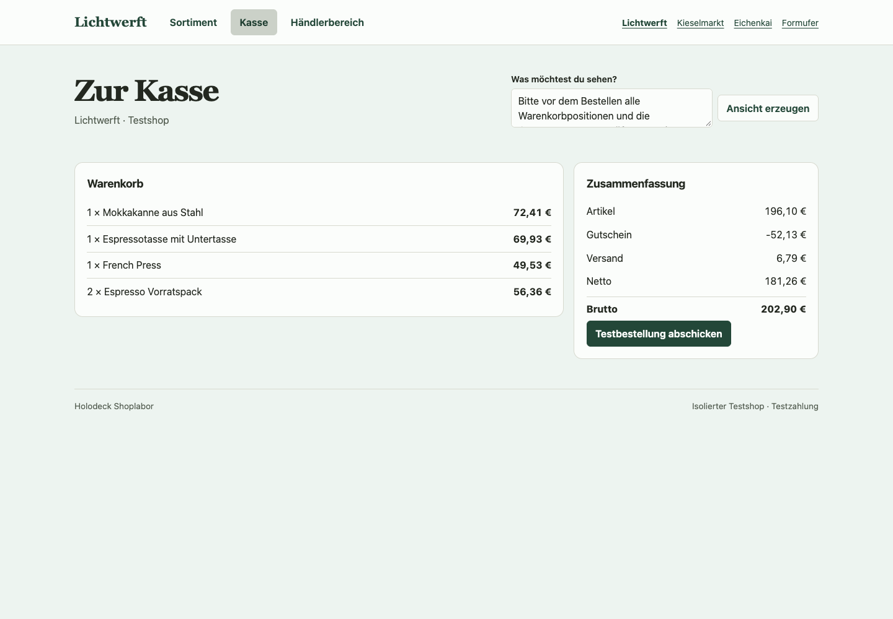
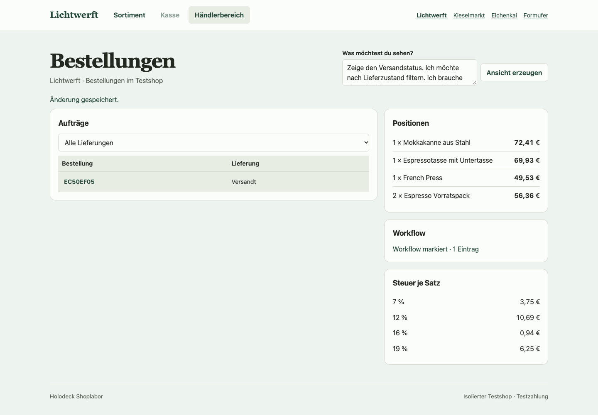

# The forward-pass shop

Holoshop runs a bounded commerce profile through compiled model subgraphs. A shopper updates a cart, applies a coupon and places an order. The merchant opens that same order in a generated Admin view, records payment, reopens payment and marks the order shipped. Shopware supplies the native reference before the run. Holoshop then serves its own catalog, orders, receipts and views.



## What runs inside the model

The sparse router runs its learned integer gate weights as a PyTorch matrix operation. The compiler lowers each available cell into a PyTorch FX forward graph. A selection activates registered subgraphs. A forward pass carries typed values between them and returns the proposed changes or the view cells. Integer addition and subtraction use exact coefficient weights, including a tensor path for bounded integers. Fractions, PHP-compatible rounding and typed record operations use exact or compatibility kernels. Nested maps execute compiled subgraphs over bounded collections.

The loader lowers the versioned expression bank when the server starts. Requests dispatch compiled cells. The reference interpreter's recursive expression evaluator is disabled during both compiled comparisons. The graph topology encodes part of the program and the sparse gates and arithmetic coefficients encode part in tensors. The experiment uses a bounded dataflow machine. It does not implement a universal neural instruction set or train Qwen end to end.

The HTTP server still validates input shapes and the test coupon code, binds projected actions and handles session transport. The prototype keeps its existing event notification and record lifecycle contracts. SQLite persists typed records, checks revisions and returns the same checkout receipt on a retry. The renderer implements a fixed vocabulary of components. The learned deck chooses and binds them at request time. Frozen Qwen supplies the existing Admin text readout in Chrome.

## What Shopware taught

The training command reruns symbolic induction from 18 native journeys across four training shops. It recovers nine scalar expressions from observed values and typed operand scopes without receiving target formulas. They cover quantity, line gross, remaining stock, absolute and percentage adjustments, delivery gross, goods total, gross total and net total. A generic operator vocabulary and the previously fitted joint deck supply the rest of the graph. The compiled bank retains the existing tax allocation, workflow and projection supervision. Training this experiment changes the induced expressions and their compiled graph. It does not update the sparse router parameters or Qwen.

Four more shops were captured after the fit, in a separate Shopware 6.7.15.1 instance. Their product IDs, configurations and expected outcomes are bundled as synthetic references. The runtime receives imported inputs only. The scorer reads the expected outcomes separately.

## Compare the three paths

| Execution | Exact native journeys | Local apply p50 / p95 |
| --- | ---: | ---: |
| A · Source-informed port, ordinary interpreter | 36/36 | 0.70 / 0.94 ms |
| B · Same port, model forward | 36/36 | 0.82 / 1.08 ms |
| C · Trace-induced expressions, model forward | 36/36 | 0.83 / 1.08 ms |
| Control · C with one gross coefficient disabled | 0/36 | 0.84 / 1.11 ms |

These are sequential, local Mac measurements of model routing, execution and SQLite apply. The timed region excludes Qwen, HTTP and rendering. A and B produced identical state and effects on all 216 steps. Each compiled path made 324 model forwards including workflow continuations. Each unmodified path replayed all 36 checkout receipts after reopening SQLite. [Recorded comparison](../experiments/shopware/evidence/forward-pass/summary.json)

The same checkout and workflow scorer checks persisted carts, order amounts, line items, stock, state transitions, workflow effects and checkout receipt replay after reopening SQLite. A and B share exactly the same program bank and sparse decisions. The comparison checks the actual state and effects after every step, ignoring backend-specific receipt identities. The fourth control changes one coefficient inside the induced gross expert and keeps the graph topology and host fixed.

All three unmodified paths score 38/40 on the earlier regression cohort. The two misses come from the known promotion ceiling at a ten cent total interval. The compiled path preserves those failures as well as the matches. [Regression comparison](../experiments/shopware/evidence/forward-pass/regression-summary.json), [Original boundary analysis](trace-induction.md#first-result-on-unchanged-shopware)

The deliberately modified teacher supplies a separate acquisition check. Its final gross total skips the configured cash interval. The two port variants and the expert fitted to the regular teacher match 2/16. The model refitted from the modified teacher's observations matches 16/16 with the same router, execution code and store. [Regular fit against modified teacher](../experiments/shopware/evidence/forward-pass/changed-teacher-regular.json), [Refitted model against modified teacher](../experiments/shopware/evidence/forward-pass/changed-teacher-summary.json)

## One order across three holos

Lichtwerft was absent from training. Chrome updated the cart, applied the 21% test coupon and placed the €202.90 order. The generated Admin opened the same order, accepted a free-text request for delivery, line items and taxes, then saved the shipment and its workflow mark. All 12 browser journeys passed across the three variants and four shops. [Browser reports](../experiments/shopware/evidence/forward-pass/)

| [Storefront](../assets/experiments/forward-pass/lichtwerft-storefront.png) | [Checkout](../assets/experiments/forward-pass/lichtwerft-checkout.png) | [Admin](../assets/experiments/forward-pass/lichtwerft-admin.png) |
| --- | --- | --- |
|  |  |  |

This result covers the recorded gross pricing, coupon, checkout, payment-state and delivery workflows. The test does not settle live payments or establish complete Shopware parity. It measures the cost of moving execution into the model and the transfer of nine acquired expressions. The independent benefit of jointly training commerce and projection remains open.

## Reproduce locally

Use Python 3.13 on Apple Silicon, the published training bundle and the joint deck dependencies. Run from the repository root. The numeric comparison uses the recorded native references and needs no Qwen download.

```sh
python3 -m venv .venv
. .venv/bin/activate
python -m pip install -r requirements-training.txt 'mlx==0.32.4' 'mlx-lm==0.32.2'

bench=experiments/shopware/benchmark
joint=experiments/shopware/evidence/joint-deck
proof=experiments/shopware/evidence/forward-pass
out=$(mktemp -d)
python "$bench/trace_induction.py" fit experiments/shopware/evidence/trace-induction/contrast-train.jsonl \
  "$out/induced" --baseline "$joint/checkpoint" --teacher-port 55740
python "$bench/compare_forward_vm.py" "$proof/holdout.jsonl" "$out/compare" \
  --port 55740 --port-reference "$joint/checkpoint" --induced "$out/induced" --cases-per-shop 9
```

For Chrome, use the [pinned local Qwen snapshot](joint-deck.md#open-the-four-shops), Chrome and Playwright. Keep Shopware stopped. The following imports only the test merchant inputs and opens the trace-induced variant.

```sh
python "$bench/joint_shop.py" import --source "$proof/holdout.jsonl" --catalog "$out/shops.json" \
  --case Lichtwerft:1 --case Kieselmarkt:1 --case Eichenkai:1 --case Formufer:1 --teacher-port 55740
python "$bench/joint_shop.py" serve --forward-vm --checkpoint "$out/induced" \
  --base "$base" --language-weights "$joint/language/admin.npz" --catalog "$out/shops.json" \
  --showcase --db "$out/shop.sqlite" --port 55741 --teacher-port 55740
```

Open [Lichtwerft](http://127.0.0.1:55741/?shop=lichtwerft). The test coupon is `LICH1`. To run the browser comparison from another terminal:

```sh
HOLODECK_CASE=1 node "$bench/joint_browser.cjs" http://127.0.0.1:55741 \
  "$proof/holdout.jsonl" "$out/browser"
```

For B, keep `--forward-vm` and serve the joint checkpoint. For A, serve the joint checkpoint without `--forward-vm`. Use a separate database and output directory for each arm. To make a fresh reference, start an isolated Shopware 6.7.15.1 test instance and run `capture_induction.py forward-holdout OUTPUT --count 9` with `HOLODECK_TEACHER_URL` set to its URL. Stop that instance before fitting, serving or scoring.
