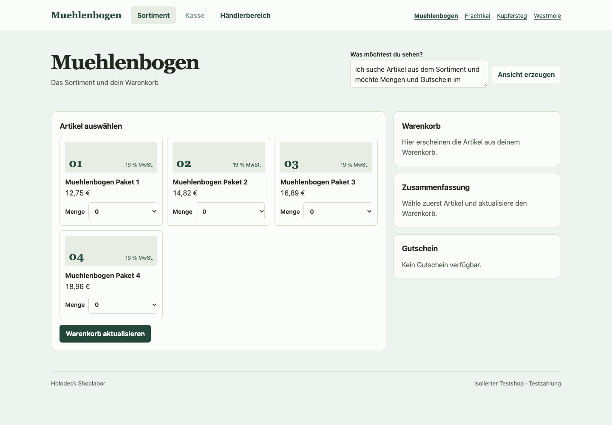

# Recover a merchant rule from its effects

The merchant import contains the product ID, name, price, tax rate and current stock. The minimum purchase, step, configured maximum and closeout flag are hidden. Can the deck recover enough of the missing rule to run a shop? The test asks the Shopware Cart API what happens to a few requests. It then uses one recovered policy to generate the quantity choices and commit cart writes.



## What the deck gets

Shopware 6.7.15.1 runs four isolated sales channels with 16 synthetic products. Each cart request starts in a fresh context. The acquisition script sees requested and accepted quantities at two controlled stock levels. It fits a bounded family of arithmetic progressions with optional stock limits and downward correction. A unique candidate becomes a typed program keyed by product ID. It reads current stock when executed. Different configured maxima can yield the same last purchasable quantity, so the program stores the effective boundary.

All three strategies have a ceiling of six Cart API calls per product. The adaptive search asks the question that leaves the fewest candidates in the worst case. The analytic strategy probes the endpoints and predecessor at high stock and uses a low stock probe for the stock dependency. The fixed schedule makes the same queries regardless of previous answers. Each strategy withholds the policy if its observations leave several candidates.

| Initial strategy | Products resolved | Cart API calls | Exact quantity controls on resolved products | Exact cart writes on resolved products |
| --- | ---: | ---: | ---: | ---: |
| Adaptive search | 12/16 | 59 | 24/24 | 240/240 |
| Analytic probes | 12/16 | 63 | 24/24 | 240/240 |
| Fixed schedule | 7/16 | 84 | 14/14 | 140/140 |

The totals count Cart API calls and exclude Admin calls used to set stock. All three programs were frozen before capture at stocks 5 and 23. Each of the two targeted arms withheld eight controls and 80 cart attempts. The fixed arm withheld 18 controls and 180 attempts. The exact write count compares persisted quantities and item lists against native results. It excludes cases withheld even when the reference cart was empty.

## A question that separates two rules

Four products have an effective maximum at or below nine. Their initial training stocks are 9 and 64. Within that support, stock can cap the quantity or leave it alone and the answers are identical. The checkpoint exposes no quantity for those products while both possibilities remain.

A second round extends the analytic arm's allowed interventions to stock zero. The learner asks one additional Cart API question per unresolved product. That brings the analytic path to 67 calls in total, with all 16 products resolved. The other arms keep their original support. After freezing the new program, a separate check at stocks 3 and 11 matches **8/8 native option sets and 40/40 persisted cart decisions** for the four newly resolved products.

Chrome exercised Holoshop in all four shops at stock 23 with Shopware stopped. It checked all 16 rendered controls and carried a quantity through the cart and checkout to the same order in Admin in each shop. Payment was simulated. [Browser results and reference captures](../experiments/shopware/evidence/hidden-quantity/)

The native Storefront has its own behavior for manual input. In all 14 eligible Chrome checks, typing a quantity between two steps and leaving the field kept the number visible and invalid. A separate Cart API request for that number returned the lower valid quantity. The shared program covers the valid options and the cart correction. The native browser check ends at field validation after blur. [Shopware quantity selector](https://github.com/shopware/shopware/blob/v6.7.15.1/src/Storefront/Resources/app/storefront/src/plugin/quantity-selector/quantity-selector.plugin.js)

## What this tells us about the architecture

The same acquired program serves the view and the commit path. Changing stock changes both consumers without supplying the hidden policy fields or changing the runtime between merchants. Every product receives its own observations. The program family and downward correction are given, and the new checkpoint stores the fitted policies as executable data. The Qwen encoder and trained selectors stay fixed.

Claude Fable 5.2 reviewed the setup and results. It pointed out that the stock tests verify a prescribed family after its parameters have been identified. The four call difference between adaptive and analytic probing in this population gives little reason to prefer the adaptive search. A single remaining candidate can still be wrong if a merchant's behavior falls outside the family. This round tests ambiguity within the family. A stronger comparison would use nested Shopware shipping rules over country, cart value, weight and customer group, and measure the cost of finding a rule and the ability to withhold on deliberately incompatible policies.

## Reproduce the offline check

Install the repository requirements and run from the root with the Shopware teacher stopped.

```sh
bench=experiments/shopware/benchmark
data=experiments/shopware/evidence/hidden-quantity
joint=experiments/shopware/evidence/joint-deck
out=$(mktemp -d)
python "$bench/hidden_quantity_evaluate.py" "$data" "$joint/checkpoint" "$out/eval"
cmp "$data/summary.json" "$out/eval/report.json"
python "$bench/hidden_quantity.py" "$data/support.jsonl" "$out/resolved.json" \
  --additional "$data/additional.jsonl"
cmp "$data/resolved.json" "$out/resolved.json"
```

For the browser run, use the same [pinned local Qwen base](joint-deck.md) and set `base` to its local directory.

```sh
python "$bench/quantity_transfer.py" import "$data/browser-input.jsonl" "$out/shops.json"
python "$bench/joint_shop.py" serve --base "$base" --checkpoint "$joint/checkpoint" \
  --language-weights "$joint/language/admin.npz" --quantity-program "$out/resolved.json" \
  --catalog "$out/shops.json" --db "$out/shop.sqlite" --port 55739 --teacher-port 55729
```

In a second shell with Playwright and Chromium available, run the browser checks.

```sh
node experiments/shopware/benchmark/quantity_browser.cjs deck http://127.0.0.1:55739 \
  experiments/shopware/evidence/hidden-quantity/browser-input.jsonl /tmp/holodeck-hidden-browser
```
