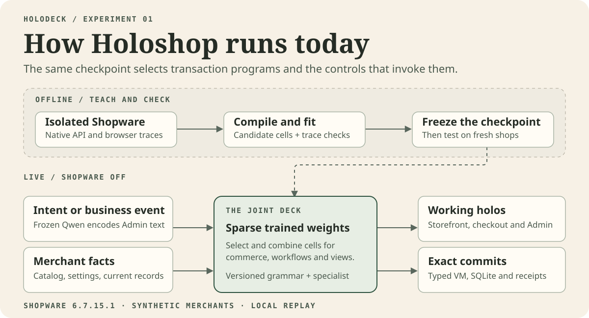
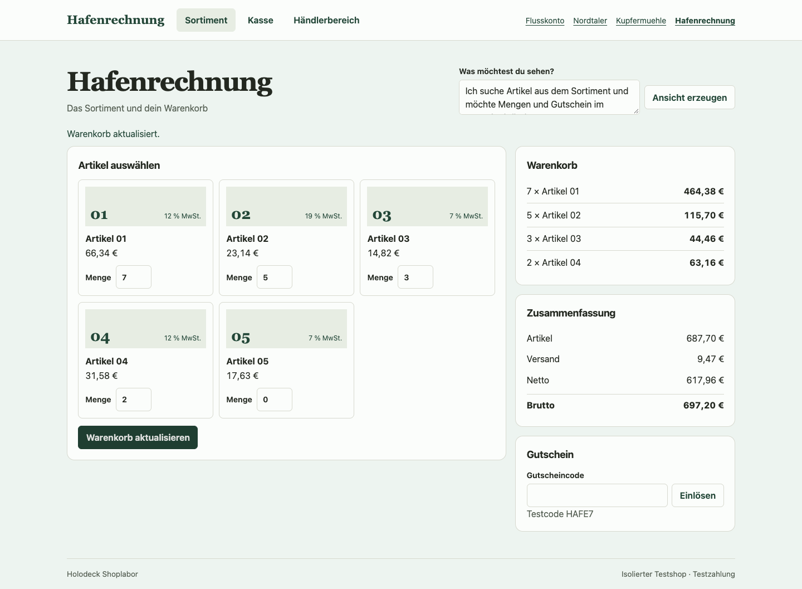
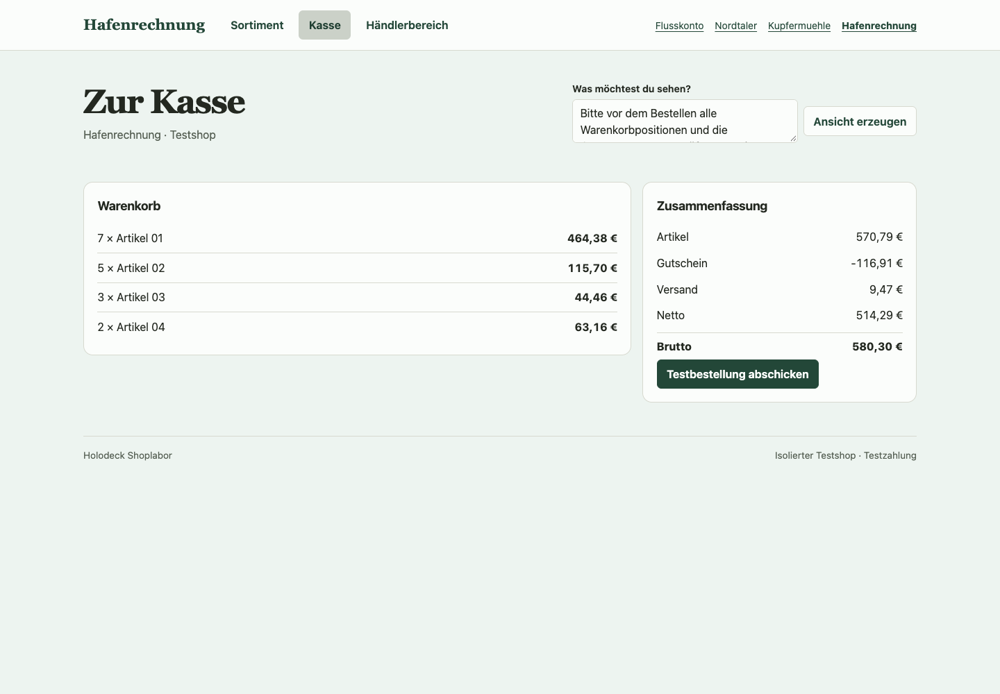
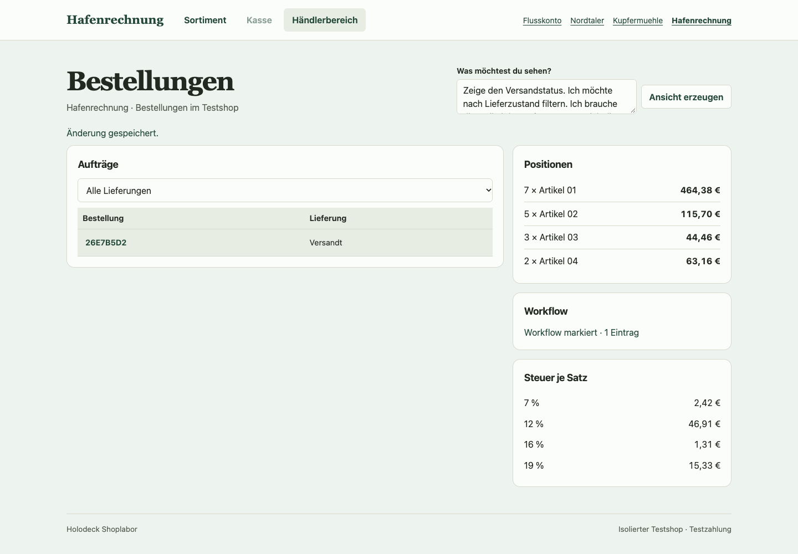

# The joint deck running Holoshop

The joint deck runs an ordinary shopping and order handling journey over a defined commerce profile. Four synthetic merchants were configured in Shopware Community Edition 6.7.15.1. Holoshop imported their inputs and ran with the teacher stopped. It produced the carts, orders, workflow effects and surfaces from its own checkpoint and local records.



## What lives where

| Part | Role in this version |
| --- | --- |
| **Frozen Qwen3.5 9B Base and text readouts** | Turn free text in Admin into requested capabilities such as showing delivery status, order items or a tax breakdown. |
| **Sparse transaction and projection checkpoint** | Selects active cells and their expressions from typed facts. The same checkpoint emits commerce writes and builds the component and action plan for the current view. |
| **Expression grammar** | Supplies the available expressions, field references and component vocabulary. The numeric hypotheses were designed from the source. Shopware traces distinguished the 14 and 17 significant digit variants. The compiler retained the earlier shipping stage and used the source specified denominator where the new traces tied. |
| **Merchant inputs and SQLite** | Hold catalog records and configuration, cart and order data, order status, effect records and durable receipts. Amounts written to records are integer cents. |
| **VM and commit path** | Execute bounded collections and versioned scalar operations, validate effects, bind the offered program to a record version and commit the writes together. |
| **Renderer** | Draws the finite component vocabulary and submits bound actions. It handles controls such as a table, delivery filter and row action. |
| **Optional service specialist** | Adds observed return and refund state decisions and Admin action cells. It can be attached as a versioned extension. |

## Measured results

The numeric checkpoint was frozen before Shopware recorded the 48 holdout cases. The replay compares full journeys, including the persisted order and stock, workflow effects and checkout idempotency across reopening SQLite.

| Native reference cohort | Previous joint deck | Numeric joint deck |
| --- | ---: | ---: |
| Four fresh merchants and configurations | 10/48 | 48/48 |
| Earlier sealed cohort including Waldkai | 47/48 | 48/48 |
| Earlier joint deck cohort | 24/24 | 24/24 |

The new merchants use item and total rounding increments of 1/1, 1/5, 5/5 and 1/10 cents. A 10 cent total increment was absent from training. The control keeps the grammar, VM and inputs fixed and changes one learned shipping output index. All 24 automatic shipping cases still match. All 24 fixed shipping cases diverge.

Eight Chrome runs checked real actions in generated surfaces. The test bought products, applied a coupon, placed an order, and used the generated Admin to record payment, reopen it and mark the order shipped. The tests checked stale offers and row binding, and verified the same record after a reload. The optional service deck also matched 16/16 separate held out journeys. These included 44 expected writes and 36 attempts expected to leave the record unchanged.

The measured money profile uses gross prices, two decimal places, a positive goods total after discount, one coupon and one delivery. The amounts and transitions cover these fixtures. They do not establish parity for net pricing, stacked promotions, commercial B2B, payment settlement or all Shopware routes. View generation uses a defined component vocabulary, and the main comparison measures a trained choice of executable expressions. The shared multimodal training target and the coverage required for system replacement are described in the [architecture](architecture.md) and [acceptance plan](shopware-absorption.md).

The [specialist activation experiment](learning.md#one-specialist-from-training-to-activation) shows the before and after Admin views on one paid order and records which checkpoint serves it after restart.

## One order in the browser

These three captures are from one Chrome run in Hafenrechnung, case 7 of the published holdout. Shopware was stopped. The [browser report](../experiments/shopware/evidence/joint-deck/walkthrough-browser.json) records the order identity, exact comparison and final status.

**Storefront.** The shopper updates quantities for four products. The generated cart shows €697.20 before the coupon and offers a code field.



**Checkout.** The 17% coupon applies €116.91 of discount. The merchant’s ten cent end total interval yields €580.30. The checkout action saves that total and the browser compares the order with the native reference.



**Admin.** The merchant asks for delivery status, the order items and the tax breakdown. The view binds to order `26E7B5D2`. After marking it shipped, the view shows the new status and the single workflow mark.



## Replay the published checkpoints

Use Apple Silicon with Python 3.13 and the tested MLX dependencies. Run from the repository root. The numerical comparison loads the bundled sparse checkpoint and grammar. It needs the MLX packages but does not load Qwen or require a model download. Use an unused loopback port for the offline teacher check.

```sh
python3 -m venv .venv
. .venv/bin/activate
python -m pip install -r requirements.txt 'mlx==0.32.4' 'mlx-lm==0.32.2'

bench=experiments/shopware/benchmark
proof=experiments/shopware/evidence/joint-deck
out=$(mktemp -d)
python "$bench/money_checkpoint.py" evaluate "$proof/traces/numeric-holdout.jsonl" "$out/numeric" \
  --baseline "$proof/baseline" --checkpoint "$proof/checkpoint" --teacher-port 55729 \
  --regression "$proof/traces/sealed-regression.jsonl" \
  --regression "$proof/traces/joint-regression.jsonl"
python "$bench/check_adaptation.py" "$proof/checkpoint" "$proof/specialist" \
  "$proof/traces/service-holdout.jsonl" "$proof/traces/joint-regression.jsonl" "$out/service" \
  --teacher-port 55729
```

Compare the terminal scores with the [recorded summary](../experiments/shopware/evidence/joint-deck/summary.json). The commands produce detailed program and receipt reports and separate SQLite files under `$out`. Timings depend on the machine. The original p95 of 0.85 ms covers local model selection, VM and SQLite apply for a small graph without load. The number excludes browser and network time.

### Refit from the bundled lessons

```sh
python "$bench/money_checkpoint.py" fit "$proof/traces/numeric-train.jsonl" "$out/refit" \
  --baseline "$proof/baseline" --commerce "$proof/lessons/retrieval.json" --teacher-port 55729
cmp "$out/refit/grammar.json" "$proof/checkpoint/grammar.json"
cmp "$out/refit/sparse.npz" "$proof/checkpoint/sparse.npz"
```

The lessons are trace checked commerce cell labels carried forward from the earlier experiment. The refit uses the numeric training traces to choose the candidate and reuses the original browser annotations for projection. To capture fresh references in Shopware and reproduce earlier comparisons, see the [benchmark procedures](../experiments/shopware/benchmark/README.md#numeric-compatibility-in-the-joint-deck).

### Open the four shops

The demo adds the Qwen text encoder. Point `base` at a local copy of the official `Qwen/Qwen3.5-9B-Base` snapshot `68c46c4b3498877f3ef123c856ecfde50c39f404`. You can fetch that revision with `hf download Qwen/Qwen3.5-9B-Base --revision 68c46c4b3498877f3ef123c856ecfde50c39f404` and use the resulting snapshot path.

```sh
base=/path/to/the/pinned/Qwen/snapshot
python "$bench/joint_shop.py" import --source "$proof/traces/numeric-holdout.jsonl" \
  --catalog "$out/shops.json" --case Flusskonto:5 --case Nordtaler:5 \
  --case Kupfermuehle:5 --case Hafenrechnung:5 --teacher-port 55729
python "$bench/joint_shop.py" serve --base "$base" --checkpoint "$proof/checkpoint" \
  --language-weights "$proof/language/admin.npz" --catalog "$out/shops.json" \
  --specialist "$proof/specialist" --service-weights "$proof/language/service.npz" \
  --active-specialist --db "$out/shop.sqlite" --port 55730 --teacher-port 55729
```

Open [Hafenrechnung on localhost](http://127.0.0.1:55730/?shop=hafenrechnung). Choose quantities, apply `HAFE5`, and place a test order. Open the merchant area and ask for a delivery filter, line items and the tax breakdown. The local demo uses a synthetic test session. To verify the same flow with Chrome, run the following in another terminal from the repository root with Playwright available.

```sh
node experiments/shopware/benchmark/joint_browser.cjs http://127.0.0.1:55730 \
  experiments/shopware/evidence/joint-deck/traces/numeric-holdout.jsonl /tmp/holodeck-browser
```

For the percentage coupon run, import case 7 for all four shops and set `HOLODECK_CASE=7` for the browser command. The normal run writes full page PNG captures of Storefront, Checkout and Admin along with the browser report.
