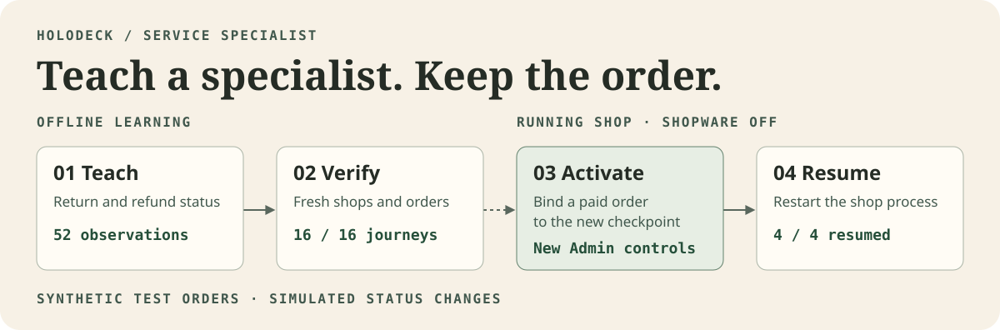
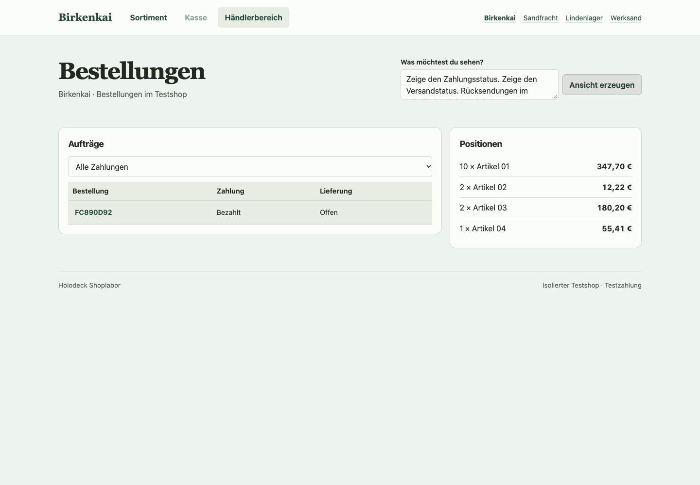
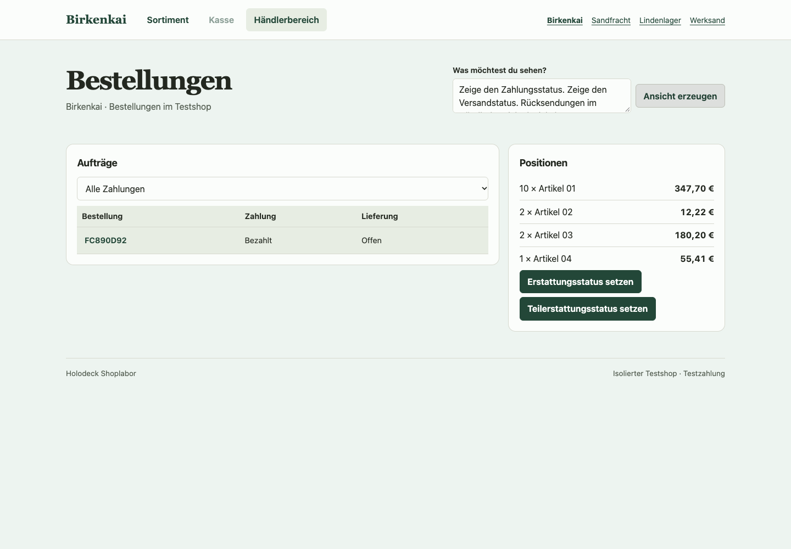

# Learning experiments

The [target learning architecture](architecture.md#4-how-a-deck-learns-an-application) combines active acquisition, reusable structure and checked installation. The [validation roadmap](roadmap.md) sets the current sequence and controls. This page records the earlier Shopware specialist activation and the later commerce adaptation proposal.

## One specialist from training to activation



The published service specialist was fitted from 52 observed commands over eight synthetic orders in two teaching shops. It learns which payment and delivery state changes are accepted, refused or accepted without a write. The service language readout uses frozen Qwen features. The numeric joint checkpoint keeps its existing commerce and projection cells.

On the independent holdout, the numeric deck alone completes 0 of 16 service journeys. With the specialist attached, it matches all 16. All 44 expected writes and all 36 attempts without a write agree with the reference. The earlier 24 journeys still emit the same 144 programs. [Recorded comparison](../experiments/shopware/evidence/joint-deck/summary.json)

### What changes on the live order

The browser creates order `FC890D92` in Birkenkai and marks it paid. It then makes the same service request on each version. Both views show the same order, line items and open delivery. After the explicit activation, the view offers full and partial refund status changes. A premature return remains unavailable. The activation itself can be retried and returns the original receipt.

| Before activation | After activation |
| --- | --- |
| [](../assets/experiments/joint-deck/birkenkai-before-activation.png) | [](../assets/experiments/joint-deck/birkenkai-after-activation.png) |

The test continues through shipment, return and refund status changes. An offer generated by the old version is rejected. After stopping and restarting the server on the same SQLite file, the same four orders resume with their final state, workflow record and activated checkpoint. These are simulated status changes. Training runs offline, and activation is explicit in the local test interface. [Activation and restart report](../experiments/shopware/evidence/joint-deck/activation-report.json)

### Reproduce the activation

Use the Apple Silicon environment and pinned Qwen snapshot from the [joint deck setup](joint-deck.md#replay-the-published-checkpoints). Run from the repository root with Shopware offline.

```sh
bench=experiments/shopware/benchmark
proof=experiments/shopware/evidence/joint-deck
out=$(mktemp -d)
base=/path/to/the/pinned/Qwen/snapshot

python "$bench/joint_shop.py" import --source "$proof/traces/service-holdout.jsonl" \
  --catalog "$out/shops.json" --case Birkenkai:0 --case Sandfracht:0 \
  --case Lindenlager:0 --case Werksand:0 --teacher-port 55729
python "$bench/joint_shop.py" serve --base "$base" --checkpoint "$proof/checkpoint" \
  --language-weights "$proof/language/admin.npz" --catalog "$out/shops.json" \
  --specialist "$proof/specialist" --service-weights "$proof/language/service.npz" \
  --db "$out/shop.sqlite" --audit "$out/audit.jsonl" --port 55736 --teacher-port 55729
```

In another terminal, run the browser check with Playwright installed. Use a fresh output path.

```sh
node experiments/shopware/benchmark/adaptation_browser.cjs http://127.0.0.1:55736 \
  experiments/shopware/evidence/joint-deck/traces/service-holdout.jsonl /tmp/holodeck-activation-browser
```

To repeat the offline fit with the bundled training partition, run the following separately. The fitted grammar and sparse weights match the published files byte for byte.

```sh
python "$bench/adaptation.py" "$proof/checkpoint" "$proof/traces/service-train.jsonl" "$out/refit" --teacher-port 55729
cmp "$out/refit/sparse.npz" "$proof/specialist/sparse.npz"
cmp "$out/refit/grammar.json" "$proof/specialist/grammar.json"
```

The report gives the shop slug, order root and expected checkpoint for each case. To verify restart, stop the server, run the same serve command with the same database, resume the root through `/api/session` and request its Admin projection. The response should retain the order and final revision. The projection entry in `audit.jsonl` identifies the checkpoint that served it.

## A later B2B transfer experiment

A purchase order amendment after partial shipment is a planned probe for transfer. Start with 40 accepted units and 24 already shipped. Ask to revise the total to 30. If the revision is accepted, six units remain to be fulfilled. The learned graph must preserve the completed shipment, apply the applicable contract terms and wait for approval when required.

Compare complete trajectories under two companies’ configurations, including approval refused and fulfilment arriving while a revision is open. Use independent expected records and action sets. Keep the runtime fixed and track which differences come from company data and which require learned semantics.

The work is sequenced in the [roadmap](roadmap.md). The [existing Shopware evidence](../experiments/shopware/README.md) establishes a narrower starting point.
