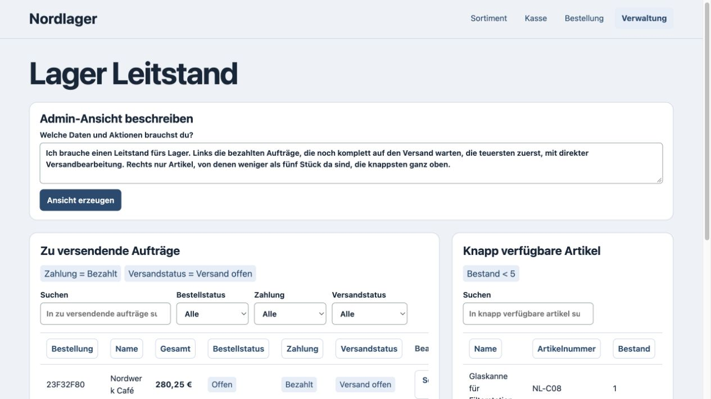

# Learn from Shopware Admin and build a third shop workspace

Nordlager runs on a new checkpoint and a separate merchant data file. Its admin accepts a free request and builds a working view over orders or inventory, or both. The request is interpreted by local Qwen. A UI head trained from the Shopware recordings emits the available fields, tools and action bindings. Those bindings execute through the same commerce model and transaction runtime as the rest of the shop.



## What the teacher supplied

| Source | What was observed | How the deck uses it |
| --- | --- | --- |
| Native Shopware Admin in Chromium | Nine observations across the real product and order grids, searches with the returned record, a sort change via the native URL state and API request, the visible filter menu, a linked order detail and a confirmed shipment | Table types, headers, sort and filter fields, detail fields and the binding from the selected order to its delivery. The native shipment returned HTTP 200 for the expected delivery, with email disabled. |
| Real Shopware Admin API | 392 responses across all 196 action and state pairs in the three selected state machines, run on two separate synthetic orders | Fit on the first matrix, verify on the second. There are 22 distinct action names, 210 acceptances and 182 refusals. The isolated fixture state was reset before each probe. The result and final state came from the real API. |
| Real Shopware Admin API without fixture resets between steps | Four complete recorded paths with 32 steps | Verify the learned runtime in order, including rejected requests, failed payments, reopening, payment, partial and full shipping, order completion, return and refund. The chain logs are held back from training. |

The second matrix repeats the same action and state inputs on another order. It tests repeatability, while the four chains test whether successive model outputs compose without resetting state. The arithmetic heads from the previous deck are retained. The model scores all 22 probed actions. Holodeck exposes ten typed status commands plus tracking, with payment and shipment effects scoped to the local test environment.

The [normalized browser trace](../experiments/shopware/workspace/ui.jsonl) comes from the native Admin, including a separate accessibility and DOM observation for the order grid columns. The sort responses confirm the requested property and direction. The filter recording captures the menu labels. The generated workspace filter is exercised separately on live local records. The [browser recorder](../experiments/shopware/workspace/capture_ui.cjs) and [API collector](../experiments/shopware/workspace/capture_transitions.py) operate only on an isolated test fixture.

## A request becomes a working view

> Ich brauche einen Leitstand fürs Lager. Links die bezahlten Aufträge, die noch komplett auf den Versand warten, die teuersten zuerst, mit direkter Versandbearbeitung. Rechts nur Artikel, von denen weniger als fünf Stück da sind, die knappsten ganz oben.

The local language specialist returns a typed view specification, including two sources, three predicates, two sort keys and an action focus. The trained readout emits the native-derived columns and interaction pointers for each source. A layout head trained with one- and two-source examples composes the result. The interpreter validates permissions and bindings, filters current records and passes only the projected data to the browser. Plan creation is read-only.

In Nordlager the view put **Nordwerk Café** (€280.25, `23F32F80`) ahead of **Hafenservice** (€68.25), with the two low-stock products beside them. Opening Nordwerk's row showed the live delivery address and the bound shipment action. After dispatch it disappeared from the list, and the durable order recorded `shipped`. [After the dispatch](../assets/experiments/workspace/nordlager-nach-versand.jpg)

A second free request for failed payments built a different workspace. **Kranhaus Küche** (`61CDCCD4`) was the only row. Reopening its payment set the durable state to `open` and removed it from the failed-payment list. Both operations used the same checkpoint with the Shopware teacher stopped. [Payment workspace](../assets/experiments/workspace/nordlager-zahlungsfehler.jpg)

A workspace's pinned criteria are checked again in the transaction. The test changes an order to refunded after a paid-only view is loaded. A later click on its old dispatch control is refused. The same commerce model still evaluates the action's own state transition.

The text specialist is the existing local Qwen model. The new training fits the commerce and UI heads. The supported sources are orders and catalog, with typed conjunctions, sort keys and the available order actions. The layout supervision and rendering primitives are explicit. The workspace supports the captured surfaces and current commerce vocabulary. It does not absorb all of Shopware Administration or invent arbitrary writes. The local plan cache lasts for the running process.

## Reproduce

```sh
python3 -m pip install -r requirements-training.txt
PYTHONPATH=src python3 experiments/shopware/workspace/train.py --output /tmp/workspace.npz
cmp src/holodeck/workspace.npz /tmp/workspace.npz
PYTHONPATH=src python3 -m unittest discover -s tests -v
```

Start the third shop with Ollama and `qwen3.6:35b` available on the local machine. Shopware can remain off.

```sh
PYTHONPATH=src python3 experiments/shopware/workspace/seed_demo.py --database .holodeck/nordlager-demo.sqlite
PYTHONPATH=src python3 -m holodeck.server --port 18781 \
  --checkpoint src/holodeck/workspace.npz --merchant src/holodeck/nordlager.json \
  --database .holodeck/nordlager-demo.sqlite --workspace-model qwen3.6:35b
```

Open the [Nordlager admin](http://127.0.0.1:18781/?task=admin) with the fixture password `deck-demo`. The [earlier two shop experiment](neural-projection.md) records the storefront and checkout generation proof separately.
