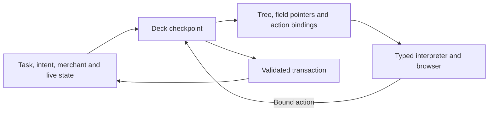

# A deck that generates its own shop surfaces

This records the two shop projection milestone. The [current joint deck](joint-deck.md) extends the same experiment to four new configured shops and publishes its replay and browser evidence.

The same checkpoint runs Kanne and Werkraum Handel. Each shop has a separate catalog, price and shipping configuration, visual profile and database. The deck generates an interface program from the current task, intent, merchant profile and business state. The browser renders the program and sends its bound actions to the same deck.

| Surface | Kanne | Werkraum Handel |
| --- | --- | --- |
| Storefront | [Product cards with photographs](../assets/experiments/projection/kanne-storefront.jpg) | [Purchasing table with live stock](../assets/experiments/projection/werkraum-storefront.jpg) |
| Checkout | [Items and form beside the gross quote](../assets/experiments/projection/kanne-checkout.jpg) | [A stacked checkout with net, tax and gross amounts](../assets/experiments/projection/werkraum-checkout.jpg) |
| Admin | [Overview, orders and catalog](../assets/experiments/projection/kanne-admin.jpg) | [Focused order grid with address and fulfilment actions](../assets/experiments/projection/werkraum-admin.jpg) |

In Kanne, selecting **Produkte vergleichen** changes the cards into a sortable table and preserves the current cart. In both shops the order grid supports searching and sorting across the merchant's records, status filters, paging and expandable details. The catalog view reads current prices and stock. Order controls follow the state of each row and the capabilities learned by the commerce network.

## One checkpoint, two learned outputs



- The existing 11,100 commerce parameters remain bit for bit identical to the Shopware trained experiment. They compute prices and stock effects, expose action availability and decide state transitions at execution.
- The 36,579 UI parameters generate widget types, ordering, parent links, titles, data sources, fields, search and sort controls, filter and detail fields, and action names. A separate head maps typed action parameters to live records, user inputs or the current quote. An order button binds `order_id` to `row.id`, and checkout binds `quote_key` to `context.quote`. The output also specifies where checkout navigates after purchase.
- The teacher is an offline curriculum of annotated interface programs. It uses product and order surfaces from the earlier demos as design references and uses the successful action inventory from the recorded Shopware training journeys. No serving module imports the curriculum. The UI training uses structured annotations and does not ingest screenshots as pixels.
- The tree network learns which context coordinates can be omitted for each output attribute by comparing examples. The comparison title can depend on the shopping intent while the cart component depends on the cart state. The interpreter checks permissions, record and field types and action signatures. A checkout requires an unchecked consent field and a visible gross quote. UI actions go through the current commerce model and transactional commit.
- The browser implements generic components and interaction mechanics. The shell navigation, control vocabulary, field labels and color palettes are authored. The model composes the surfaces within that vocabulary. The runtime can reuse a decoded program for an identical context and bind it again to live records.

## What passed

Training excludes every example that shows a comparison with a nonempty cart. It sees comparison tables with an empty cart and carts in regular browsing. The final model reconstructs the withheld annotated comparison tree and its cart field and action bindings in both presentation profiles. Across the full split it matches 20 of 20 held out annotated programs, including two cart binding contexts absent from fitting. Other holdout rows exercise combinations of context flags. This is a compositional test in a bounded vocabulary.

A separate test removes the UI binding weights. Checkout generation refuses to continue, while the existing commerce network still computes the price. A corrupted checkout program with no visible total is rejected. Another test searches the oldest of 502 orders and checks that its action binds to the returned record.

| Browser run with the Shopware container stopped | Total | Result | Tracking |
| --- | --- | --- | --- |
| Kanne · `F77538DF` | €42.89 | Paid, shipped, closed | `KANNE-HOLO-03` |
| Werkraum · `29BC4A4D` | €54.75 | Paid, shipped, closed | `WERK-HOLO-04` |

The customer and admin surfaces reported the same order status and tracking number for each merchant. The demo uses simulated payments. Admin covers catalog inspection and the existing order actions for processing, payment, shipment, tracking, completion, return and refund. Product editing, a general image or code generator and the full Shopware Administration surface are outside this proof.

## Run and refit

```sh
python3 -m pip install -r requirements.txt
PYTHONPATH=src python3 -m holodeck.server --port 18779
PYTHONPATH=src python3 -m holodeck.server --port 18780 --merchant src/holodeck/werkraum.json
```

Use [Kanne](http://127.0.0.1:18779/) and [Werkraum](http://127.0.0.1:18780/). The local demo admin password is `deck-demo`. Pass a distinct `--database` path to start with empty records.

```sh
python3 -m pip install -r requirements-training.txt
PYTHONPATH=src python3 experiments/shopware/projection/train.py \
  --commerce src/holodeck/weights.npz --output /tmp/holodeck-deck.npz
cmp src/holodeck/deck.npz /tmp/holodeck-deck.npz
PYTHONPATH=src python3 -m unittest discover -s tests -v
```

[Training curriculum](../experiments/shopware/projection/curriculum.py) · [Decoder and interpreter](../src/holodeck/projection.py) · [Commerce training and pricing scope](standalone-shop.md)
