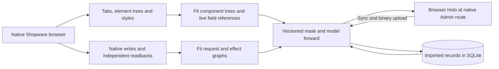
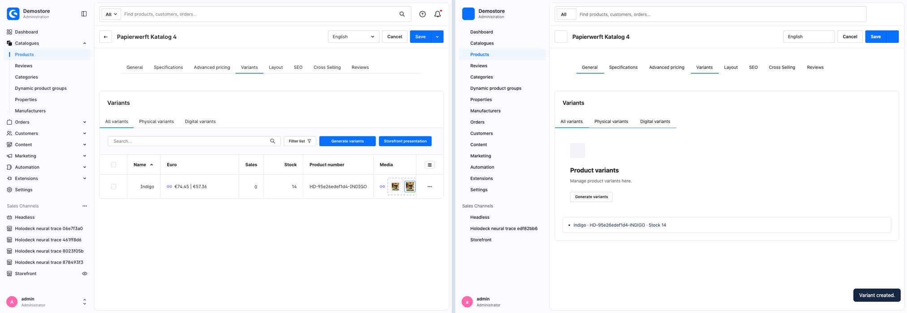

# Learning a Shopware product mask

The browser teacher visits the actual Shopware Administration for three synthetic products. It discovers the available product tabs from native links and records visible element trees, labels, values and computed layout at a 1440 × 1000 viewport. Each tab has its own recorded state. The compiler groups those states and looks for fields whose values vary in exactly the same way as a record field across the three products.



The native layout is captured as structured component trees and reusable computed style values. The renderer rebuilds browser elements from that representation. Its live bindings are produced from typed record slots in a PyTorch forward graph. The baseline theme and controls can therefore appear at the original Admin path with a new product name, number and stock. The compiler uses a captured topology for each observed tab. It does not generate arbitrary visual structure with Qwen.

The eight captured tabs are General, Specifications, Advanced pricing, Variants, Layout, SEO, Cross Selling and Reviews. Their geometry comes from the measured desktop states. The live product editor supports stock, base gross and net price, creating a variant from a configured option, uploading a JPEG, assigning it to the product and choosing a cover. The price experiment stores the link flag and the two entered amounts. It does not reproduce Shopware's client-side automatic gross/net conversion.

## From a click to a saved record

1. The browser requests a product and tab from the local Deck using the original Admin hash route. The projection combines a fitted element tree and style tokens with live product slots and request programs. The renderer uses standard browser elements and binds the supported controls. The field selection and the variant and media interaction sequences are currently written in the browser code.
2. The browser fills the fitted request program with the product ID and current inputs. Price and variant changes use `POST /api/_action/sync`. A media upload creates a record with `POST /api/media`, sends the JPEG bytes to `POST /api/_action/media/{id}/upload`, and uses Sync for the assignment and cover. [Shopware Admin API media model](https://github.com/shopware/admin-api-reference/blob/main/docs/guides/quick-start/03-media-handling.md)
3. The local server checks the request against the fitted shape. A PyTorch FX forward computes a typed record effect. SQLite commits each request and stores media bytes separately from the projected tree. A reload binds the new values from the store. Variant setup and media upload comprise multiple independent requests and are not one transaction.

The structural fit used three products and 21 native Admin API writes. For each write the recorder queried Shopware again to obtain the stored result. It varied prices, IDs, options, file names and file sizes to distinguish constants from input references. The fitter writes explicit request, effect and status programs into the checkpoint. This round did not update Qwen weights. The known UI trees came from browser traces, while the additional action lessons came from direct calls to the native Admin API.

After the fit was frozen, Shopware generated references for two different Papierwerft products. The replay imported their starting records and options, stopped the teacher, and operated only the Holo. All 14 browser writes matched the observed native route and HTTP status. Both products matched the checked gross and net prices, link flag, variant number, stock and options, media metadata and cover relation. The saved JPEG bytes matched the fixture hashes and rendered in the cover slot. The Deck reopened both products from the same database after restart. [Traces, checkpoint and browser reports](../experiments/shopware/evidence/product-actions/)

The result covers these seven write profiles. The Sync success JSON envelope, arbitrary media formats, product editing outside the observed fields, advanced price tiers, multi-option variant generation, and the other tabs' actions remain outside this evidence. The native price lessons use a single currency and live version. The browser comparison is for the captured desktop viewport.



[Cover image served by the Holo](../assets/experiments/product-mask/actions-media.png)

## Compare the original with the Holo

The compiler was frozen after three Kornufer training products. The browser then recorded two products from a fresh Papierwerft channel. Shopware was stopped before rendering the Holo. The screenshots show the same Papierwerft product before the write, with Shopware on the left and Holodeck on the right.


[Specifications comparison](../assets/experiments/product-mask/specifications-side-by-side.png)

Chrome visited all eight tabs on both products. Counts of inputs, selects and textareas matched on all 16 views, including 34 controls on General. The product name and number came from the imported records. Saving stock on both records returned HTTP 200, and a reload and separate Store API read confirmed the change from 58 to 71. [Browser evidence, training traces and fitted mask](../experiments/shopware/evidence/product-mask/)

## Training further areas

`train-more.sh` runs native Admin capture and structural candidate fitting, then fits the existing checkout and shipping learners from native corpora. The capture waits for actual list or content panels and records unresolved routes separately. A candidate at this stage is a view structure. Promotion of its writable behavior still needs a browser action trace, matching API effects and held-out verification, as in the [absorption pipeline](absorption-pipeline.md).

```sh
bash experiments/shopware/mask/train-more.sh /tmp/holodeck-area-training http://127.0.0.1:55748
```

The command accepts the same Python, Node, Chrome and Playwright environment overrides as the existing pipeline. Use the isolated native reference for browser recording. The function fits use published training corpora, and the shipping and checkout benchmark drivers provide their separate replays.

This run fitted view candidates for product lists, categories, manufacturers, properties, customers, rules and flows. Orders, promotions and media remain unmeasured as Admin views in this batch. The checkout fit recovered nine expressions and the shipping fit wrote a new prior from the archived native traces. An independent refit of the workflow specialist on the archived native corpus matched 28 of 28 sequences for each of the two conditions. These are separate candidates and evaluations. [Training summary](../experiments/shopware/evidence/product-mask/training-summary.json)

## Replay the bundled mask

With the [forward-pass dependencies](forward-pass.md) installed, use the compressed checkpoint and a fresh SQLite file. Keep the teacher offline. The original Admin path identifies the new product.

```sh
proof=experiments/shopware/evidence/product-mask
python experiments/shopware/mask/server.py experiments/shopware/evidence/absorption/model.json \
  "$proof/mask.json.gz" "$proof/catalog.json" /tmp/holodeck-product-mask.sqlite
```

Open [Papierwerft Artikel 1](http://127.0.0.1:55749/admin#/sw/product/detail/17c41a22ebe74ac5b1606b40881120f9/base). For a refit, `learn.py product` accepts `train-ui.json.gz` directly. For the browser replay, unpack `holdout-ui.json.gz` and pass it to `replay.cjs` with the local base URL and a new output directory.

For the extended action run, fit the published native action traces and add the action catalog and checkpoint. The action catalog contains the two starting records and their available options. The browser verifier reads the expected outcomes separately.

```sh
proof=experiments/shopware/evidence/product-actions
views=experiments/shopware/evidence/product-mask
python experiments/shopware/mask/actions.py "$proof/train.json" /tmp/holodeck-actions.json
python experiments/shopware/mask/server.py experiments/shopware/evidence/absorption/model.json \
  "$views/mask.json.gz" "$views/catalog.json" /tmp/holodeck-product-actions.sqlite \
  --actions /tmp/holodeck-actions.json --action-products "$proof/catalog.json" \
  --port 55757 --teacher-port 55753
# In a separate terminal
node experiments/shopware/mask/replay_actions.cjs http://127.0.0.1:55757 \
  "$proof/holdout.json" /tmp/holodeck-product-actions-report
```

After restarting the server with the same database, append `verify` to the browser command to check persisted values without replaying writes. The test assets are the JPEG fixtures under `experiments/shopware/native/public/assets`. The binary request observations reference their SHA-256 digests.
