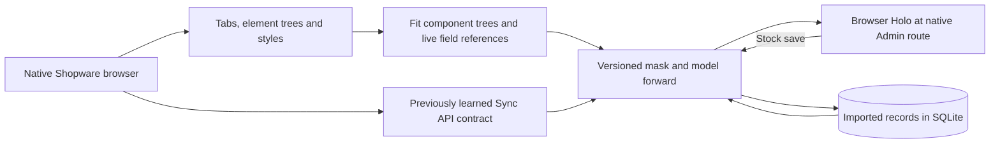
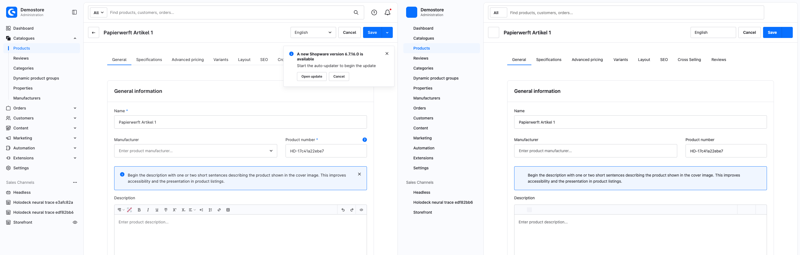

# Learning a Shopware product mask

The browser teacher visits the actual Shopware Administration for three synthetic products. It discovers the available product tabs from native links and records visible element trees, labels, values and computed layout at a 1440 × 1000 viewport. Each tab has its own recorded state. The compiler groups those states and looks for fields whose values vary in exactly the same way as a record field across the three products.



The native layout is captured as structured component trees and reusable computed style values. The renderer rebuilds browser elements from that representation. Its live bindings are produced from typed record slots in a PyTorch forward graph. The baseline theme and controls can therefore appear at the original Admin path with a new product name, number and stock. The compiler uses a captured topology for each observed tab. It does not generate arbitrary visual structure with Qwen.

The eight visible native tabs are General, Specifications, Advanced pricing, Variants, Layout, SEO, Cross Selling and Reviews. The snapshot includes the states those tabs showed on the synthetic products. The live editable action is **Stock → Save**, executed through the previously acquired Sync API profile. Product name, product number and both stock displays bind to imported facts. Other captured controls remain visually represented. Media, pricing editors, associations, variants and other writes require their own learned action and persistence profiles. The renderer omits native vector icons and third-party assets, and responsive parity is unmeasured.

## Compare the original with the Holo

The compiler was frozen after three Kornufer training products. The browser then recorded two products from a fresh Papierwerft channel. Shopware was stopped before rendering the Holo. The screenshots show the same Papierwerft product before the write, with Shopware on the left and Holodeck on the right.



[Specifications comparison](../assets/experiments/product-mask/specifications-side-by-side.png)

Chrome visited all eight tabs on both products. Counts of inputs, selects and textareas matched on all 16 views, including 34 controls on General. The product name and number came from the imported records. Saving stock on both records returned HTTP 200, and a reload and separate Store API read confirmed the change from 58 to 71. [Browser evidence, training traces and fitted mask](../experiments/shopware/evidence/product-mask/)

## Training further areas

`train-more.sh` runs native Admin capture and structural candidate fitting, then fits the existing checkout and shipping learners from native corpora. The capture waits for actual list or content panels and records unresolved routes separately. A candidate at this stage is a view structure. Promotion of its writable behavior still needs a browser action trace, matching API effects and held-out verification, as in the [absorption pipeline](absorption-pipeline.md).

```sh
bash experiments/shopware/mask/train-more.sh /tmp/holodeck-area-training http://127.0.0.1:55748
```

The command accepts the same Python, Node, Chrome and Playwright environment overrides as the existing pipeline. Use the isolated native reference for browser recording. The function fits use published training corpora, and the shipping and checkout benchmark drivers provide their separate replays.

This run fitted view candidates for product lists, categories, manufacturers, properties, customers, rules and flows. Orders, promotions and media remain unmeasured in this batch. The checkout fit recovered nine executable expressions again, and the shipping replay matched its published benchmark. [Training summary](../experiments/shopware/evidence/product-mask/training-summary.json)

## Replay the bundled mask

With the [forward-pass dependencies](forward-pass.md) installed, use the compressed checkpoint and a fresh SQLite file. Keep the teacher offline. The original Admin path identifies the new product.

```sh
proof=experiments/shopware/evidence/product-mask
python experiments/shopware/mask/server.py experiments/shopware/evidence/absorption/model.json \
  "$proof/mask.json.gz" "$proof/catalog.json" /tmp/holodeck-product-mask.sqlite
```

Open [Papierwerft Artikel 1](http://127.0.0.1:55749/admin#/sw/product/detail/17c41a22ebe74ac5b1606b40881120f9/base). For a refit, `learn.py product` accepts `train-ui.json.gz` directly. For the browser replay, unpack `holdout-ui.json.gz` and pass it to `replay.cjs` with the local base URL and a new output directory.
