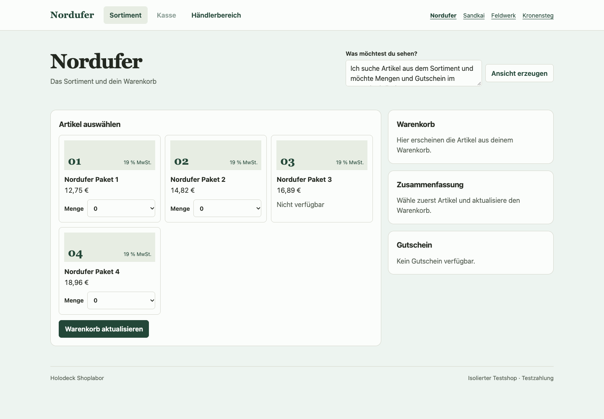

# One learned quantity policy for a control and a write

Can a deck learn a business rule from its effects and generate the right interface for it without seeing that interface during training? This experiment learns one executable quantity domain from Shopware Cart API outcomes and checks its generated control against Shopware's native Storefront. It also fits the reverse direction to see what information an interface actually carries.



## Evidence

The two learners saw the same 16 products and typed merchant facts across four Shopware Community Edition 6.7.15.1 channels. Each training file physically omits the other source of supervision. The inputs are the configured minimum, maximum and step, current stock and the closeout flag. Neither learner receives Shopware's calculated maximum or its production code as a label. The search starts from a bounded progression family with generic integer expressions and four possible request corrections.

Both fits were frozen before capture of four new channels with 16 fresh products. Training includes closeout with step 1 and steps 2 and 3 without closeout. The holdout adds closeout with steps 4 and 5, higher configured maxima and policy twins that differ in the closeout flag. The native HTML capture was checked again in Chrome. All 220 Cart API probes start without a reused cart context. There are 34 requests inside the offered range and 161 outside it where the product still offers a quantity. Another 25 target products with no offered quantities. The native responses all use HTTP 200.

| Fit or control | Exact native quantity controls | Exact persisted quantity decisions |
| --- | ---: | ---: |
| Cart outcomes only | 16/16 | 220/220 |
| Storefront controls only | 16/16 | 59 determinate and exact, 161 ambiguous |
| Cart fit with the stock dependency removed | 9/16 | 172/220 |

The cart fit also blocked checkout for all 25 empty carts in the persisted replay. The control changes one output of the shared domain. Its upper bound reads the configured maximum directly, so stock no longer narrows it. The writer and projection use that same altered output. Checkout, storage and the renderer are otherwise identical.

In each new shop, Chrome verified the offered quantities, selected a valid one, and submitted it through the normal UI. A separate bound request bypassed the select and asked for a quantity outside its grid. Holoshop stored the same corrected quantity as the native cart and carried it into checkout and the order visible in Admin. This browser test verifies the quantity, stock update and order identity. It does not compare every price or Shopware notice.

[Training partitions, runtime report and browser checks](../experiments/shopware/evidence/quantity-transfer/)

## What the program learned

A domain has three integer producers. The cart fit selected the merchant's minimum and step as two of them. For the upper bound, it learned to use the smaller of stock and the configured maximum for closeout products, and the configured maximum otherwise. In Nordufer, a stock of 12, minimum 5, step 4 and maximum 19 yield choices 5 and 9 with closeout. Without closeout the choices are 5, 9, 13 and 17.

The rendered choices are the positive fixed points of the learned normalization. The writer projects a request onto the same progression. The fit from cart outcomes selects rounding down between steps, with the appropriate endpoint outside the interval. The UI observations identify the same progression. Floor, ceiling, nearest and rejection all produce the same visible choices, so the UI fit leaves the correction mode unresolved. It is never used as a cart writer.

Fable 5.2 reviewed the design. Its strongest caveat is the distinction between recovering a program that uses typed merchant facts and recovering hidden policy or a shared neural representation. The typed grammar supplies the progression abstraction. One reduced minimum-cost domain fits each training arm. The executable expression is acquired from traces. The sparse gates and Qwen weights remain fixed, and the same compiled domain is explicitly reused in both paths.

A stronger follow-up would hide the raw policy and give each surface only partial behavioral evidence. The evaluation would ask whether a single acquired representation recovers both the effect and the offered action under an intervention. Native storefront handling of a typed off-grid request and the Cart API must be measured separately before assuming that both implement the same correction. [Native quantity control](https://github.com/shopware/shopware/blob/v6.7.15.1/src/Storefront/Resources/views/storefront/component/buy-widget/buy-widget-form.html.twig) · [Native cart processor](https://github.com/shopware/shopware/blob/v6.7.15.1/src/Core/Content/Product/Cart/ProductCartProcessor.php)

## Reproduce

Use the [joint deck environment](joint-deck.md#replay-the-published-checkpoints) with Shopware stopped. The numeric comparison runs without loading Qwen.

```sh
bench=experiments/shopware/benchmark
joint=experiments/shopware/evidence/joint-deck
data=experiments/shopware/evidence/quantity-transfer
out=$(mktemp -d)

python "$bench/quantity_transfer.py" fit "$data/cart-train.jsonl" "$out/cart.json" --supervision cart
python "$bench/quantity_transfer.py" fit "$data/storefront-train.jsonl" "$out/view.json" --supervision storefront
python "$bench/quantity_transfer.py" evaluate "$data/holdout.jsonl" "$out/result.json" \
  --fit "$out/cart.json" --fit "$out/view.json" --runtime-checkpoint "$joint/checkpoint"
```

To reproduce the browser test, start the joint deck with a local Qwen snapshot and the newly fitted cart program. The import copies only merchant inputs.

```sh
base=/path/to/the/pinned/Qwen/snapshot
python "$bench/quantity_transfer.py" import "$data/holdout.jsonl" "$out/shops.json"
python "$bench/joint_shop.py" serve --base "$base" --checkpoint "$joint/checkpoint" \
  --language-weights "$joint/language/admin.npz" --quantity-program "$out/cart.json" \
  --catalog "$out/shops.json" --db "$out/shop.sqlite" --port 55738 --teacher-port 55729
```

Open [Nordufer on localhost](http://127.0.0.1:55738/?shop=nordufer). With Playwright and Chromium installed, run `node experiments/shopware/benchmark/quantity_browser.cjs deck http://127.0.0.1:55738 experiments/shopware/evidence/quantity-transfer/holdout.jsonl /tmp/holodeck-quantity-browser` for the four browser checks.
