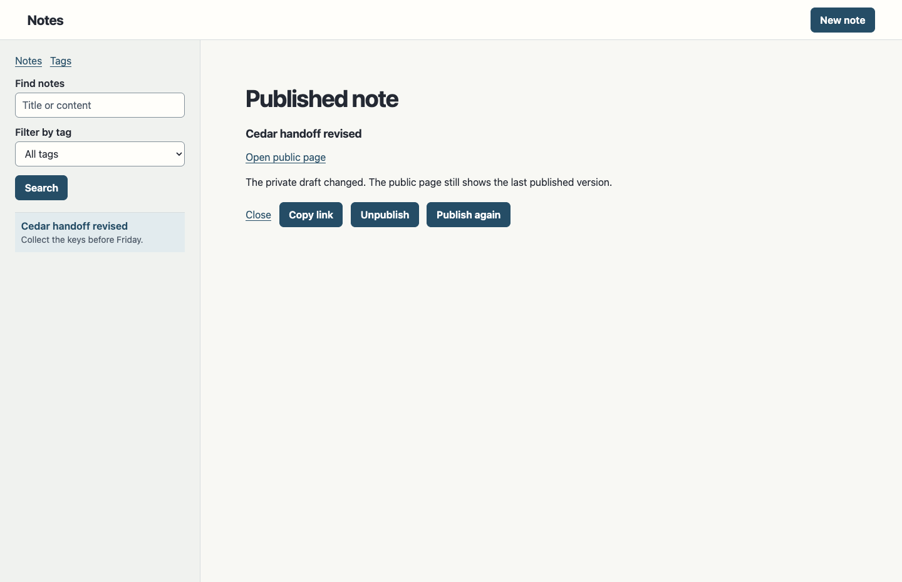
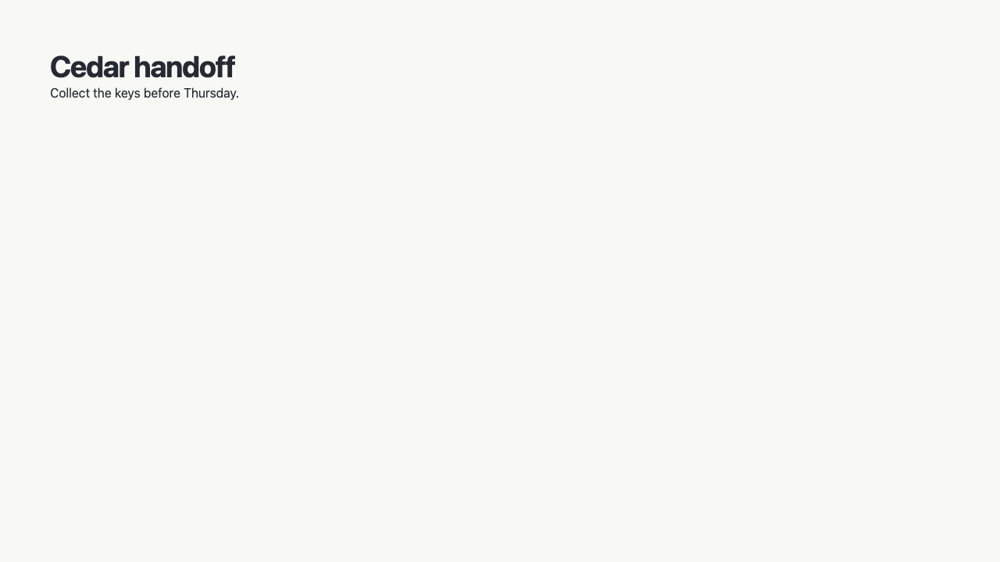
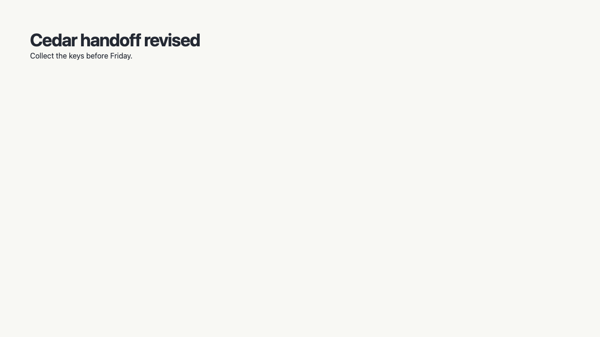
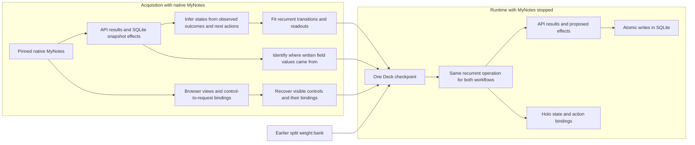
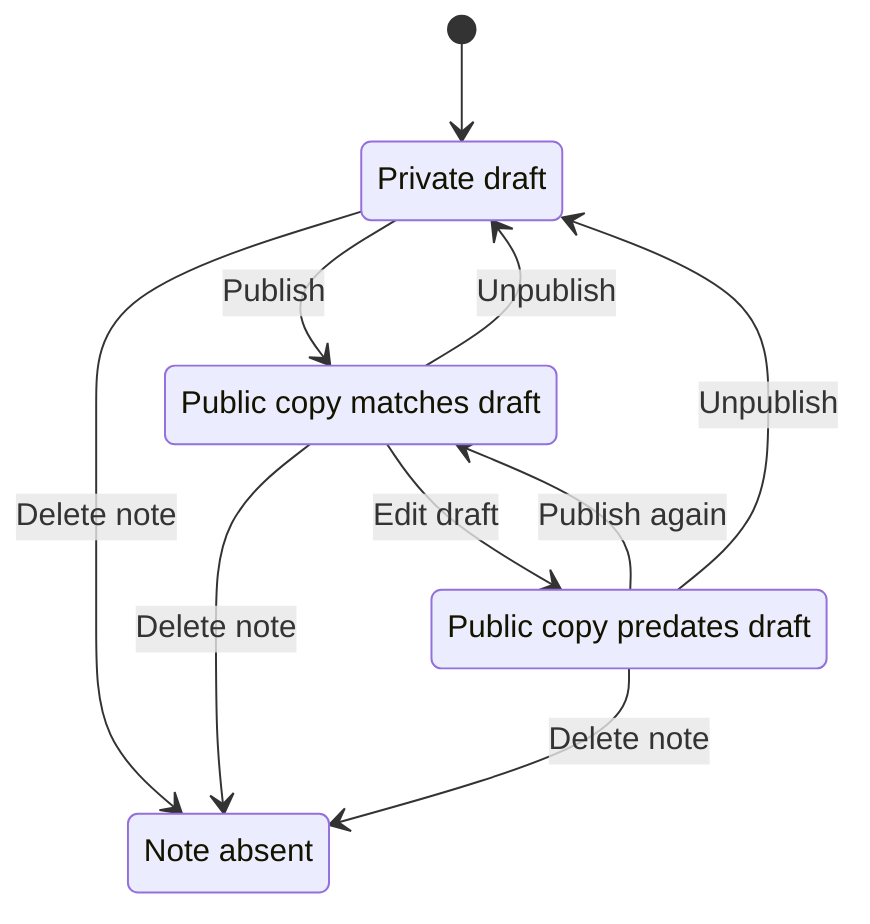
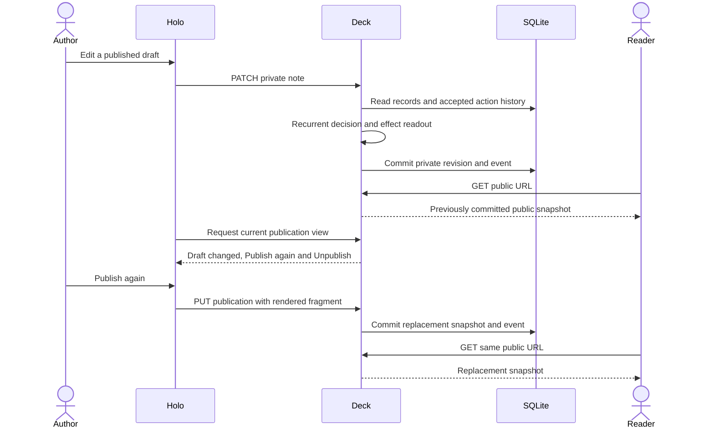

# From application traces to a running Deck

A Deck is meant to run a business and make its capabilities available wherever the work happens. An API call, a button in a Holo and a request from an agent should use the same executable semantics. A Holo can change with the person and task while the rules, data and durable commitments remain coherent. This experiment tests one part of that architecture: can the same recurrent machine acquire a second workflow, discover its states from observations and run it after the original application is switched off? [Vision](article.md) · [Target architecture](architecture.md)

**The result.** One Notes Deck runs two workflows through the same recurrent operation. The earlier experiment learned how to split a note with a supplied state representation. The publication experiment inferred its own four states from native traces and fitted a second weight bank. Its model decisions govern the API, the public page and the actions shown in the Holo. Both banks run in one checkpoint. [Split comparison](../experiments/mynotes/versions/README.md) · [Publication evidence](../experiments/mynotes/publication/evidence/summary.json)

## What a person sees

Publish a note, then edit the private draft. The public link keeps serving the saved copy. The Holo notices that the draft has moved on and offers **Publish again** and **Unpublish**. Republishing updates the public page. Unpublishing removes the page and keeps the private note. These are actual browser captures from the Deck with MyNotes off.

| Working Holo after a private edit | Public page before republishing | Public page after republishing |
| --- | --- | --- |
| [](../experiments/mynotes/publication/evidence/draft-out-of-date.png) | [](../experiments/mynotes/publication/evidence/public-before-republish.png) | [](../experiments/mynotes/publication/evidence/public-after-republish.png) |

The public and private records are separate durable facts. The Holo reflects the model's decision about which actions apply now. It uses the same HTTP endpoints an external client can call. SQLite stores the private record, public snapshot and accepted event history in the Deck's own database.

## How the Deck is made



1. **Capture an action and its consequences.** We exercised four typed actions in 256 native journeys. The recorder kept the response, the private and public reads and the snapshot writes recorded by SQLite triggers. The browser capture paired visible controls with their real requests. [Capture script](../experiments/mynotes/publication/capture.mjs) · [Browser trace](../experiments/mynotes/publication/evidence/browser.json)
2. **Discover which histories have the same behavior.** The learner grouped 341 distinct prefixes by their current observations and the observed consequences of each next action. A state is one of those groups. The observation contract includes response statuses, snapshot effects and whether the private revision still matches the revision that was published. The number and identities of the groups came from the evidence. We checked that the grouping agreed with all training prefixes. [Learner](../experiments/mynotes/publication/learn.py) · [Inferred states](../experiments/mynotes/publication/evidence/fit.json)
3. **Fit weights and bind effects.** The same trainer used for splitting fitted the next-state network and observable readouts. For snapshot writes, the learner matched written values to their origins across native examples. The title came from the private note, the HTML came from the request and the stored timestamp matched the publication receipt. At runtime the generic clock supplies that timestamp. The typed adapter is authored and compiled into the checkpoint. [Shared trainer](../experiments/mynotes/recurrent_fit.py) · [Adapter](../experiments/mynotes/publication/program.js)
4. **Run the artifact.** The recurrent step is $s_{t+1}=\operatorname{argmax}f_\theta(s_t,a_t)$. Its readouts supply the action result, snapshot effect and view state. A typed adapter turns a proposed effect into an operation the generic host can commit. The renderer turns the model's view description into working controls. The application has two weight banks in this run. They use one execution mechanism, with independently fitted parameters. [Runtime kernel](../experiments/mynotes/deck/kernel.mjs) · [Runnable checkpoint](../experiments/mynotes/publication/evidence/checkpoint.json)

### The inferred publication states



The diagram names the four inferred groups for readability. It shows the transitions that explain the browser journey. The full model also handles repeated actions and refusals. The existing note creation capability initializes a fresh history when a slug is reused.

### One interaction through the runtime



## What the experiment demonstrates

| Claim | Evidence |
| --- | --- |
| **The execution mechanism transfers to a second workflow.** | Splitting and publication share the recurrent runtime and trainer. Publication inferred its state representation from native observations. The deployed checkpoint contains both weight banks and the browser exercised both. |
| **The learned state has authority over behavior.** | Zeroing only the publication bank's recurrent output changed the result of the same publish sequence. The public URL went from `200` to `404` and the Holo heading changed from **Published note** to **Publish note**. |
| **The contract holds beyond the training sequence length.** | Six reserved native journeys used fresh records and up to 12 actions, compared with four-action training journeys. All 60 mutation results, 60 private reads, 60 public reads and 60 SQLite snapshot comparisons matched after clock normalization. |
| **The application survives a process restart.** | Chrome exercised private edits, republishing, withdrawal, deletion and address reuse across two restarts with MyNotes off. The browser and API read the persisted outcome. |

[Raw reserved traces](../experiments/mynotes/publication/evidence/holdout.json) · [Machine-readable results](../experiments/mynotes/publication/evidence/summary.json)

The tested profile covers publication of simple text notes and escaped paragraph or heading fragments. Common note operations, action vocabulary, observation schema, adapters and the renderer are supplied. The browser and API enter through typed inputs. The target foundation model would also ground free requests and compose capabilities through that same interface. The experiment leaves full MyNotes acquisition, arbitrary application transfer, dense foundation-model execution, complex content, production permissions and operational scale unmeasured.

### Where the contribution sits

The interesting step is that **the same state recovered from native behavior controls a persistent write and the available interactions in a generated surface**. The browser trace tells the Deck what an action looks like and how it is called. The API and database observations tell it what that action does. Wiring them to one executable model prevents a view from becoming a second implementation of the workflow.

Active automata learning provides the idea of distinguishing states by their future behavior. Loom demonstrates execution of an already compiled program inside a looped transformer. DreamCoder offers a way to learn reusable program structures and a prior over them. The proposed Holodeck contribution is the combination we are testing: acquisition from real application evidence, execution against live records and projection through the same learned capability. We have not measured an advantage over running the inferred state machine directly. That is the strongest simple control for this experiment. [Active automata learning](https://proceedings.mlr.press/v21/steffen12a.html) · [Loom](https://arxiv.org/abs/2604.08816) · [DreamCoder](https://arxiv.org/abs/2006.08381)

## How this could scale

The current learner enumerates $4^4$ training sequences. The runtime replays a note's event history and the host loads a full record snapshot for each request. These are deliberate prototype boundaries. A larger Deck needs to change acquisition, composition and execution.

| Scale problem | Proposed change | Decisive check |
| --- | --- | --- |
| **Too many sequences to record** | Let rival hypotheses choose the next query. Find a short suffix or configuration change on which their predicted effects differ. Save the result as a counterexample and refine the state representation. | Qualified workflow coverage at a fixed teacher-call budget, including explicit unresolved cases. |
| **Too many objects and interacting workflows** | Learn small routines over typed objects and compose them through shared references, read sets and effect contracts. Keep identities, amounts and revisions exact. Persist waiting work as versioned continuations. | Hold out whole rule families and cross-workflow compositions. Check interleavings, idempotency, restart and exact durable effects. |
| **Runtime cost grows with data and history** | Use indexed dependency reads and materialize versioned recurrent state with the commit. Retain the event log for recovery and auditing. Cache compiled operations and view structures with fresh bindings to live data. | Compare p95 action latency, cold and warm Holo latency, and throughput at matched correctness. Include crash and replay tests for the materialized state. |
| **A foundation model needs to contribute to the application** | Train the reasoner to ground intent, choose and compose checked capabilities and propose new ones. Supply the same typed semantics to generated Holos, direct APIs and agents. | Compare against a direct automaton, symbolic acquisition and ordinary generated code under the same evidence and budget. Intervene in model decisions and measure the downstream effect. |

For Shopware, the corresponding milestone is an end-to-end standard commerce workflow across shopper and merchant surfaces, with the original switched off and a whole merchant configuration family held out. The capability learned from that evidence should be usable from a new Holo, through the compatibility API and after a restart. Scaling to a full replacement also requires the broader version and edition inventory, permissions, external events and extensions. [Commerce acceptance profile](shopware-absorption.md) · [Learning and controls](learning-application-semantics.md) · [Acceptance roadmap](roadmap.md)

## Reproduce

From the repository root with Node 24, Python 3, curl, Playwright and Chrome:

```sh
publication=experiments/mynotes/publication
out=$(mktemp -d)
bash "$publication/verify.sh" "$publication/evidence" "$out/proof"
```

This starts the archived checkpoint and reads the held-out native observations from disk. It verifies API, browser, public pages and SQLite, restarts the runtime twice during the browser journey and runs the weight intervention. MyNotes stays off. Expected totals are 60 of each comparison type and three passing browser phases.

To reconstruct the artifact from the archived native traces, unpack `evidence/train.json.gz`, run `learn.py` with PyTorch, and run `build.mjs` with Acorn. To collect new traces, run `build-lab.sh` with the pinned MyNotes binary. Both paths are documented in the [experiment README](../experiments/mynotes/publication/README.md#run-and-verify).
