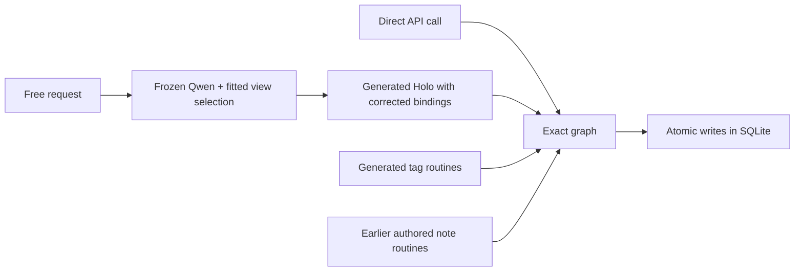

# Where Holodeck stands

The goal is a model that can take over an application and use what it knows to run it, adapt it and present it in new ways. A Deck learns the application's decisions and effects. A Holo is one working projection of that knowledge. The same capability can be reached from a browser control, an API or an agent. The data and commitments of the business stay durable while the experience can change around them. [Vision](article.md) · [Target architecture](architecture.md)

MyNotes is a test of this claim outside commerce. It gives us a small but connected application with documents, relations, mutable state, visible controls and independent API consumers. Shopware is still the commerce test. Its finish line is an ordinary full shop lifecycle and the broader compatibility profile. A second implementation of notes, even one that passes its fixtures, does not by itself show that a system can acquire the next application.

## What the experiments established

All MyNotes comparisons use the pinned native reference at `73ef4b7b37109a5209d9fbcfbd5d3799918071be`. “Teacher off” means that the reference process was stopped during the relevant replay. It describes deployment independence. Acquisition is assessed separately.

| Experiment | Where the behavior came from | Observed result | What the result establishes |
| --- | --- | --- | --- |
| [Conditional title edit](../experiments/mynotes/README.md#earlier-title-edit-probe) | A narrow source pattern was lowered to a Rust parameter circuit. | 25 of 25 agreed on status and durable effects apart from the clock. 23 timestamps matched exactly and two fell in the observed clock interval. A source change altered one selector. | A bounded source behavior can be represented by parameters and can causally determine a write. |
| [Source and revision controls](../experiments/mynotes/README.md) | Original backend code ran as WebAssembly. One arm substituted the revision decision with a compiled parameter circuit. Both used the original browser assets. | Each arm matched 26 HTTP responses and four persisted tables after clock normalization. The browser state survived restart. A changed revision parameter altered a real stored timestamp. | There is an offline portability control, plus a causal test for the exact revision computation. |
| [Standalone Notes Deck](../experiments/mynotes/deck/README.md) | The operations and projection were authored in a parameter graph. Three native traces selected three switches out of eight assignments. | 26 reference HTTP responses and the persisted workspace matched. Chrome completed the workflow with the original and WebAssembly off. One split selector changed both the preview and the rows committed. | One exact capability can govern a new interface and real persistence. The three switches are the measured acquisition scope. |
| [Qwen follow up](../experiments/mynotes/learned/README.md) | Ten native browser captions fitted a small readout over frozen Qwen features. Qwen Coder emitted tag routines and a Holo candidate. The Holo was corrected by hand and note operations came from the preceding graph. | The mixed arm matched 78 of 78 HTTP interactions across three fresh fixture families using the same workflow template. Five reserved intents selected the intended mode. Four intents drove actual browser writes in Cedar, with links, split and restart verified. | The language model can select a working interface and some generated behavior can replace authored routines. The broader business graph is still inherited. |
| [Full Qwen candidate](../experiments/mynotes/learned/evidence/full-candidate.js) | Native trace examples, a restricted language and human feedback guided generation. | The preserved full candidate was rejected during lowering. The first error was a reference to an unbound record in the link routine. Candidate inspection also found missing write effects and incorrect record shapes. | Full acquisition has no passing run. The 78 matches belong to the mixed arm. |
| [Two workspace versions](../experiments/mynotes/versions/README.md) | A source-compiled policy and a recurrent model trained on native behavior used a shared workspace. The state representation was supplied. | Both engines matched 64 of 64 HTTP comparisons in Original and 63 of 63 in Review. Switching model artifacts changed actions, previews and persisted rows from identical starting data. | The exact execution path can be replaced with a trained recurrent mechanism for the measured decision. |
| [Publication and splitting in one Deck](recurrent-workflow-acquisition.md) | The publication state partition came from native observations. The same trainer and recurrent runtime fitted the new bank. Typed adapters and the common note graph were supplied. | Six held-out native journeys matched on 60 mutation results, 60 private reads, 60 public reads and 60 durable snapshot comparisons. Chrome passed across two restarts. An intervention in publication weights changed both public visibility and Holo state. | A second workflow can be acquired without supplying its state space and deployed alongside an earlier workflow. Transfer to a different application remains open. |

The Shopware work demonstrates parts of the same idea in a much larger application. The [joint deck](joint-deck.md) matched 48 journeys in its declared profile and showed a causal effect from changing one shipping output. The [forward comparison](forward-pass.md) matched 36 journeys in each execution arm. The [API inventory](absorption-pipeline.md) describes the small measured subset of routes. Each of those experiments supplies useful behavior and reference material. None establishes that a model acquired the full Shopware system.

## How to inspect and reproduce the Qwen result

1. **Capture.** The teacher produced 208 HTTP interactions across eight training fixtures and seven browser interactions that retain before and after accessibility trees and the accompanying requests. There are 78 additional native interactions across three reserved data fixtures. Their operation sequence comes from the same script. The generator saw selected examples from one training fixture at a time. [Training HTTP](../experiments/mynotes/learned/evidence/traces/training.json) · [Browser observations](../experiments/mynotes/learned/evidence/traces/browser-expanded.json) · [Reserved HTTP](../experiments/mynotes/learned/evidence/traces/holdout.json)
2. **Fit and lower.** Frozen Qwen embedding features and ten manually labelled native captions produce five normalized linear readouts. The generated program text goes through a structural compiler into numeric instruction rows. The runtime consumes those rows through a discrete JavaScript interpreter. They are executable program parameters. This run does not put the note algorithms in the neural layers of Qwen. [Readout fit](../experiments/mynotes/learned/evidence/grounding-report.json) · [Raw Holo candidate](../experiments/mynotes/learned/evidence/holo.raw.txt) · [Qualified Holo](../experiments/mynotes/learned/evidence/holo.qualified.js)
3. **Deploy.** The isolated process receives the generic kernel, renderer, checkpoint, grounding head and a new SQLite database. Local Qwen is called for free text grounding. Typed API calls and already selected views use the numeric graph directly. The handwritten fallback in the qualified run is the earlier graph loaded into the checkpoint, not an executable copy of MyNotes. [Commands and artifact rebuild](../experiments/mynotes/learned/README.md#reproduce)
4. **Compare.** The independent runner compares statuses and bodies after clock normalization and checks the revision headers. Chrome verifies the Cedar workflow and reopening saved records after a full restart. The 78 observations test generalization to fresh data under familiar workflow structure. [Machine-readable results](../experiments/mynotes/learned/evidence/comparison.json) · [Cedar split view](../experiments/mynotes/learned/evidence/cedar-holo.png)

## What needs to change

We optimized too early for a working replacement demo. A handwritten rule can fill any gap in a demo, which makes the result an increasingly poor test of whether an application was learned. A good interface and correct HTTP answers are also compatible with a wrong state transition. The next experiment should start with the full observable transition and build an acquisition method that knows when the evidence is insufficient.

The [learning proposal](learning-application-semantics.md) makes that change concrete. It defines what the model must identify, how the teacher can distinguish rival explanations, and the three comparisons needed to tell a novel architecture from an ordinary generated implementation.
