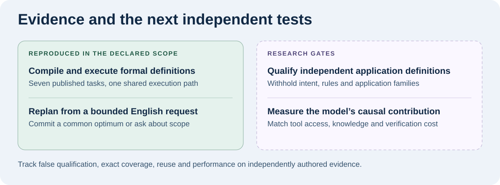

# Holodeck research roadmap

The finish line is a compiler from an independently authored application definition to an executable AI model, with shared Foundation Intelligence, generated streamed interfaces and configurable durable state. The acceptance unit is a **new definition run across the complete architecture**. Existing application replays supply measurements, adversarial cases and reference behavior.

[Architecture and mathematical claims](model-application-architecture.md) · [Protocols and executable experiment](../experiments/model-applications/README.md) · [Literature and its implications](model-application-research.md)

## What would count as solving it

An independent team supplies a definition and observable obligations for a domain that was withheld when the runtime, model architecture and operator basis were frozen. The compiler resolves material ambiguity with concrete counterexamples or records an explicit policy choice. It produces a signed Deck artifact and a machine-checkable certificate for the supported obligations. The released inference system and generic Host execute the artifact. The team can configure the physical data layout, carry open work through migration, and use independently generated streamed Holos, the API and agents against the same state. The accepted workload includes concurrency, delayed effects, failures, restore and a policy revision.

Run the same experiment with a matched coding agent and generic web runtime, a symbolic compiler with generated forms, and the same foundation model operating the same exact semantic engine through external tools. Require comparable correctness, price, latency, evidence and data access. The comparison isolates whether the discovery of reusable abstractions and internal access to exact semantic results do something existing stacks cannot do at the same budget.

## Research stages

| Stage | Work that advances the architecture | Evidence required to advance |
| --- | --- | --- |
| **1 · Semantics across contexts** | Define contextual equality under ordered effects, mutable authority, revisions and restart. Check that replacing a backend and projecting a Holo commute with execution under explicit conditions. Find minimal witnesses that separate an apparent state alias. | Publish a semantics and proof in a proof assistant for the finite kernel. Replay minimal failure witnesses for an overcoarsened state, a lossy adapter, stale actions and reordered external effects. The first executable finite check is in the repository. |
| **2 · Compile definitions and expose missing intent** | Develop a typed language of entities, relations, capabilities, effects, clocks and scoped obligations. Compile it into an independently checked intermediate representation and an exact model execution target. Learn deferred definitions from active witness choices. | Two families designed by separate authors produce runnable decks without application specific runtime code. Test each requirement independently of the generator. Detect and keep open inconsistent and ambiguous contracts. Demonstrate a mechanically checked reduction from a general computation model for the idealized core and document the deployed resource envelope. |
| **3 · Build a complete vertical experiment** | Compile one unfamiliar contract through model execution, actual streaming and a generic Host. Use two independently implemented storage adapters. Interleave model execution, user edits, restart, retries and a single rule change. | One checkpoint serves new HTML or native surfaces and the API, while the same rule change causes the predicted new result everywhere. Run every arm of the integrated experiment. Measure exact end effects, controls, replay and migration, and expose a first divergence for every failed run. |
| **4 · Invent and test Foundation Intelligence** | Compare compiled sparse modules with a shared recurrent model that induces executable modules. Learn typed abstractions with bound variable transport and reusable proof schemas. Train only on families open at the split. | Show a causal advantage from using exact results inside inference over a strong external arm, and separately show transfer of induced abstractions over a matched symbolic library. Establish cost, footprint and what training preserved. |
| **5 · Scale, transfer and reproduce** | Scale by effect topology, identities, state size and concurrent histories. Freeze the architecture and let independent authors submit unseen definitions. Bind diverse qualified backends and new renderers through general interfaces. | Independently reproduce compilation, migration, streaming and exact effects on withheld families. Demonstrate a release and later rule revision without changing the host or renderer. Report how costs grow and the profiles the system can qualify. |

The [vertical development run](../experiments/model-applications/README.md#executable-vertical-development-run) connects bounded contract compilation, exact model execution, streamed controls and live state across two storage implementations. The subsequent [foundation experiments](../experiments/model-applications/foundation/README.md) compare internal and external transfer of exact feasibility evidence and test the separation of language-grounded intent from exact, revision-aware optimization of effect outcomes. An additional [objective discovery pilot](../experiments/model-applications/elicitation/README.md) derives a candidate vocabulary from executable effects, finds provably sufficient calibration questions, and checks a separately authored synthetic holdout. The [external formal-definition qualification](../experiments/model-applications/structural/README.md) now compiles and replays original public planning tasks across three domains. It verifies frozen module reuse and observer-dependent planning compression. The next qualification targets a broader application contract, independently authored natural comparison answers, calibrated intent and an actual advantage versus a matched typed tool stack. Independently authored, withheld definitions remain the acceptance unit. A Stage 3 tie tells us what architecture remains compatible with the evidence. Failure of deep coupling directs Stage 4 toward a stronger learned semantic machine or a more precise claim. It never turns a compatibility replay into evidence for deep coupling. Model training and larger compute runs follow a measured bottleneck in the structural experiments.

## Experimental decisions

- **B1 · Semantics.** Does a single quotient preserve rights, effects, active controls and open work as observers change? The baseline partitions by displayed state. Reject the proposed rule on one distinguishing context that it loses.
- **B2 · Compiler.** Can two unseen contracts compile without family handlers or guessed semantics? Give the competing approaches the same language evidence and declared choices. Score which obligations passed, which remain open, and independent task equivalence.
- **B3 · Coupling.** Does an exact result available within inference change what a model can reason about at fixed budget? Compare equal backbone, actions and result information. Switch one policy cell, sever the internal feedback and intervene on a matched external result. Report the training advantage and the coupling advantage separately.
- **B4 · Streaming and storage.** Can the same semantic transition survive arbitrary layout edits, reconnect and a qualified backend migration? Use revision bound handles, hostile timing, pre/post commit faults and multi-client races. Score effect/receipt parity, usable patch latency and visible-state convergence.
- **B5 · Abstraction discovery.** Does a learned library compose mechanisms across new structural families? Freeze the library and test transfer with renamed entities, novel composition and genuinely new structure as separate cohorts. Charge training and proof work, compare with symbolic compression, and remove or shuffle the library.
- **B6 · Independent challenge.** Have an independent maintainer publish contracts from unfamiliar domains after freeze. Show a second team can build, run and revise a deck from the published artifacts.

The full protocol names budgets, controls, disqualifying outcomes and candidate thresholds. [Experiment protocols](../experiments/model-applications/README.md)

## How work enters the roadmap

Each proposed experiment must name the architectural claim it changes, the strongest simpler explanation, a counterexample that kills the claim and the artifact an independent team can reproduce. Work whose main payoff is route coverage or another domain demo belongs in the supporting evidence unless it exercises a missing architectural operation. The earlier causal acquisition and application acceptance work follows below for reference.

## Earlier validation work

Holodeck aims to replace complete applications with learned, executable decks. The first question is whether the model can acquire a capability and own its effects. The next question is whether a trainable backbone and reusable learned components make acquisition, composition or use better than the strongest simpler implementation. We test both. [Target architecture](architecture.md)

Start with [learning the semantics of an application](learning-application-semantics.md) for the acquisition hypothesis and the matched comparison. [Current results and their limits](research-status.md)

The [recurrent workflow experiment](recurrent-workflow-acquisition.md#how-this-could-scale) connects the latest measured results to a scaling plan for acquisition, workflow composition and runtime.

The [live intent replay](../experiments/model-applications/intent/README.md) adds a prototype from English constraints to revision-bound execution. The next experiment holds out expressions and definitions from independent authors. Compare a grammar, a frozen foundation grounder and a trained grounder with identical compiled semantics. Count omitted meanings and false commits first, then clarification rate and time to a verified decision. Charge each arm for authoring, inference and verification.

The [development scope replay](../experiments/model-applications/intent/scope.md) isolates two failure modes before that independent trial. Exact planning can use several predicted readings when they share an optimum. A request with an unrepresented clause can still authorize a false commit if grounding omits the clause. The next runtime experiment compares a typed confirmation of the whole supported objective against the same model without confirmation. Its held-out definitions must contain valid new clauses, qualifying qualifiers and requests outside the capability. Score unsafe automatic commits and the cost of recovering a verified decision.

## Next experiments

The first research milestone is [causal acquisition and transfer](#causal-acquisition-and-transfer). The existing G0 to G8 gates define acceptance for the relevant mechanisms and product profiles. Transaction and renderer work can progress once the contract is fixed. A larger joint model run depends on a gain over the cheaper matched controls.

| Gate | Build and run | Pass condition and decision |
| --- | --- | --- |
| **G0 · Reproduce and freeze** | Publish the independent Rust experiment. Freeze the operator vocabulary, trace schema, train/test boundary, scoring rules, budgets and baseline versions for G1. | Reproduce the three offline comparisons and verify checkpoint intervention, restart, idempotency and conflict handling. Freeze the next evaluation manifest before generating its hidden cases. The existing run is a bounded mechanism check. |
| **G1 · Identify rules** | Extend the isolated teacher and learner to multiple hidden families of guards and effects. Compare candidate pairs and request distinguishing examples. | On 240 independently generated cases, qualify at least 108 of 120 identifiable cases. There must be zero false qualifications. Forty observationally ambiguous and 80 behaviorally outside-grammar cases must abstain in the declared domain. The outside-grammar cases need a reference witness or a distinguishing probe inside the declared budget. Cases indistinguishable at the allowed interfaces belong to the ambiguity cohort. Count how many cases timeout. |
| **G2 · Learn reusable structure** | Compare a symbolic interpreter with the exact parameter forward on the same synthesized program. Add library induction and a trainable proposal distribution. Run library-only, prior-only, joint and uniform arms. | The execution paths agree on decisions, effects and declared resource behavior. The joint learner reduces median teacher calls by at least 30% at matched qualified coverage, or improves coverage by at least 10 percentage points at the fixed query budget. A paired family-level interval must support an improvement on the declared primary endpoint. If the benefit comes entirely from the symbolic library, record that. |
| **G3 · Scale and resume** | Learn rules over structured objects, variable-length collections, multi-step state, loops and delayed events. Include held-out structures and larger dependency graphs. | Fit and replay families with effective program sizes above 15 nodes. Exact effects and continuations must match on predeclared holdouts, including restart and checkpoint pinning. Report teacher calls, time and memory as curves across sizes. A failure to acquire the larger family within budget stops progression on that capability. |
| **G4 · Compare to ordinary code generation** | Give a pinned LLM the same evidence, active teacher access, verifier, action contracts and budget. Let it generate ordinary executable code in the isolated evaluator. Compare also with a symbolic learner using the same grammar. | Measure qualified coverage, false promotions, teacher calls, compute and time. The Deck must improve a preregistered primary endpoint at matched correctness, cost or query budget. If the controls tie, attribute the demonstrated result to the generic runtime and synthesis method. |
| **G5 · Prove Qwen's contribution** | Compare the trained multimodal model, frozen Qwen with a trained router, a small encoder and shuffled grounding or composition heads. Use equivalent typed actions as the deterministic reference. | On held-out paraphrases, images, documents and novel compositions, the trained arm must improve exact completed tasks by at least 10 percentage points over the strongest matched non-joint arm, with a paired family-level interval excluding zero. A grounding or composition intervention must produce a predicted downstream decision or effect under controlled input. A text quality improvement alone passes only a language claim. |
| **G6 · Replace and transfer** | Learn the Calc and Shopware profiles below. Freeze the host and vocabulary, then let an independent contributor onboard a third application profile through evidence, schemas and model artifacts. | Full requirement coverage for each declared profile, with the corresponding teacher off. Publish identical runtime and primitive hashes for the frozen transfer arms. Publish compatibility exclusions and stop claiming full replacement when a required behavior is open. |
| **G7 · Change rules while work is open** | Exercise deterministic interleavings, optimistic conflicts, crash before commit, crash after commit before reply, duplicate events, outbox retry and revision migration. | Each sequence preserves all declared invariants, produces the expected effects and receipts, and gives every continuation a reproducible version. Faults in the new release leave the previous release and its active work recoverable. |
| **G8 · Make Holos useful** | Generate views for tasks absent from the browser corpus, starting with empty projection storage. Compare with an automatically built form over the same allowed actions. Include changed roles, stale objects and malformed bindings. | Equal action correctness and zero unauthorized effects. Require a preregistered improvement in task completion or task time without increasing errors. Record screen structure and visual fidelity separately from functional and user outcomes. |

These numerical thresholds are proposed design targets. Each executable benchmark pins the cohort seed commitment, sample size, estimand, allowed interfaces, timeout, resource budget and statistical method before opening its final holdout. Run each learned arm over five declared training seeds where training is stochastic. Report individual seeds, paired results and uncertainty. One policy family is one cluster for inferential comparisons. Thousands of input variations of one rule do not count as thousands of independent rule acquisitions.

### How to build the first decisive benchmark

1. **Publish a task envelope.** Each task exposes an authorized snapshot, typed inputs, a reset operation and a deterministic observation contract. The label includes accept/refuse, exact effects, subsequent state and any continuation.
2. **Seal families before fitting.** Split by program topology and rule family as well as by object identity, values and application. Keep generated teacher code, seeds and labels in an independent evaluator. Score direct API events and UI events through the same model. Normalize unstable IDs only through a declared semantic mapping.
3. **Prove what is identifiable.** Record the grammar $G$, domain $D$, evidence $E$ and candidate $h$. Search for a second hypothesis in $G$ that fits $E$ and differs from $h$ on an allowed input in $D$. A satisfiable result produces a teaching question. An unsatisfiable result is a relative certificate if the search is complete for the declared encoding. Timeouts and incomplete search stay unresolved. Prove mandatory invariants separately. The independent hidden evaluator checks teacher parity.
4. **Compare at equal opportunity.** Start G1 with a 64-query cap per case including seed probes. Freeze larger task caps before G3/G4. The enrollment rule also fixes which cases carry a formal specification and which rely on independently recorded behavior. Give all arms the same initial evidence, reset privileges, candidate-validation feedback and time/compute envelopes. Report wall time and teacher calls separately. Count an abstention as unqualified coverage and an incorrect qualification as an error.
5. **Keep the causal tests.** Replay the same checked program in the symbolic and parameter paths. Intervene separately in an exact selector, grounding and composition. Hold runtime, input facts and projection context constant for each relevant intervention. Use a counterfactual expectation fixed before the test. Publish the first divergence and the complete outcome, including held-out cases that did not qualify.

## Causal acquisition and transfer

| Priority | Research question | Decision evidence |
| --- | --- | --- |
| 1 | Can we recover hidden state and causal decomposition in unseen applications? | Reconstruct finite behavior and predict held out dependencies. Compare a flat active automaton learner, a factorized learner and passive traces at equal observation access. |
| 2 | Can the system discover its own executable abstractions? | Freeze typed primitives learned from training worlds. Compare a fixed grammar, an induced library, a learned prior and their combination on an independent topology. Apply G2's prespecified improvement and coverage conditions. |
| 3 | Do path signatures help learn from traces? | Compare path signatures with a sequence encoder and hand constructed features, then ablate each in the same proposal and verification loop. Measure qualified behavior and query cost as well as retrieval accuracy. |
| 4 | Can the same acquisition machinery replace different applications? | Use an independently selected real profile in addition to synthetic families. Hold out all application rules, keep the same Host, and compare with a coding agent, symbolic synthesis and the current Holodeck core. Apply G4 and G6. |
| 5 | Can independently acquired Decks compose safely? | Combine two released Decks in a new workflow. Check state mappings, durable commitments, unauthorized effects and fault interleavings against a declared invariant set. |

Start with generated small applications that contain latent control state, typed records, role dependent guards, delayed events and at least two potentially independent subsystems. Cross these factors during training and seal structurally distinct test families before fitting. The generator builds versions and reset snapshots. The learner gets only declared observation channels and bounded interventions. An independent evaluator owns the reference transition semantics, holdouts and scoring. Source access is a separate arm. A [finite state pilot](../experiments/causal-discovery/README.md) exercises the observation and verification loop on public fixtures.

Publish each world's reachable starting states, admissible action and context domain, conformance bound, timeout and oracle and compute budgets. Publish the hashes of the frozen Host, primitives and holdout commitment. Measure qualified coverage, false qualifications, unauthorized effects, original queries and actions, elapsed time and compute. Count timeouts and abstentions in coverage. Test every mandatory behavior with the original off.

Run the first comparisons on CPU. Use the DGX Spark systems for parallel world generation and learner sweeps once the protocol is frozen. Use the H200s for matched neural proposals and trace encoders after the CPU comparison identifies a measurable bottleneck.

## First delivery and acceptance

### Calc

Use LibreOffice Calc as the first foreign teacher. Declare a profile with multi-sheet references, relative and absolute copy, formula evaluation, dependency invalidation, visible errors, save and restore. Reserve sheet shapes, dependency topologies and combinations of edits. Generate a grid and an error-repair Holo with working interactions. The runtime receives typed workbook data and model artifacts. Evaluate with Calc stopped. [Calc reference and recalculation API](https://api.libreoffice.org/docs/idl/ref/interfacecom_1_1sun_1_1star_1_1sheet_1_1XCalculatable.html)

### Holoshop

Use a pinned Shopware edition and an explicit standard commerce profile. Capture linked Store API, Admin API, browser and persistence observations. The old product mask, shopping journeys and state-transition probes are curriculum and baselines. The full first journey is browse and search, select a variant, cart, price and availability, checkout, receive a test payment event, fulfil in Admin and reopen the resulting order. Include expected refusals, catalog changes and ordinary after-sales actions covered by the selected profile. Reserve whole merchants, tax and pricing combinations, data shapes and permissions.

A customer can open a fresh Holo Storefront and Checkout. A merchant works on the same order in a fresh Holo Admin. Each path binds real capabilities and writes, using one deployed model and one set of durable records. Shopware is stopped for the run. Route compatibility and generated view usability are separate checks. The [Shopware inventory and acceptance design](shopware-absorption.md) describes the domain detail.

### A third application

Use an independent team to choose a profile structurally different from commerce and spreadsheets, such as a document editor with dependency-sensitive operations or an algorithmic tool with strict resource bounds. Record how it was acquired and what external contracts it requires. Compare the same acquisition and runtime machinery. Progress across pure computation, structured state, variable-length workloads, time and concurrency, external effects, and algorithmically demanding software. Report the highest profile actually passed.

[MyNotes](../experiments/mynotes/deck/README.md) now runs the covered note workflow through one exact parameter artifact, including the Holo and its action bindings. The native reference and earlier WebAssembly control remain available for comparison. The next milestone is to acquire complete operations and Holo bindings from mixed traces, measure what the foundation model contributes, and reuse the execution vocabulary on a second application. The proof should include unfamiliar request families, data and view arrangements.

### Operational measurement

Once a profile passes, compare cold first Holo, warm action, time to commit, steady-state throughput and resource use on the same hardware against its native reference and code-generation arm. Report p50, p95 and p99 plus timeout and failure rates. The first provisional targets are p95 below 10 ms for a small warmed local model action excluding network/render and below 400 ms to first useful Holo content on the declared workstation. Performance is measured only under an explicit workload, concurrency and correctness contract.

[Architecture](architecture.md) · [Independent review](architecture-review.md) · [First measured core](../experiments/model-core/README.md) · [Earlier commerce work breakdown](https://github.com/sthamann/holodeck/blob/b572b93/docs/roadmap.md)
