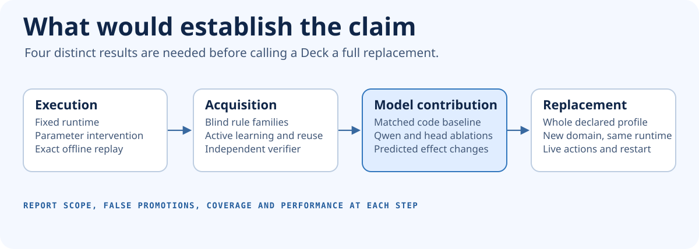

# Experiments and acceptance

Holodeck aims to replace complete applications with learned, executable decks. The first question is whether the model can acquire a capability and own its effects. The next question is whether a trainable backbone and reusable learned components make acquisition, composition or use better than the strongest simpler implementation. We test both. [Target architecture](architecture.md)

Start with [learning the semantics of an application](learning-application-semantics.md) for the acquisition hypothesis and the matched comparison. [Current results and their limits](research-status.md)

## Next experiments

Run the gates in order of dependency. Transaction and renderer work can progress once the contract is fixed. The larger joint model run depends on a decisive result from the inexpensive learning and baseline comparisons.

| Gate | Build and run | Pass condition and decision |
| --- | --- | --- |
| **G0 · Reproduce and freeze** | Publish the independent Rust experiment. Freeze the operator vocabulary, trace schema, train/test boundary, scoring rules, budgets and baseline versions for G1. | Reproduce the three offline comparisons and verify checkpoint intervention, restart, idempotency and conflict handling. Freeze the next evaluation manifest before generating its hidden cases. The existing run is a bounded mechanism check. |
| **G1 · Identify rules** | Extend the isolated teacher and learner to multiple hidden families of guards and effects. Compare candidate pairs and request distinguishing examples. | On 240 independently generated cases, qualify at least 108 of 120 identifiable cases. There must be zero false qualifications. Forty observationally ambiguous and 80 behaviorally outside-grammar cases must abstain in the declared domain. The outside-grammar cases need a reference witness or a distinguishing probe inside the declared budget. Cases indistinguishable at the allowed interfaces belong to the ambiguity cohort. Count how many cases timeout. |
| **G2 · Learn reusable structure** | Compare a symbolic interpreter with the exact parameter forward on the same synthesized program. Add library induction and a trainable proposal distribution. Run library-only, prior-only, joint and uniform arms. | The execution paths agree on decisions, effects and declared resource behavior. The joint learner reduces median teacher calls by at least 30% at matched qualified coverage, or improves coverage by at least 10 percentage points at the fixed query budget. A paired family-level interval must support an improvement on the declared primary endpoint. If the benefit comes entirely from the symbolic library, record that. |
| **G3 · Scale and resume** | Learn rules over structured objects, variable-length collections, multi-step state, loops and delayed events. Include held-out structures and larger dependency graphs. | Fit and replay families with effective program sizes above 15 nodes. Exact effects and continuations must match on predeclared holdouts, including restart and checkpoint pinning. Report teacher calls, time and memory as curves across sizes. A failure to acquire the larger family within budget stops progression on that capability. |
| **G4 · Compare to ordinary code generation** | Give a pinned LLM the same evidence, active teacher access, verifier, action contracts and budget. Let it generate ordinary executable code in the isolated evaluator. Compare also with a symbolic learner using the same grammar. | Measure qualified coverage, false promotions, teacher calls, compute and time. The Deck must improve a preregistered primary endpoint at matched correctness, cost or query budget. If the controls tie, attribute the demonstrated result to the generic runtime and synthesis method. |
| **G5 · Prove Qwen's contribution** | Compare the trained multimodal model, frozen Qwen with a trained router, a small encoder and shuffled grounding or composition heads. Use equivalent typed actions as the deterministic reference. | On held-out paraphrases, images, documents and novel compositions, the trained arm must improve exact completed tasks by at least 10 percentage points over the strongest matched non-joint arm, with a paired family-level interval excluding zero. A grounding or composition intervention must produce a predicted downstream decision or effect under controlled input. A text quality improvement alone passes only a language claim. |
| **G6 · Replace and transfer** | Learn the Calc and Shopware profiles below. Freeze the host and vocabulary, then let an independent contributor onboard a third application profile through evidence, schemas and model artifacts. | Full requirement coverage for each declared profile, with the corresponding teacher off. Publish identical runtime and primitive hashes for the frozen transfer arms. Publish compatibility exclusions and stop claiming full replacement when a required behavior is open. |
| **G7 · Change rules while work is open** | Exercise deterministic interleavings, optimistic conflicts, crash before commit, crash after commit before reply, duplicate events, outbox retry and revision migration. | Each sequence preserves all declared invariants, produces the expected effects and receipts, and gives every continuation a reproducible version. Faults in the new release leave the previous release and its active work recoverable. |
| **G8 · Make Holos useful** | Generate views for tasks absent from the browser corpus, starting with empty projection storage. Compare with an automatically built form over the same allowed actions. Include changed roles, stale objects and malformed bindings. | Equal action correctness and zero unauthorized effects. Require a preregistered improvement in task completion or task time without increasing errors. Record screen structure and visual fidelity separately from functional and user outcomes. |

These numerical thresholds are proposed design targets. Each executable benchmark pins the cohort seed commitment, sample size, estimand, allowed interfaces, timeout, resource budget and statistical method before opening its final holdout. Run each learned arm over five declared training seeds where training is stochastic. Report individual seeds, paired results and uncertainty. One policy family is one cluster for inferential comparisons. Thousands of input variations of one rule do not count as thousands of independent rule acquisitions.

### How to build the first decisive benchmark

1. **Publish a task envelope.** Each task exposes an authorized snapshot, typed inputs, a reset operation and a deterministic observation contract. The label includes accept/refuse, exact effects, subsequent state and any continuation.
2. **Seal families before fitting.** Split by program topology and rule family as well as by object identity, values and application. Keep generated teacher code, seeds and labels in an independent evaluator. Score direct API events and UI events through the same model. Normalize unstable IDs only through a declared semantic mapping.
3. **Prove what is identifiable.** Record the grammar $G$, domain $D$, evidence $E$ and candidate $h$. Search for a second hypothesis in $G$ that fits $E$ and differs from $h$ on an allowed input in $D$. A satisfiable result produces a teaching question. An unsatisfiable result is a relative certificate if the search is complete for the declared encoding. Timeouts and incomplete search stay unresolved. Prove mandatory invariants separately. The independent hidden evaluator checks teacher parity.
4. **Compare at equal opportunity.** Start G1 with a 64-query cap per case including seed probes. Freeze larger task caps before G3/G4. The enrollment rule also fixes which cases carry a formal specification and which rely on independently recorded behavior. Give all arms the same initial evidence, reset privileges, candidate-validation feedback and time/compute envelopes. Report wall time and teacher calls separately. Count an abstention as unqualified coverage and an incorrect qualification as an error.
5. **Keep the causal tests.** Replay the same checked program in the symbolic and parameter paths. Intervene separately in an exact selector, grounding and composition. Hold runtime, input facts and projection context constant for each relevant intervention. Use a counterfactual expectation fixed before the test. Publish the first divergence and the complete outcome, including held-out cases that did not qualify.

## First delivery and acceptance

### Calc

Use LibreOffice Calc as the first foreign teacher. Declare a profile with multi-sheet references, relative and absolute copy, formula evaluation, dependency invalidation, visible errors, save and restore. Reserve sheet shapes, dependency topologies and combinations of edits. Generate a grid and an error-repair Holo with working interactions. The runtime receives typed workbook data and model artifacts. Evaluate with Calc stopped. [Calc reference and recalculation API](https://api.libreoffice.org/docs/idl/ref/interfacecom_1_1sun_1_1star_1_1sheet_1_1XCalculatable.html)

### Holoshop

Use a pinned Shopware edition and an explicit standard commerce profile. Capture linked Store API, Admin API, browser and persistence observations. The old product mask, shopping journeys and state-transition probes are curriculum and baselines. The full first journey is browse and search, select a variant, cart, price and availability, checkout, receive a test payment event, fulfil in Admin and reopen the resulting order. Include expected refusals, catalog changes and ordinary after-sales actions covered by the selected profile. Reserve whole merchants, tax and pricing combinations, data shapes and permissions.

A customer can open a fresh Holo Storefront and Checkout. A merchant works on the same order in a fresh Holo Admin. Each path binds real capabilities and writes, using one deployed model and one set of durable records. Shopware is stopped for the run. Route compatibility and generated view usability are separate checks. The [Shopware inventory and acceptance design](shopware-absorption.md) describes the domain detail.

### A third application

Use an independent team to choose a profile structurally different from commerce and spreadsheets, such as a document editor with dependency-sensitive operations or an algorithmic tool with strict resource bounds. Record how it was acquired and what external contracts it requires. Compare the same acquisition and runtime machinery. Progress across pure computation, structured state, variable-length workloads, time and concurrency, external effects, and algorithmically demanding software. Report the highest profile actually passed.

[MyNotes](../experiments/mynotes/deck/README.md) now runs the covered note workflow through one exact parameter artifact, including the Holo and its action bindings. The native reference and earlier WebAssembly control remain available for comparison. The next milestone is to acquire complete operations and Holo bindings from mixed traces, measure what the foundation model contributes, and reuse the execution vocabulary on a second application. The proof should include unfamiliar request families, data and view arrangements.

### Operational measurement

Once a profile passes, compare cold first Holo, warm action, time to commit, steady-state throughput and resource use on the same hardware against its native reference and code-generation arm. Report p50, p95 and p99 plus timeout and failure rates. The first provisional targets are p95 below 10 ms for a small warmed local model action excluding network/render and below 400 ms to first useful Holo content on the declared workstation. Performance is measured only under an explicit workload, concurrency and correctness contract.

[Architecture](architecture.md) · [Independent review](architecture-review.md) · [First measured core](../experiments/model-core/README.md) · [Earlier commerce work breakdown](https://github.com/sthamann/holodeck/blob/b572b93/docs/roadmap.md)
