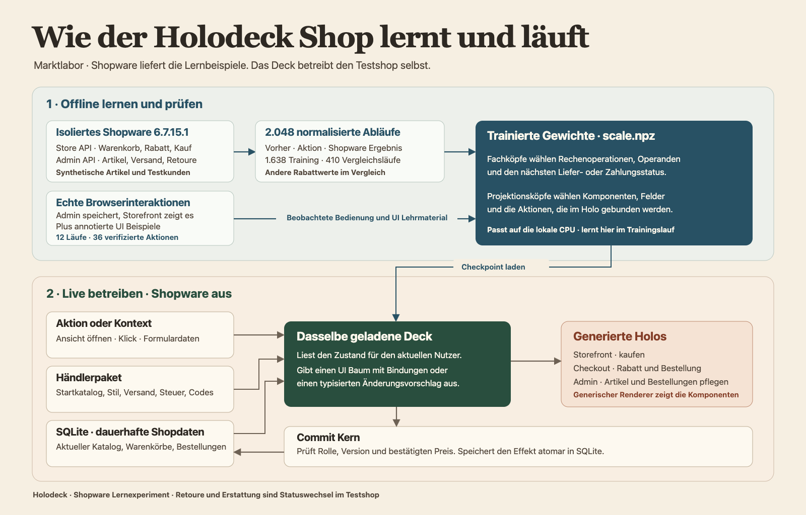

# Learn a shop from Shopware at scale

Marktlabor runs the same deck through catalog maintenance, checkout, fulfilment and return status updates. Shopware supplies the reference transitions during capture. The local Marktlabor demo runs with the Shopware container stopped.



## Sources and what they teach

| Input | Use |
| --- | --- |
| 2,048 journeys through the Shopware 6.7.15.1 Store API and Admin API | Admin changes the name, gross price and stock and reads them back. Store API adds an item, tests a promotion and places an order. Admin records payment, shipment, a full or partial return and a full or partial refund status. The recorder keeps before and after values, line totals, refusal signals and stock. |
| 12 native browser journeys with 36 verified interactions | Shopware Admin saves an edit and the native storefront displays it, adds the item to its cart and applies a code. These observations ground the catalog editor and promotion form. The component tree and typed data bindings are annotated supervision. |
| 24 additional Store API quantity changes | Cover increases, decreases and closeout stock caps. Eighteen observations refit the existing quantity head, and six are held out. |
| Prior Shopware observations and projection lessons | Preserve the earlier commerce capabilities and controls. They are listed separately from the new corpus. |
| 410 held-out journeys and 64 independent two-line baskets | Full replay compares exact amounts, discount, line quantities, taxes, stock and return/payment states. The new accepted coupon values in the 410 journeys are disjoint from training values. The 64 extra baskets use a different shipping price and include full discounts on cent-priced items. |

Capture executes real Shopware code on synthetic products and guests. The 2,048 journeys are API traces. The native browser observations form a separate, smaller set. The traces store normalized observations and omit credentials and customer identifiers. The main corpus contains 1,638 training rows and 410 held-out rows. A held-out journey replays the preceding Marktlabor writes into each next step. It uses the Shopware result only for comparison.

## Recorded results with the teacher stopped

- All 410 held-out journeys matched. The recorded set includes 55 rejected codes and 115 partial return sequences.
- All 64 additional two-line carts and all six reserved quantity edits matched the recorded Shopware amounts or quantities. The quantity test covers requests above the live stock cap.
- A local browser run edited a catalog item to €50, increased its cart quantity to two and placed a test order for €89.25 after a €17 discount and €6.25 shipping. The admin used the model's generated actions to mark the same order shipped, partially returned and partially refunded. SQLite retained the final states and ten remaining units.
- Changing only the trained percentage head changes the checkout amounts with the same runtime and merchant package. Refitting from the same corpus reproduced the published checkpoint byte for byte on the same local environment.

## What runs after training

`scale.npz` carries trained choices for the supplied catalog fields, quantity changes, coupon acceptance, percentage and capped fixed discounts, the discount tax and amount deltas, and the applicable state transitions. Its projection heads emit a typed component tree with field and action bindings. The heads are compact PyTorch models exported for local NumPy inference. The existing exact integer instruction set handles the cent arithmetic.

The merchant package holds the starting catalog, presentation tokens, configured promotion codes, shipping and a uniform gross tax rate. SQLite holds the current catalog, shopper carts and orders. The host still declares the domain schema, builds the current actor's typed context, dispatches named events, wires model outputs to write effects and enforces roles, version checks and atomic commits. The browser renders generic components. An authorized catalog edit is visible in the buyer's next projection because both views read the same records.

The experiment covers one active code per cart at a time, either percentage or fixed amount. The capture uses uniform 7% or 19% gross tax per basket. Return and refund actions are status transitions in the observed Shopware configuration. No parcel intake or money transfer is recorded. In the reference traces, stock remains unchanged after return status updates. Marktlabor uses a test payment handler.

## Run Marktlabor

Use Python 3.11 or later and install `requirements.txt`.

```sh
PYTHONPATH=src python -m holodeck.server \
  --port 18782 --checkpoint src/holodeck/scale.npz \
  --merchant src/holodeck/marktlabor.json --database .holodeck/marktlabor-scale.sqlite
```

Open the [storefront](http://127.0.0.1:18782/) or the [catalog in Admin](http://127.0.0.1:18782/?task=admin&intent=catalog). The local admin passphrase is `deck-demo`. Use `LAB17` for 17% or `LAB625` for €6.25. Checkout uses test data only.

```sh
PYTHONPATH=src python -m unittest discover -s tests -p test_scale_shop.py
```

To refit on the checked-in data, install `requirements-training.txt` as well.

```sh
PYTHONPATH=src python experiments/shopware/scale/train.py \
  --trace experiments/shopware/scale/journeys.jsonl.gz --output /tmp/holodeck-scale.npz
```

To capture fresh data, point the scripts at a clean, disposable Shopware 6.7.15.1 instance. They change records and create real test orders. The Store API and Admin API recorder creates its own sales channel and fixtures. The browser fixture binds its own sales channel to the loopback domain.

```sh
export HOLODECK_TEACHER_URL=http://127.0.0.1:51438
python experiments/shopware/scale/capture.py --count 2048 --workers 12 \
  --output /tmp/holodeck-journeys.jsonl --resume
python experiments/shopware/scale/capture_baskets.py --output /tmp/holodeck-baskets.jsonl
python experiments/shopware/scale/capture_baskets.py --rounding --output /tmp/holodeck-rounding.jsonl
python experiments/shopware/scale/capture_quantities.py --output /tmp/holodeck-quantities.jsonl
python experiments/shopware/scale/browser_fixture.py /tmp/holodeck-browser-fixture.json
node experiments/shopware/scale/capture_ui.cjs /tmp/holodeck-browser-fixture.json \
  /tmp/holodeck-browser-observations.jsonl 12
```

The browser recorder needs Playwright and Chromium. Set `HOLODECK_PLAYWRIGHT` to an installed Playwright module and `HOLODECK_CHROME` to a Chromium executable if they are supplied separately. Stop the teacher before starting the independent demo and replay. For a fresh archived corpus, sort the lines by the numeric `case` field before compression so the archive is independent of worker completion order.
