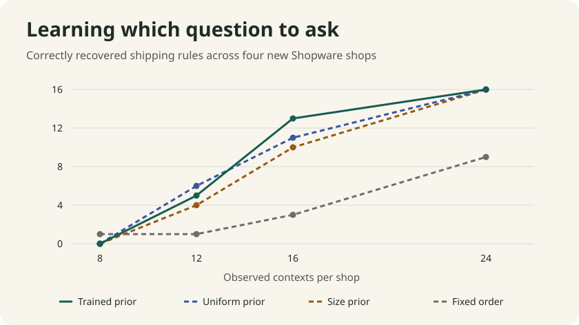

# Learn the structure of a shipping rule

The deck sees what Shopware offers when the shopper changes country, customer group, basket value or weight. It reconstructs the conditions that decide whether a shipping method is available, then fits the price tiers from observed checkout quotes. The recovered program supplies both the checkout choices and the price written into the order.



## Teacher and experiment

Shopware 6.7.15.1 supplies four training shops with 24 native shipping methods and four independent test shops with 20. The driver configures actual Rule Builder conditions and shipping price matrices. It logs into synthetic retail and trade accounts, resets the cart and selected method, adds a product and records which methods the Store API offers. It selects one available method to read the cart's shipping cost and total. The teacher uses cent rounding so that the comparisons around €60 and €90 preserve the intended input. [Shipping method route](https://github.com/shopware/shopware/blob/v6.7.15.1/src/Core/Checkout/Shipping/SalesChannel/ShippingMethodRoute.php) · [Delivery calculator](https://github.com/shopware/shopware/blob/v6.7.15.1/src/Core/Checkout/Cart/Delivery/DeliveryCalculator.php)

The learner has a fixed vocabulary of fields, candidate thresholds and AND and OR. It can compose 2,196 distinct behaviors across the observation grid. Each field can appear once in a candidate. The training process fits 45 weights over structural features such as the root connective and grouped fields. The trained prior changes which question the learner asks. Each new method's observations determine its executable tree. For prices, the learner checks whether two observed prices are uniquely separated by a threshold on amount or weight. The candidate family assumes a single price matrix shared by the methods within one shop.

The prior was frozen before recording the four test shops. Each test shop contributes 36 selectable contexts and 36 independent contexts with different amounts and weights. Acquisition receives only the support archive and reveals one context per query. A context exposes all of that shop's method availability and at most one quote. The counter counts revealed contexts. The native capture records the whole pool up front, so these are sample efficiency results and do not measure live network savings.

Sixteen test methods fit the family and are behaviorally distinct from all training methods on the support grid. Four of those use structural templates absent from training. Four other test methods use repeated fields and are deliberately outside the family.

## Recovered rules on four new shops

The first three arms ask questions by expected information gain and differ in how they weight the candidates. The fourth sees a fixed shuffled schedule. All receive the same input and use the same exact rule fitter.

| Observed contexts per shop | Trained prior | Uniform prior | Shorter trees first | Fixed schedule |
| ---: | ---: | ---: | ---: | ---: |
| 8 | 0/16 | 0/16 | 0/16 | 1/16 |
| 12 | 5/16 | 6/16 | 4/16 | 1/16 |
| 16 | 13/16 | 11/16 | 10/16 | 3/16 |
| 24 | 16/16 | 16/16 | 16/16 | 9/16 |

At 16 contexts the trained prior leads by two rules over uniform and three over the size prior. At 12 the uniform prior leads, and at 24 the three targeted arms converge. Across 16 fixed orders, the median is three of 16 at the 16 context budget. The comparison is descriptive and reflects the four test shops and the authored rule distribution.

Price recovery and eligibility are scored separately. At 16 contexts all three targeted arms have a tier model for each shop. They reproduce 98, 69 and 87 of 139 independent native quotes respectively, including the effect of withheld methods in the denominator.

## What happened at checkout

At eight contexts the learned prior can leave a single in-family program for one incompatible rule. In one held-out cart it offers a method Shopware excludes. The candidate even produces a valid Joint Deck checkout program for that method. The independent native parity comparison catches the error. Agreement with all observations seen so far is too weak as a promotion criterion.

After 24 contexts all three targeted arms contradict all four incompatible methods and withhold them. With Shopware stopped, each arm checks the **144 independent option sets** for the 16 supported methods. Each rejects a method that Shopware excluded in each of the four shops. The learned shipping program reads the persisted cart lines, subtotal, country and customer group and supplies the selected shipping amount to the joint commerce program.

Per arm, **107 local orders** match the native shipping method, shipping price and total after reopening SQLite. Twelve of those have independently persisted Shopware orders for direct comparison. Four more native orders and 28 cases with only a quote use methods the model withheld. This experiment exercises the shared model and transaction path. Its projection output is a typed set of choices, and the harness calls the checkout runtime directly.

Claude Fable 5.2 reviewed the measurement and code. It identified that quote coverage changes with query order, and that comparing two outputs of the same program can miss an incorrect offer. The final replay reports eligibility and price separately, compares the entire offer set against the native API, and tests rejection of a native-unavailable method in every shop. The early incorrect checkout remains a regression case.

The 45 weights encode how to search for a rule. The concrete rules and price tiers live in recovered executable programs. Qwen and the existing sparse commerce selectors were held fixed.

## Reproduce with Shopware stopped

Install the repository requirements and MLX 0.32.4. Use `mlx` on Apple Silicon or `mlx[cpu]` on Linux. Run from the repository root. [MLX installation](https://ml-explore.github.io/mlx/build/html/install.html#python-installation)

```sh
data=experiments/shopware/evidence/shipping-rules
bench=experiments/shopware/benchmark
checkpoint=experiments/shopware/evidence/joint-deck/checkpoint
out=$(mktemp -d)
python "$bench/shipping_evaluate.py" "$data" "$checkpoint" "$out/eval"
cmp "$data/summary.json" "$out/eval/report.json"
```

For fresh captures use a disposable loopback Shopware 6.7.15.1 teacher and set `HOLODECK_TEACHER_URL`. Capture training, fit and save the prior, then record the test shops and freeze the acquisition output. Stop Shopware for the replay.

```sh
fresh=$(mktemp -d)
python "$bench/capture_shipping_rules.py" train "$fresh/train.jsonl"
python "$bench/shipping_rules.py" fit "$fresh/train.jsonl" "$fresh/prior.json"
python "$bench/capture_shipping_rules.py" test "$fresh/support.jsonl" --holdout "$fresh/holdout.jsonl"
python "$bench/shipping_rules.py" acquire "$fresh/support.jsonl" "$fresh/programs.json" --prior "$fresh/prior.json"
```
