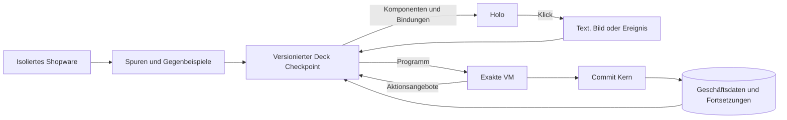

# Wie ein Deck Shopware lernt

Der [aktuelle gemeinsame Checkpoint](joint-deck.md) verbindet Commerce, Workflow und Oberfläche. Die öffentliche Auswertung enthält die eingefrorenen Gewichte, synthetische Referenzverläufe und einen Kontrollversuch mit geändertem Modellausgang. Dieser Plan definiert, wie daraus eine vollständige Profilprüfung wird.

Stand 10. November 2026. Das Ziel ist der vollständige Ersatz von Shopware für ein ausgewiesenes Produktprofil. Ein multimodales Deck trägt die Shopware Geschäftssemantik in seinen gelernten Parametern und erzeugt die fachlichen Entscheidungen, Abläufe und Oberflächen für jeden Händler. Der feste Kern führt die daraus erzeugten Programme aus und sichert die Transaktionen. Die bisherigen Ergebnisse messen Teilfähigkeiten. Der folgende Prüfplan entscheidet über die Architektur, bevor aus den bestandenen Fähigkeiten eine Demo entsteht.

## Entscheidung nach dem Review mit Claude Fable 5.2

Fable empfiehlt als ersten Schritt eine lernbare Programmsuche über einer kleinen getypten VM. Ein Suchverfahren ohne Modell und ein kleiner trainierter Controller liefern die Referenzen. Das große multimodale Backbone muss seinen Beitrag später separat zeigen. Der stärkste Einwand aus dem Review ist praktisch. Ein Port der offenen Shopware Logik ist eine ernsthafte Alternative, wenn wir für neue Händler und Regelkombinationen durch Lernen keine schnellere oder breitere Übernahme erreichen.

Wir unterscheiden zwei Leistungsnachweise. **Gelerntes Erwerben** bedeutet, dass die Gewichte aus Spuren und Konfiguration ein ausführbares Programm ableiten und dies mit weniger Orakelabfragen oder für mehr neue Konfigurationen schaffen. **Gelernte Entscheidung im Betrieb** bedeutet, dass die Gewichte bei einem neuen, realen Vorgang tatsächlich den ausgeführten Graphen bestimmen. Ein vollständig zwischengespeicherter Pfad kann den ersten Nachweis tragen. Für den zweiten braucht es einen Lauf, bei dem die Änderung der Gewichte bei gleichem Programmvorrat und gleicher Laufzeit die Auswahl kausal verändert.

In der Gegenfrage hat Fable diesen Laufzeitpfad unter Bedingungen bejaht. Der Controller muss anhand von relevanten Fakten zwischen mehreren technisch zulässigen Programmen wählen können. Für Fälle, in denen die Prüfung nur ein Programm übrig lässt, gibt es keinen solchen Nachweis. Die Ausführungsprüfung garantiert ausgewiesene technische Eigenschaften. Fachliche Übereinstimmung mit Shopware wird separat gemessen. Der Controller kann die passende Semantik aus klarer Konfiguration ableiten, aber er kann aus einer mehrdeutigen Konfiguration keine verbindliche Absicht erfinden.

Die im Review erwähnten 410 Verläufe waren deterministisch aufgeteilt und enthielten bisher ungesehene Rabattwerte. Sie stammen aus derselben engen Szenariofamilie. Das nächste Experiment reserviert ganze Händler, unabhängige Konfigurationen und die Kombination mehrerer Regeln. [Messbereich des bisherigen Versuchs](scaled-shopware-learning.md)

## Ausgangspunkt

Marktlabor hat 2.048 Abläufe mit Shopware Community Edition 6.7.15.1 aufgezeichnet. Die gelernten Rechenköpfe und Statusentscheidungen bestanden 410 zurückgehaltene Abläufe innerhalb des untersuchten Profils. Der Host hat die Aktionen ausgewählt, die Eingaben der Köpfe zusammengestellt und aus ihren Ausgaben die Schreibvorgänge gebaut. Die 410 Fälle belegen damit die Entscheidungen innerhalb dieser Schablonen. Sie belegen noch nicht, dass das Modell die Schablonen selbst gelernt hat. Nordlager verwendet Qwen für Text zu JSON. Marktlabor und Nordlager teilen mit Qwen bisher keine trainierten Aktivierungen. [Marktlabor](scaled-shopware-learning.md) · [Nordlager](native-shopware-workspace.md)

Das Deck soll in einem vollständigen Standardshop lernen, **welche Fakten es braucht, wann eine Handlung zulässig ist, welche Berechnung gilt, welche Datensätze sich gemeinsam ändern und wie der Vorgang weitergeht**. Dieselbe Entscheidung liefert die ausführbaren Aktionen für Storefront, Checkout und Admin. Der Lehrer ist nur bei der Aufnahme und beim Vergleich beteiligt.

## 1. Die ausführbare Einheit

Ein versioniertes Deck besteht aus einem multimodalen Backbone, einem Encoder für typisierte Geschäftsobjekte und gelernten Köpfen. Ein Kopf kann ein kleines neuronales Netz sein, das die nächste Instruktion, ihre Operanden oder einen Teilgraphen auswählt. Zuerst gibt es einen gemeinsamen Kopf für Geschäftsentscheidungen und einen Kopf für Projektionen. Aufteilung in weitere Spezialisten folgt einem nachgewiesenen Fehlerbild.

```text
Deck.step(
  actor, observation_or_event, allowed_snapshot, continuation, merchant_configuration
) → program, offers, holo, evidence

VM.evaluate(program, allowed_snapshot)
  → effect_plan | need_data | refused

Commit.apply(effect_plan, read_versions, command_id)
  → receipt | conflict
```



Die Eingabe enthält eine versionierte Sicht auf Objekte wie Produktvarianten, Warenkörbe, Bestellungen, Zahlungen und vereinbarte Konditionen. Das Modell erhält eine Darstellung dieser Objekte und stabile Zeiger auf die exakten Werte. Ein in Cent gespeicherter Preis bleibt ein typisierter Wert mit Währung. Ein Bestellereignis wird als Eingabe bezeichnet. Der Host ruft dazu keinen versteckten Checkout Handler auf.

Die Programmausgabe ist ein getypter, endlicher Datenflussgraph mit überprüfbaren Leseabhängigkeiten. Ein erster Befehlssatz enthält Vergleiche, Dezimalrechnung und explizite Rundung, logische Operationen, begrenzte Mengenoperationen, lesende Zeiger, Verzweigungen und generische Schreibvorschläge. Ein Programm kann einen Datensatz erzeugen, Werte ändern und ein nächstes erwartetes Ereignis oder eine Frist festhalten. Externe Aktionen erscheinen als deklarierte Vorschläge für die Outbox. Berechnungen haben Budgetgrenzen für Knoten, Iterationen und gelesene Objekte. Das Deck kann fehlende Daten gezielt nachfordern oder mit einer eindeutigen Ablehnung enden. Entitäten und Felder gehören zum Schema. Befehle wie `applyPromotion`, `transitionShopwareOrder` oder `calculateTax` würden die gerade zu lernende Semantik in den Executor verschieben.

| Komponente | Zuständigkeit |
| --- | --- |
| Gemeinsame Modellrepräsentation | Verbindet Text, Bild, Ereignis, Geschäftsobjekte und ihre Beziehungen. Der Geschäfts- und Projektionskopf können daraus dieselben referenzierten Objekte lesen. |
| Trainierbarer Geschäftskopf | Wählt die relevanten Fakten, Operatoren, Geschäftsbedingungen, Schreibziele und Fortsetzungen. Ein dekodierter Graph ist versioniert, lesbar und mit seinen Ursprungsgewichten verknüpft. |
| Generischer VM Executor | Typen, Ressourcenbudget, exakte Rechenoperationen, Auswertung des Graphen ohne externe Effekte. |
| Commit Kern | Rollen und Mandantengrenzen unabhängig prüfen, gelesene Versionen bestätigen und Änderungen, Fortsetzung, Quittung und Outbox atomar speichern. |
| I/O und Renderer | Eingaben normalisieren, erlaubte Komponenten darstellen, Ereignisse an denselben Einstieg übergeben und externe Effektquittungen einspielen. |

Fachregeln gehören ins Deck. Händlerwerte wie ein Grenzbetrag, eine berechtigte Kundengruppe oder der Gültigkeitszeitraum einer Aktion sind referenzierte Konfiguration. Hat ein Händler eine zusammengesetzte Bedingung selbst konfiguriert, wird deren Bedeutung explizit als Eingabe gekennzeichnet. Die generische Fähigkeit, diese Konfiguration auszuwerten und mit anderen Entscheidungen zu verbinden, muss das Deck nachweisen. Eine vollständig importierte Regelimplementierung zählt separat als übernommene Logik.

### Wo das Modell im laufenden Shop entscheidet

Ein kleiner gelernter Controller kann beim Aufruf aus geprüften Teilprogrammen auswählen, aktuelle Datensätze binden und kompatible Teile zusammensetzen. Jedes Teilprogramm hat getypte Ein- und Ausgaben, eine deklarierte Anwendungsbedingung und einen Effektvertrag. Vor einer verbindlichen Ausführung muss die vollständige Zusammensetzung diese Verträge erfüllen. Zwei einzeln korrekte Teilprogramme können zusammen einen Rabatt doppelt buchen oder Rundung an die falsche Stelle verschieben. Die Prüfung gilt deshalb für die Komposition und die aktuellen Referenzen.

Wenn zwei Programme zu verschiedenen verbindlichen Ergebnissen führen und beide zu den bisher geprüften Bedingungen passen, entscheidet die Modellwahrscheinlichkeit nicht über den Willen des Händlers. Ein ausdrücklich gespeicherter Regelparameter, ein verbindlicher Vertrag oder unabhängig bestätigte Gegenbeispiele lösen die Mehrdeutigkeit. Ohne diese Evidenz bleibt die Anfrage offen oder wird abgelehnt. Bei der Darstellung dürfen mehrere Ansichten gleichermaßen passen, solange sie die gleichen zulässigen Wirkungen anbieten.

Ein wiederverwendeter Graph muss an die passende Version von Policy, Schema und Befehlssatz gebunden sein. Neue Datensätze und aktuelle Zustände werden für jede Ausführung aufgelöst. Der Cache kann die Programmsuche sparen. Er entscheidet nicht, ob sich eine Rechnung, Berechtigung oder ein bereits bestätigter Preis inzwischen geändert hat.

### Gemeinsame Aktivierungen und exakte Werte

Qwen liefert Text- und Bildmerkmale. Ein leichter Entitätenencoder setzt Geschäftsfelder, Typen und Kanten in Entitätsslots um. Queraufmerksamkeit zwischen Eingabe und Entitätsslots erzeugt einen gemeinsamen Kontext. Der Programmkopf liefert Verteilungen über Operatoren, Slots und Schreibziele. Der Projektionskopf sieht denselben Kontext und die ermittelten Aktionsangebote. IDs, Geldbeträge und Mengen werden über Slots auf den gebundenen Datenstand aufgelöst. Das Modell rekonstruiert sie nicht aus Vektoren oder Text.

Für Preis und Bestand braucht der Executor eine vollständige Menge aller einschlägigen Zeilen und Regeln. Eine Fotosuche darf mit einer begrenzten Rangliste starten. Eine finanzielle Entscheidung braucht für ihre konkrete Abfrage eine deklarierte vollständige oder gezielt nachgeladene Sicht. Die Quelle vermerkt die Versionen der relevanten Zeilen und gegebenenfalls der Menge, um eine zwischenzeitlich neu hinzugekommene Zeile zu erkennen.

Eine Fortsetzung speichert den Geschäftsbezug, den erwarteten Ereignistyp, Frist, Status und Modellversion. Neustart, doppelte externe Quittung und verspätetes Ereignis gehören zum Test. Ob eine neue Version eine offene Fortsetzung übernehmen darf, wird separat geprüft. Die Entscheidung über einen geschäftlichen Folgeschritt bleibt im Deck.

## 2. Was Shopware tatsächlich lehren kann

Wir beginnen bei einer exakt benannten Community Edition und einem registrierten Satz aktiver Features. Die öffentliche Store API und Admin API beschreiben Eingänge. DAL Definitionen beschreiben Entitäten und Beziehungen. Registrierte Regeln, Flow Auslöser und Aktionen, Warenkorbprozessoren, Zustandsmaschinen, Testfälle und Browserinteraktionen ergänzen die beobachtbaren Verhaltensfamilien. Eine Route kann mehrere Verhalten enthalten und verschiedene Routen können dieselbe Logik auslösen. Die Abdeckungsmatrix zählt deshalb überprüfbare Verhalten mit benannten Bedingungen. Generisches CRUD, API Kompatibilität und gelernte Fachsemantik werden separat gemessen. [Store API](https://github.com/shopware/store-api-reference) · [Admin API](https://github.com/shopware/admin-api-reference) · [Warenkorbprozessoren](https://developer.shopware.com/docs/guides/plugins/plugins/checkout/cart/add-cart-processor-collector.html) · [Zustandsmaschinen](https://developer.shopware.com/docs/guides/plugins/plugins/checkout/order/using-the-state-machine.html)

Beispiele für eine Zeile in der Matrix sind die Kombination aus Auslöser, Regeln, berechtigter Rolle, relevantem Vorzustand, Zielzustand und beobachteten Nebeneffekten. Die Zeile enthält außerdem Edition und Version, Konfiguration, Quelle, positive und negative Fälle sowie die Belegstufe. Ein Verhalten geht von inventarisiert über beobachtet und lernbar zu im Holdout bestanden und im Deck eigenständig ausgeführt. Abgedeckte Zeilen werden immer gegen die konkret registrierte Population berichtet. Für kommerzielle B2B Funktionen wie Angebotsverwaltung und Freigaben braucht es ein eigenes lizenziertes Orakel und einen eigenen Nenner. Installierbare Erweiterungen haben jeweils eigene Verhalten und Voraussetzungen. [Shopware B2B Components](https://docs.shopware.com/en/shopware-6-en/commercial-features/b2b-components)

### Aufnahme und Entflechtung der Daten

1. **Reproduzierbare Referenz.** Lehrer, Erweiterungen, Konfiguration und Fixtures versionieren. IDs, Zeit, Währung, Ereignisse und Testprovider unter kontrollierten Bedingungen erzeugen. Dieselbe Anfrage gegen denselben Ausgangszustand wiederholen und beobachtete Nichtdeterminismen ausdrücklich kennzeichnen.
2. **Anfragen und Datenänderungen.** Store und Admin Requests mit einem gemeinsamen Korrelationsschlüssel erfassen. Neben dem Ergebnis den Zustand vor und nach dem tatsächlichen Commit, Ablehnungen und unveränderte Felder beobachten. DAL Schreibereignisse sind ein Messpunkt. Bei Warenkörben, Prozessoren und postcommit Verarbeitung braucht es zusätzliche Messpunkte und einen unabhängigen Nachlesevorgang.
3. **Abhängigkeiten.** Relevante Lesezugriffe, ausgewertete Bedingungen, Rundung und ausgewählte Pfade als optionale Lehrerhinweise protokollieren. Ihre Kausalität über Interventionen prüfen. Eine gelesene Konfiguration kann für das Ergebnis irrelevant sein. Interne PHP Klassen, Statusantworten und Referenzdeltas sind keine Inferenzmerkmale.
4. **Seiteneffekte.** Geplante und bestätigte Aufrufe getrennt beobachten. Für Versand, Zahlung, Mail und Nachrichten kontrollierte Adapter einsetzen. Beobachtung endet erst am vereinbarten Abschluss oder einem erwarteten Wartezustand. Eine markierte Erstattung und ein ausgeführter Geldtransfer sind verschiedene Verhalten.
5. **Normalisierung.** Zufallswerte, generierte IDs und technische Zeitpunkte über stabile symbolische Referenzen vergleichbar machen. Mengen, Beträge, Währung, Rundung, Reihenfolge und Beziehungen erhalten. Versions- und Rolleninformationen bleiben Teil der Eingabe. Für die Entwicklung nur synthetische oder freigegebene Daten verwenden.
6. **Aktive Gegenbeispiele.** Käufergruppe, Rabattkombination, Menge, Währung, Steuer, Zeitpunkt oder Bestand gezielt einzeln verändern. Fälle an Gleichheitsgrenzen, Nullbeträgen, leeren Listen und Konflikten erzeugen. Für konkurrierende Kandidaten zuerst die Fälle ausführen, bei denen ihre Vorhersagen auseinanderliegen.
7. **Getrennte Prüfpopulation.** Ganze Händler, Regelkombinationen, Kataloge, Sprach- und Bildvarianten sowie Ablaufstrukturen trennen. Gleichartige Varianten und dieselbe Episode bleiben in derselben Partition. Entwicklungsgegenbeispiele gelangen ausschließlich in die nächste Entwicklungsrunde. Ein neuer reservierter Holdout misst die Wirkung.
8. **Kontrollierter Lehrer mit neuer Regel.** Eine isolierte Shopware Erweiterung ändert gezielt eine Semantik. Der Lernarm erhält die neue Konfiguration oder wenige beobachtete Beispiele, alle Vergleichsarme dasselbe Material. Der Holdout prüft, ob die Änderung auf neue Kontexte übergeht. So können wir Vorwissen über den öffentlichen Shopware Code von Lernen aus der neuen Evidenz unterscheiden.

```text
TeacherTrace
  oracle_revision, fixture_id, merchant_family, scenario_family, episode_id
  request {intent, event, actor_scope, input_values}
  prestate {records, relations, configuration, continuation, clock}
  observation {read_evidence, optional_branch_hints}
  target {response_class, typed_delta, unchanged, side_effects, continuation}
  presentation {dom_or_ax, normalized_ui_tree, action_binding_evidence}
```

Vorher/Nachher allein identifiziert keine eindeutige Regel. Gleiche Beträge können etwa aus einer Obergrenze oder einer anderen Reihenfolge der Rabatte entstehen. Falls zwei Referenzverläufe bei gleichen beobachtbaren Eingaben verschieden ausgehen, kommt zuerst die fehlende Eingabe oder eine externe Quittung in Betracht. Ein größeres Modell kann diesen Informationsmangel nicht auflösen.

## 3. Wie die Gewichte lernen

Die erste Implementierung sucht in einer begrenzten Grammatik Programme, die alle Referenzbeispiele einer kleinen Familie erklären. Eine feste Menge an primitiven Operationen gilt für alle Kandidaten. Fehlende Ausdruckskraft der Grammatik und verfehlte Programmauswahl werden getrennt untersucht. Gelernte kleine Programme können später zu wiederverwendbaren Teilgraphen verdichtet werden. Auch diese Teilgraphen bleiben in der Ausführung auf ihre generischen Operationen zurückführbar.

Ein einfacher Trainingsschritt verknüpft Operatorwahl, Operanden, Wirkung, Fortsetzung und Projektion. Bei mehreren konsistenten Programmen kann der Programmkopf Wahrscheinlichkeit auf die Menge der passenden Programme verteilen. Für einen endlichen Satz `V(x,y)` konsistenter Programme lautet der Term `-log Σ[pθ(g|x), g ∈ V(x,y)]`. Counterexamples schrumpfen diese Menge. Die VM liefert exakte Ausführungsergebnisse. Wir differenzieren dabei durch die Auswahlwahrscheinlichkeiten oder trainieren auf verifizierte Programmspuren. Durch Centarithmetik muss kein Gradient fließen. Die Projektion erhält eigene Labels für Baum, Felder, Aktionen und deren Bindung an die Offers.

1. **Mac und CPU.** Bestehenden Shopware Recorder, das kleine exakte Operandenmodell und den Renderer weiterverwenden. Die gewählte vertikale Scheibe läuft im generischen Executor und unter einem eingefrorenen Vergleichsplan. Beim Export und Restore muss derselbe Graph tatsächlich ausgeführt werden. Die Suche ohne Netz ist die Referenz für Ausführung und Orakelkosten.
2. **H200, erstes Experiment.** Einen kleinen dichten Controller auf typisierten Spuren trainieren. Fables Korridor von 30 bis 150 Millionen Parametern ist eine Versuchshypothese. CPU Instanzen liefern die Shopware Ausführungen. Ein H200 trainiert, der zweite wertet Modelle und Gegenbeispiele aus, soweit die Messungen das rechtfertigen. Danach einen kleinen eingefrorenen multimodalen Encoder mit denselben Köpfen testen. Merkmale dürfen für identische Objektversionen gecacht werden. Speicher, Durchsatz und Anzahl der benötigten Beispiele werden gemessen.
3. **H200, kontrollierte Adaption.** Den eingefrorenen Encoder mit trainierten Köpfen gegen denselben Encoder mit LoRA und denselben Köpfen vergleichen. Erst bei messbarem Gewinn ein größeres Backbone oder getrennte Spezialisten testen. Qwen3.5-9B-Base ist ein kleiner Kandidat für den ersten gemeinsamen Trainingspfad, Qwen3.8-27B ein Skalierungsvergleich. Auf dem Mac ist das vorhandene Qwen3.6 der Vergleich für Text zu JSON. Die RTX 6000 erhält eine Rolle nach Prüfung von Generation und VRAM. [Qwen3.5-9B-Base](https://huggingface.co/Qwen/Qwen3.5-9B-Base) · [Qwen3.8-27B](https://huggingface.co/Qwen/Qwen3.8-27B) · [LoRA](https://arxiv.org/abs/2106.09685)

Shopware liefert Gegenbeispiele für den beobachtbaren Bereich. Der Solver prüft nur die formulierten Invarianten im deklarierten Typ- und Wertebereich. Einen globalen Äquivalenzbeweis zu PHP liefert dieses Verfahren nicht. Die Arbeiten zu CEGIS, DreamCoder und CLRS zeigen passende Methoden für Suche, Abstraktion und Transfersplits. Commerce Parität bleibt eine eigene empirische Frage. [Program Sketching](https://dspace.mit.edu/entities/publication/ba8c3c2f-ab29-4334-bcb1-abcb8da0f6a9) · [DreamCoder](https://arxiv.org/abs/2006.08381) · [CLRS](https://proceedings.mlr.press/v162/velickovic22a.html)

## 4. Vom importierten Shop zum Holo

Der Import übernimmt Produkte, Varianten, Medien, Texte, Preis- und Steuerkonfiguration, Kunden, Bestellungen und Bezüge in eine Staging Sicht. Stabile externe IDs, Provenienz, Versionen und eine idempotente Wiederholung verhindern doppelte Bestellungen. Die Prüfung meldet unaufgelöste Referenzen und vergleicht historische Summen und Status, bevor der Shop aktiviert wird. Preise bereits abgeschlossener Bestellungen werden als historische Vereinbarung übernommen. Ein einmaliger Export genügt für den Betrieb. Medien und Texte werden zusätzlich nach Mandant und Objektversion indexiert. Personenbezogene Daten bleiben in der dafür vorgesehenen Datenbank und unterliegen den entsprechenden Zugriffsbeschränkungen.

Das Holo erzeugt einen typisierten Komponentenbaum aus Kontext und geprüften Aktionsangeboten. Ein sortierbares Grid bindet Filter, Spalten und Zeilen an lesende Abfragen. Ein Kauf- oder Versandbutton bindet ein Aktionsangebot an konkrete Objektversionen und übergibt den Klick wieder an `Deck.step`. Die VM prüft den aktuellen Fachzustand, der Commit Kern die technischen Rechte und Konflikte. Kompositionen dürfen nach Modell, Kontext, Rolle und Schema gecacht werden. Geschäftsobjekte und Aktionsangebote werden frisch gebunden. Eine andere Darstellung kann dieselbe Transaktion bedienen.

## 5. Lernen im Betrieb

Neue Fakten werden sofort gespeichert. Indexe, Verknüpfungen und bestätigte Präferenzen stehen nach Aktualisierung als Kontext zur Verfügung. Ein Gewichtsupdate ist ein separater Vorgang. Ein Klick kann etwas über die Darstellung oder das Ranking aussagen. Eine neue Preis- oder Retourenregel braucht eine bestätigte Erwartung oder ein autorisiertes Referenzergebnis.

Ein Gegenbeispiel wird mit Ausgangszustand, gewählter Handlung, beobachtetem Ergebnis und bestätigter Korrektur gespeichert. Zuerst unterscheiden wir fehlende Fakten, falsches Retrieval, falsche Modellentscheidung, Grenzen der Grammatik und Fehler im UI. Ein spezialisierter Kandidat entsteht asynchron und läuft auf alten und neuen vollständigen Verläufen im Schatten. Erst danach wird eine versionierte Fähigkeit aktiviert. Alte offene Vorgänge behalten ihre gebundene Version, bis ein geprüfter Übergang möglich ist. Beim Rollback wird die frühere Modellversion für neue Vorgänge aktiviert. Zurzeit bindet Marktlabor seine Datenbank an die Checkpoint Identität. Diese Bindung muss vor dem ersten live trainierten Wechsel in eine pro Fähigkeit oder Fortsetzung nachvollziehbare Versionierung überführt werden. [Heutige Datenbankbindung](../src/holodeck/runtime.py#L200)

## 6. Prüfprogramm für den Systemersatz

Die erste Versuchsrunde muss strukturell breit sein. Sie verbindet Katalog und Varianten, Preise und Verfügbarkeit, Checkout, Zahlung, Bestellung und Händlerbearbeitung. Dazu kommen eine ereignisgesteuerte Automatisierung, ein tabellarischer Adminvorgang und eine rollenabhängige Entscheidung. Sobald ein lizenziertes B2B Orakel verfügbar ist, kommt ein Ablauf mit Angebot und Freigabe hinzu. Diese Familien erzwingen unterschiedliche Arten von Rechenregeln, Objektbeziehungen, Rechten, Fortsetzungen und Oberflächen. Welche Modellvariante für das ganze System trägt, lässt sich erst an solchen zusammenhängenden Familien entscheiden. Der Festbetragskauf in Hafenlicht dient als Regression.

Jede Familie wird über Store oder Admin API und, wo sinnvoll, im Browser bis zum dauerhaften Endzustand gefahren. Dieselbe Konfiguration wird gegen Shopware aufgezeichnet und bei abgeschaltetem Lehrer gegen das Deck ausgeführt. Zurückgehalten werden ganze Händler, Regelkombinationen, Rollenverteilungen, Oberflächenaufgaben und Ereignisfolgen. Die Konfiguration bleibt lesbar und kontrolliert variierbar. Ein separater Satz von Händlern misst den Aufwand der Migration und den Start mit leerem Cache ohne Training je Händler.

| Vergleich | Aussage |
| --- | --- |
| A. Gefrorenes Qwen mit Programmsuche und abrufbaren Beispielen | Starker Vergleich für Lernen in Gewichten. Gleiche Eingabedaten, gleiche Grammatik, gleiches Budget für Ausführungsversuche. Ein einfacher deterministischer Sucher misst zusätzlich den Wert des Modells für die Programmsuche. |
| B. Gemeinsamer trainierter Modellkern | Multimodales Qwen, Entitätsslots, gemeinsam trainierte Operator-, Zeiger- und Projektionsköpfe. Verglichen werden eingefrorenes Backbone mit Köpfen, gemeinsames LoRA Training und getrennt trainierte Köpfe mit gleicher sichtbarer Schnittstelle. |
| C. Gemeinsamer Kern mit gelernten Spezialisten | Gleicher Ein- und Ausgang wie B. Kleine Spezialisten arbeiten auf denselben Aktivierungen. Ein gelernter Router wählt sie nach Zustand und Aufgabe, ohne Zuordnung zu einer Route durch den Host. C muss bei vergleichbarem Rechenbudget entweder mehr Verhalten tragen, früher lernen, weniger vergessen oder schneller laufen. |
| Shopware und heutiger Prototyp | Shopware liefert das Soll und die Laufzeitreferenz. Der heutige Prototyp ist eine Regression und zeigt, welche Fachsemantik für den Vergleich noch aus dem Host herausgelöst werden muss. |

Alle Varianten laufen mit derselben VM und demselben Renderer. Sie erhalten dieselben Fakten und erlaubten Trainingsquellen. Erfasst werden Datenmenge, Trainingsaufwand, aktive Parameter, Orakel- und VM Aufrufe sowie Kosten und Zeit je erfolgreichem Verlauf. Die Kurven werden über steigende Datenmenge und steigende Anzahl gleichzeitig gelernter Familien gemessen. Ein Gewinn auf bekannten Abläufen bei gleichzeitigem Einbruch auf neuen Kombinationen trägt die Architekturentscheidung nicht.

Vor dem Training prüfen diagnostische Referenzprogramme offline, ob die eingefrorene VM die Familien überhaupt ausdrücken kann und ob der Modellinput die nötigen Informationen enthält. Solche Programme kommen nicht in den Ausführungspfad des Modelltests. Bei Fehlern wird unterschieden zwischen fehlendem Zustand, falschem Abruf, unzureichendem Befehlssatz, falschem Modellprogramm, falscher UI Bindung und fehlender Aktivierung. Damit zeigt ein negatives Ergebnis, welchen Architekturteil wir ändern müssen.

Für die Laufzeitablation bleibt die Bibliothek in beiden Armen identisch. In einem Kontrollarm lernt der gleiche Kopf aus einem Lehrer mit einer gezielt veränderten Semantik. Beim Tausch der Gewichte soll sich die Entscheidung genau dort ändern, wo diese Semantik relevant ist. Die Prüfung misst die Änderung, sie gibt dem mutierten Ergebnis im ursprünglichen Shop keine Schreibberechtigung. Für die Erwerbsablation beginnt jeder Arm mit leerem Cache für die neue Familie. Beide Messungen dürfen nicht miteinander vermischt werden. Ein JSON Vergleich bekommt dieselben verfügbaren Fakten und Ziele. Bei bereits vollständig typisierten Eingaben kann eine JSON Schnittstelle alle entscheidungsrelevanten Informationen tragen. Gemeinsame Aktivierungen müssen ihren Vorteil an mehrdeutigen Texten, Bildern oder einer konkreten Kopplungsaufgabe zeigen.

Abbruch und Fehler werden pro Verhaltensfamilie getrennt gezählt. 90 Prozent Abdeckung bei 3.000 Testfällen ergeben an der Schwelle 2.700 tatsächlich ausgeführte Fälle. Für eine obere einseitige 95 Prozent Grenze von 0,1 Prozent bei null Fehlern bräuchte es mindestens 2.995 unabhängige ausgeführte Fälle aus der betreffenden Population. Viele Variationen desselben Händlers oder derselben Policy erzeugen korrelierte Fälle. Für solche Stichproben braucht es eine Auswertung pro unabhängig variiertem Händler und Regeltyp. Jede verpflichtende Fallgruppe hat eine eigene Mindestabdeckung, damit Ablehnungen schwierige Fälle nicht aus der Messung entfernen.

### Abnahme pro Produktprofil

| Dimension | Beleg |
| --- | --- |
| Fachliche Abdeckung | Jedes verpflichtende Verhalten des Inventars hat eine beobachtbare Referenz und einen bestandenen Test. Deltas, Quittungen, Ablehnungen und externe Effekte stimmen im geprüften Bereich exakt. Berechtigte Vorgänge, die abgebrochen werden, zählen als fehlende Abdeckung. Offene, unprüfbare und nicht unterstützte Zeilen bleiben sichtbar. |
| Händlerwechsel | Ein neuer, zurückgehaltener Händler lässt sich über Import und Feldzuordnung starten. Derselbe Checkpoint übernimmt Daten und Konfiguration. Gezählt werden manuelle Eingriffe, Zeit bis zur Betriebsbereitschaft und Abweichungen. Konfigurationseingriffe ändern nur die dafür vorgesehenen Ergebnisse. |
| UI | Storefront, Checkout und Händleroberfläche entstehen für unbekannte Aufgaben aus dem Modell. Browserprüfung verifiziert Daten, Interaktionen, Rechte und Wirkung. Beurteilt werden außerdem Aufgabenzeit, Fehler und Bedienbarkeit gegenüber der Referenz. Ein optisch ähnlicher Screenshot reicht nicht. |
| Laufzeit | Dieselben Journeys, Datenmengen, Parallelität und Ressourcenbudgets für Deck und Shopware. p50/p95/p99 für kalte Generierung, erste benutzbare UI, warme Interaktion und Commit getrennt erfassen. VM Ziel p95 unter 10 ms, gespeicherte Ansicht unter 50 ms serverseitig. Für vollständige warme Journeys ist Shopware Parität bei gleicher Last die erste Vergleichsschwelle. |
| Fortgesetztes Lernen | Einen neuen Regeltyp im laufenden Betrieb aus bestätigten Fällen lernen. Die alte und neue Modellversion auf neuen Händlern ohne gespeichertes Beispielprogramm vergleichen. Rückfall auf bereits bestandenen Familien, Zeit bis zur Aktivierung, Zusatzkosten und Wiederaufnahme offener Vorgänge messen. Neue Katalogfakten und sofort wirksame Händlerkonfiguration werden separat von einem Gewichtsgewinn ausgewiesen. |

Der Laufzeittest hat einen kalten und einen warmen Arm. Kalt werden Programme und Ansichten aus den Gewichten neu erzeugt. Warm dürfen abgeleitete Programme, Abfragen und Komponentenbäume nach Modell, Händlerkonfiguration und Schema wiederverwendet werden. Aktuelle Daten und Rechte werden neu gebunden. Herkunft und Cachetreffer werden protokolliert. Der warme Arm muss unter Last dieselben Wirkungen liefern und darf bei einer relevanten Konfigurationsänderung keine alte Entscheidung weiterverwenden.

Das Ergebnis ist eine Entscheidung je Architekturvariante, Verhaltensfamilie und Prüfbedingung. Wenn B gegenüber A bei frischen Aufgaben keinen Vorteil liefert, ist der Beitrag des Gewichtstrainings dafür offen. Wenn C gegenüber B keinen belegten Zusatznutzen liefert, bleibt B der einfachere Kandidat. Wenn eine gemeinsame Repräsentation bei neuen UI und Geschäftsaufgaben keinen Vorteil gegenüber getrenntem Training zeigt, ist ihre behauptete Kopplungswirkung offen. Erst eine bestandene Produktprofilprüfung erlaubt die Aussage, Shopware in diesem Profil ersetzt zu haben. Ein endlicher Prüfstand begründet eine ausgewiesene Abdeckung, keine universelle Äquivalenz.

### Reihenfolge im Repository

1. **Vertrag und Inventar.** Produktprofil, Schnittstellen, Herkunft jeder Fachentscheidung und feste VM Operationen festlegen. Den Recorder über die strukturell unterschiedlichen Familien erweitern. Referenz, Händlerdaten und reservierte Prüfpopulation versionieren. [Vorhandene Aufgaben](roadmap.md#m0-boundary-and-teaching-contract)
2. **Modellvergleich.** Auf dem Mac den gemeinsamen Vertrag und kleine Läufe etablieren. Auf den H200 dieselben Familien mit A, B und C trainieren oder auswerten. Die GPU Zuteilung folgt gemessenem Speicherbedarf. Kalt, warm und bei wachsender Familienzahl auswerten.
3. **Systemprüfung.** Mit abgeschaltetem Shopware vollständige Journeys, Händlerwechsel, UI Interaktion, Last und Lernaktivierung im laufenden System prüfen. Abhängigkeiten je Entscheidung und nach Neustart nachvollziehen.
4. **Profil ausbauen und Demo ableiten.** Die gewählte Architektur über die übrigen Inventarzeilen prüfen. Für die Demo erst danach jene Fähigkeiten gemeinsam zeigen, deren Wirkung über mehrere zurückgehaltene Shops beobachtet wurde.

### Nachweis für Geldbeträge und Händlerkonfiguration

Der gemeinsame Commerce und UI Checkpoint kann die Rundungseinstellungen eines neuen Shops als Eingabe übernehmen. Die Gewichte wählen die Teilprogramme. Die Teilprogramme lesen Stückrundung, Endrundung und Steuersätze aus dem Händlerpaket. Der Executor rechnet und speichert Centbeträge. Für die Shopware Kompatibilität verwendet er versionierte numerische Grundoperationen. Ein Test mit unverändertem Interpreter und unveränderter Grammatik zeigt, dass ein einzelner geänderter Ausgabeindex in den Gewichten den festen Versandsteuersatz aus der Berechnung entfernt.

Die neue Fassung trifft 48 von 48 frisch aufgezeichneten Shopware Verläufen über vier Shops. Dazu kommt der zuvor abweichende Waldkai Auftrag. Acht dieser neuen Verläufe laufen durch die generierten Storefront, Checkout und Admin Ansichten bei abgeschaltetem Shopware. Die Spuren entscheiden zwischen den geprüften Präzisionsvarianten. Die Rechenausdrücke selbst stammen aus einer am Shopware Quellcode orientierten Grammatik. Dieser Nachweis betrifft die Ausführung und Übertragung des gemessenen Preisprofils. Das gemeinsame Training der multimodalen Aktivierungen und die Profilprüfung aus Abschnitt 6 bleiben eigene Arbeit. [Versuch und Reproduktion](../experiments/shopware/benchmark/README.md#numeric-compatibility-in-the-joint-deck)
