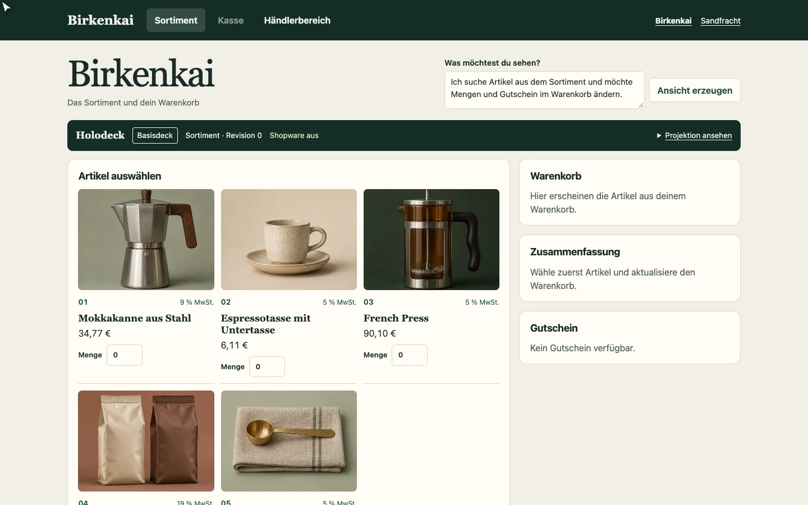
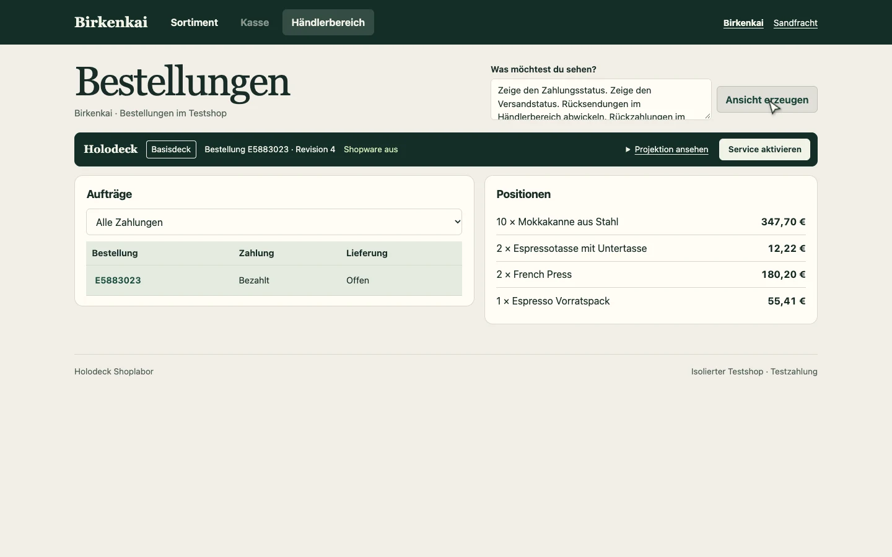
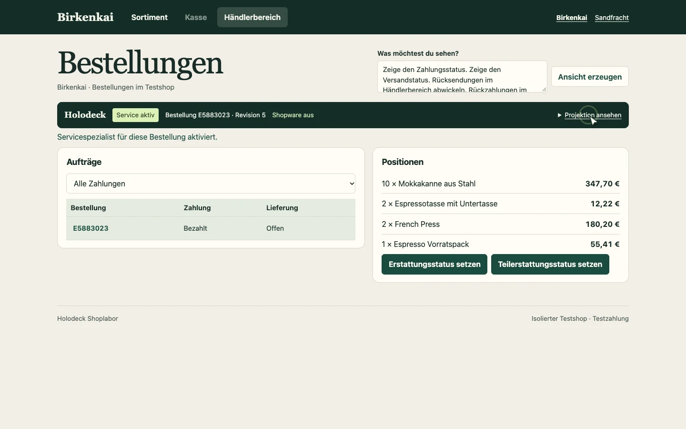

# One order through three live surfaces

Birkenkai begins with a shop catalogue, builds a cart and saves an order for €471.06. In Admin, the merchant asks to see delivery and payment status and work on returns and refunds. The basis deck opens the order. After explicit activation of the trained service specialist, the same request exposes refund controls for the same order. The return control appears once the delivery is marked shipped. Shopware stays offline throughout.



| Before activation | After activation |
| --- | --- |
|  |  |

The demo displays the loaded checkpoint, bound order and revision, and can expand the current component and action bindings. The browser verifies the native cart, discount and saved order, and checks that a premature return is rejected. It runs the workflow in Birkenkai and Sandfracht. The filmed Birkenkai order was reopened on the same service checkpoint at revision 10 after restarting the server. The [earlier replay](learning.md#one-specialist-from-training-to-activation) documents the specialist's training and native comparisons.

[Checkout capture](../assets/experiments/showcase/checkout.webp) · [Saved order after the service workflow](../assets/experiments/showcase/final.webp)

The walkthrough uses synthetic merchants, test payment and simulated return and refund status changes. The demo product photos are generated catalogue illustrations. The running prototype uses the existing frozen language encoder, trained sparse commerce and projection cells, and the pre-trained service specialist.

## Start the interactive demo

Use the [pinned Qwen and MLX setup](joint-deck.md#replay-the-published-checkpoints). From the repository root with Shopware stopped, set `base` to the local Qwen snapshot and run the following.

```sh
bench=experiments/shopware/benchmark
proof=experiments/shopware/evidence/joint-deck
out=$(mktemp -d)

python "$bench/joint_shop.py" import --source "$proof/traces/service-holdout.jsonl" \
  --catalog "$out/shops.json" --case Birkenkai:0 --case Sandfracht:0 --teacher-port 55729
python "$bench/joint_shop.py" serve --showcase --base "$base" --checkpoint "$proof/checkpoint" \
  --language-weights "$proof/language/admin.npz" --catalog "$out/shops.json" \
  --specialist "$proof/specialist" --service-weights "$proof/language/service.npz" \
  --db "$out/shop.sqlite" --audit "$out/audit.jsonl" --port 55742 --teacher-port 55729
```

Open [Birkenkai](http://127.0.0.1:55742/?shop=birkenkai&demo=1) or [Sandfracht](http://127.0.0.1:55742/?shop=sandfracht&demo=1). For the filmed Birkenkai cart, enter 12, 2, 2 and 1 for the first four products and apply the code `BIRK0`. Checkout saves the order. Open it in Admin and use **Service aktivieren** to attach the specialist to that order.

To repeat the browser check, use Playwright with Chrome or Chromium available. Pass `record` in place of `rehearse` for an unedited capture of Birkenkai.

```sh
node "$bench/showcase_browser.cjs" http://127.0.0.1:55742 \
  "$proof/traces/service-holdout.jsonl" "$out/browser" rehearse
```
