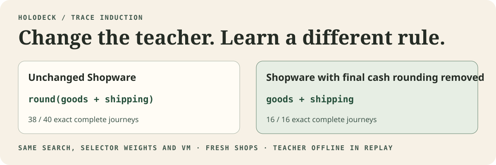

# From traces to executable knowledge

Holodeck's target is a model that learns the same business decision a shopper uses at checkout, a merchant uses in Admin, and a workflow uses after an event. A deck emits a typed operation. That operation determines the state change and the actions a view can offer. The VM executes it and the transaction store records it.

The previous joint deck learned to select among supplied expressions. This experiment asks whether new expressions can be recovered from Shopware input and output observations, using a fixed vocabulary of generic operations.

## The challenge from Fable 5.2

A correct replay can hide an incorrect rule. If shipping already falls on the final rounding grid, rounding goods before adding shipping and rounding the sum produce the same observations. A different merchant can still have that same property. Entire shops are necessary holdouts. The training evidence also needs cases where the two explanations predict different results.

Fable recommended an executable library, counterexample queries to Shopware and a learned proposer that reduces search cost. The first experiment establishes a symbolic baseline. Fable's stronger follow-up asks for terminal-state-only supervision, a deliberately modified teacher, and a new operation that benefits from a learned abstraction. Those are separate tests.

## The experiment

The compiler sees named, typed operand scopes and observations of quantities, line totals, discounts, shipping, cart totals and stock. Some of the supervision comes from intermediate cart fields. The search receives neither the source formulas nor expression labels. It enumerates expressions in increasing node count and merges candidates with the same observed values within a type. The grammar supplies addition, subtraction, minimum, maximum, negation, multiplication and a versioned quantization primitive. It has no commerce operations.

The selected expressions are lowered into the existing VM vocabulary and compiled into the joint deck's expression slots. The original sparse selectors, tax allocation, workflow programs, renderer and transaction runtime supply the rest of the system. Holdout outcomes are used by the scorer. The running deck receives the catalog, event arguments and merchant settings. The two induction arms use the same search and runtime. One gets the earlier 18 passive trajectories. The other gets additional forms of evidence from a new campaign with requests above stock, coupons above the basket value and different item and total intervals.

This is symbolic acquisition. The experiment keeps the decoder's parameter arrays byte for byte. The expression grammar and merchant independent programs change.

## First result on unchanged Shopware

The compiler fit nine expressions on each of two 18 journey partitions. Both resulting checkpoints were frozen before the four fresh shops were recorded.

| Program source | Exact complete journeys |
| --- | ---: |
| Earlier source informed joint deck | 38/40 |
| Induced from earlier passive observations | 6/40 |
| Induced from deliberately varied observations | 38/40 |

The contrast fit learned to cap requested quantity by stock, cap a fixed discount by its basis, and round after adding delivery. The passive fit copied the requested quantity, applied the configured discount amount, and rounded before adding delivery. Each was consistent with its own training observations.

Both better variants miss the same Drahtufer boundary twice. Shopware applies a €6.30 discount on a €6.32 basket with a ten cent total interval. Both variants applied €6.32. With the fixed shipping charge, the gross order matches but the persisted net is €7.54 instead of €7.56, and the tax basis differs. This locates the remaining work at the interaction between the rounded cart ceiling and the promotion. The original holdout remains scored as recorded. [Shopware promotion limit](https://github.com/shopware/shopware/blob/v6.7.15.1/src/Core/Checkout/Promotion/Cart/PromotionCalculator.php)

## The teacher changes one rule



For the control, the final gross price calculation in the isolated Shopware instance used `mathRound` in place of `cashRound`. The currency's configured interval stayed in the trace. The same compiler and operand schema refit on 16 fresh journeys. The learned final total became `goods + delivery`. The regular fit had learned `quantize(goods + delivery, total_interval)`.

| Replay against the changed teacher | Exact complete journeys |
| --- | ---: |
| Earlier source informed joint deck | 2/16 |
| Induced from contrasts in unchanged Shopware | 2/16 |
| Induced from observations of the changed teacher | 16/16 |

The changed checkpoint was frozen before its holdout was recorded. Shopware was stopped for every replay. The PHP file was restored byte for byte afterwards. This tests one causal change to arithmetic, with the same selector weights and executor throughout. The four regular case 1 journeys also ran through Storefront, Checkout and Admin in Chrome and matched their persisted orders and workflow effects. [Recorded fits and reports](../experiments/shopware/evidence/trace-induction/) · [Shopware amount calculator](https://github.com/shopware/shopware/blob/v6.7.15.1/src/Core/Checkout/Cart/Price/AmountCalculator.php)

## Reproduce

Use the [joint deck MLX environment](joint-deck.md#replay-the-published-checkpoints). The numerical replay uses the bundled captures and sparse weights. It runs with Shopware offline and without loading Qwen.

```sh
bench=experiments/shopware/benchmark
deck=experiments/shopware/evidence/joint-deck
evidence=experiments/shopware/evidence/trace-induction
out=$(mktemp -d)
port=55729
python "$bench/trace_induction.py" fit "$deck/traces/numeric-train.jsonl" "$out/passive" \
  --baseline "$deck/checkpoint" --teacher-port "$port"
python "$bench/trace_induction.py" fit "$evidence/contrast-train.jsonl" "$out/contrast" \
  --baseline "$deck/checkpoint" --teacher-port "$port"
python "$bench/trace_induction.py" fit "$evidence/changed-teacher-train.jsonl" "$out/changed" \
  --baseline "$deck/checkpoint" --teacher-port "$port"
python "$bench/trace_induction.py" evaluate "$evidence/native-holdout.jsonl" "$out/native" \
  --baseline "$deck/checkpoint" --checkpoint "$out/contrast" --passive "$out/passive" \
  --cases-per-shop 10 --teacher-port "$port"
python "$bench/trace_induction.py" evaluate "$evidence/changed-teacher-holdout.jsonl" "$out/changed-eval" \
  --baseline "$deck/checkpoint" --checkpoint "$out/changed" --passive "$out/contrast" \
  --cases-per-shop 4 --teacher-port "$port"
```

For the browser replay use the [joint deck server instructions](joint-deck.md#open-the-four-shops). Import case 1 from `native-holdout.jsonl` in Ankerfluss, Drahtufer, Walzwerk and Seidenhafen. Serve the `$out/contrast` checkpoint and set `HOLODECK_CASE=1` for the Chrome check.

## One operation across business logic and UI

An operation has a policy precondition, an executable effect and a view binding. For state `s`, merchant policy `m` and request `x`, the deck's program proposes a typed delta `Δ`. The authorization and commit core checks the actual actor, versions and invariants before recording `s ⊕ Δ`. A valid database delta can still violate merchant policy. Those checks have different responsibilities.

The evidence for a shared internal representation needs a stronger test than sharing the same checkpoint. Intervene on a single semantic fact, such as eligibility for a coupon. Its calculated effect, available action and projected control should change in the same way as the teacher. Independent UI labels can pass ordinary replay while failing that intervention. An unavailable action can be omitted from a view because its bound program does not accept the current state. The test for a learned shared representation also requires changing the model's internal representation and observing both consequences together. [Causal Abstractions of Neural Networks](https://arxiv.org/abs/2106.02997)

A follow-up review with Fable 5.2 proposed quantity admissibility as the first cross-view test. Vary minimum, maximum, purchase step and clearance across paired catalog records. Keep one generated quantity affordance and one cart transition attached to the same learned program. Train one arm on cart outcomes and check unseen native quantity controls. Train the reverse arm on controls and check native writes and refusals. Supply the same typed merchant policy or explicitly budgeted support examples to every arm. Otherwise two identical inputs can have different legal outcomes, which no inference method can identify. Use held out combinations and a changed teacher to test both directions. [Shopware product cart processor](https://github.com/shopware/shopware/blob/v6.7.15.1/src/Core/Content/Product/Cart/ProductCartProcessor.php)

The [quantity transfer experiment](quantity-transfer.md) implements this first cross-view test. It identifies the shared domain and measures where the reverse direction remains underdetermined.

## Where the learned library earns its place

A proposed abstraction must keep every verified effect exact and reduce the description length of programs across distinct operations, including the cost of the abstraction itself. A held out operation should solve faster with it than with the original grammar. Keep a source-authored ceiling and enumerative and lookup controls. Add a neural proposer only at a scale where it can improve search cost or solve previously inaccessible cases. DreamCoder supplies a precedent for jointly growing a symbolic library and training its proposer. Stitch and LILO supply tested approaches to compressing a program corpus. Their reported results are in their own domains. [DreamCoder](https://arxiv.org/abs/2006.08381) · [Stitch](https://arxiv.org/abs/2211.16605) · [LILO](https://arxiv.org/abs/2310.19791)

The next broader experiment should train from terminal effects, ask Shopware for inputs that split competing programs, and reserve a distinct downstream operation. Use the same resource limit for enumeration, enumeration with the learned library, and a neural proposer. Score exact effects, oracle queries, search nodes and whether the held out operation actually calls the learned abstraction. A miss under the changed teacher or no improvement from reuse is an explicit negative result.
