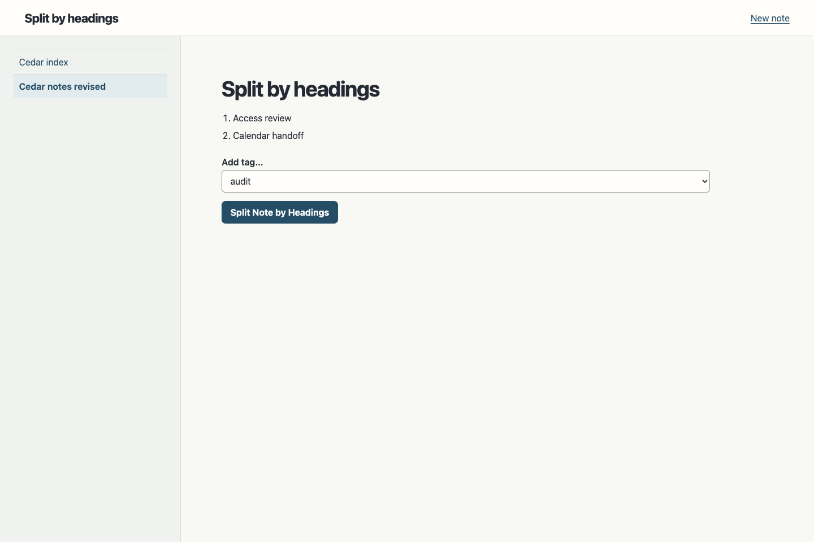

# Qwen and native MyNotes traces

The recorded result is a mixed provenance Deck. A Qwen readout selects the view from a free request. The parameter graph then composes the Holo against the current records and binds its controls to the same API used by external clients. An isolated deployment contains numerical model artifacts, the generic renderer, HTTP and SQLite. MyNotes and the earlier WebAssembly processes are stopped.

## Results

- Native MyNotes produced 208 API interactions across eight training fixture families, seven browser interactions with accessibility trees and HTTP requests, and 78 API interactions across three reserved fixture families. The generator prompts show examples from one training family at a time. The reserved data was used for verification.
- Qwen3 Embedding 0.6B encodes the request. Five normalized linear readouts were fitted to ten captions observed in the native browser. The readout selected the expected mode for five reserved phrasings. The base checkpoint stayed frozen.
- Qwen generated candidate code for the application and the Holo. The structural compiler lowers a restricted source subset into numeric operator and operand selections and never runs the source as JavaScript. The full generated application candidate was rejected. Its link routine referenced an unbound record. Additional candidate problems included missing transaction effects and incorrect record shapes.
- The qualified checkpoint contains the Qwen Coder generated tag creation, listing and deletion routes. Its Holo starts from the Qwen Coder output and includes human corrections to field shapes, preview rendering, navigation and the call to the existing note projection. Note creation, edits, links and sectioning still use the earlier authored parameter graph. The raw and qualified Holo outputs are included for comparison.
- The qualified checkpoint matched **78 of 78** reserved native API interactions after clock normalization. In a separate fresh Cedar workspace, Chrome opened generated views from free requests, created a tag and a linked note, navigated the link and backlink, edited the note, previewed a split and persisted the two sections. The saved state survived a restart.

This verifies a trace-derived Qwen grounding head, guided Holo synthesis, and replacement of the tag routes. Automatic acquisition of the entire application graph remains open.

[HTTP comparison](evidence/comparison.json) · [Grounding results](evidence/grounding-report.json) · [Full candidate](evidence/full-candidate.js) · [Compiler rejection](evidence/full-candidate.log) · [Research status](../../../docs/research-status.md)

[](evidence/cedar-holo.png)

## Run the qualified Deck

Use Node 24 and a local Ollama with `qwen3-embedding:0.6b`. From the repository root:

```sh
mynotes=experiments/mynotes
export HOLODECK_GROUNDING="$PWD/$mynotes/learned/evidence/grounding.json"
node "$mynotes/deck/host.mjs" "$mynotes/learned/evidence/checkpoint.json" /tmp/cedar-deck.sqlite 55771
```

Open [the Notes Deck](http://127.0.0.1:55771/) or [ask Qwen for a new note](http://127.0.0.1:55771/?intent=I%20want%20to%20create%20a%20new%20note). To scope an intent to an existing note, add its slug to the URL query.

## Reproduce

Install Playwright and Acorn for capture and compilation. The built checkpoint needs neither package. The scripts accept `HOLODECK_NODE`, `HOLODECK_ACORN`, `HOLODECK_PLAYWRIGHT` and `HOLODECK_CHROME` overrides.

1. Start the pinned native MyNotes reference from the [earlier experiment](../README.md) on port 55766 in a temporary workspace. Run `record.mjs URL LAB/training.json` and `native-browser.cjs URL LAB/browser.json`. Start a second fresh native workspace and run `record.mjs URL LAB/holdout.json holdout`. Stop the reference.
2. Run `fit-grounding.mjs LAB/browser.json LAB/grounding.json LAB/grounding-report.json`. This fits the readout using local Qwen features.
3. To reproduce the synthesis attempt, use `parts.mjs LAB links` and repeat for `sections`, `writes` and `reads`. Set `HOLODECK_QWEN_GENERATOR=qwen2.5-coder:32b` to use the Coder model. Concatenate those four files as `LAB/api.source.js`. Use `generate.mjs LAB holo` for an initial Holo, with optional training diagnostics for a new candidate. Compile and run the candidate without imports before claiming full acquisition.
4. To rerun the measured qualified arm, use the stored checkpoint:

```sh
learned="$PWD/experiments/mynotes/learned"
HOLODECK_CHECKPOINT="$learned/evidence/checkpoint.json" \
  HOLODECK_HEAD="$learned/evidence/grounding.json" HOLODECK_BROWSER=1 \
  bash "$learned/verify.sh" "$LAB" holdout
```

The qualified checkpoint can be rebuilt exactly from its retained source and the earlier Deck:

```sh
learned="$PWD/experiments/mynotes/learned"
HOLODECK_IMPORTS="$PWD/experiments/mynotes/deck/checkpoint.json" \
  HOLODECK_ALIASES='{"projectNote":"document"}' \
  node "$learned/lower.cjs" "$learned/evidence/tags.generated.js" /tmp/rebuilt-notes.json \
  "$learned/evidence/holo.qualified.js"
cmp /tmp/rebuilt-notes.json "$learned/evidence/checkpoint.json"
```
