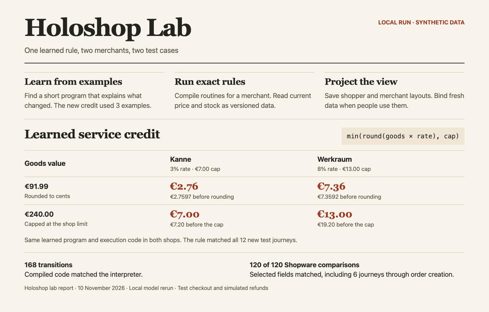
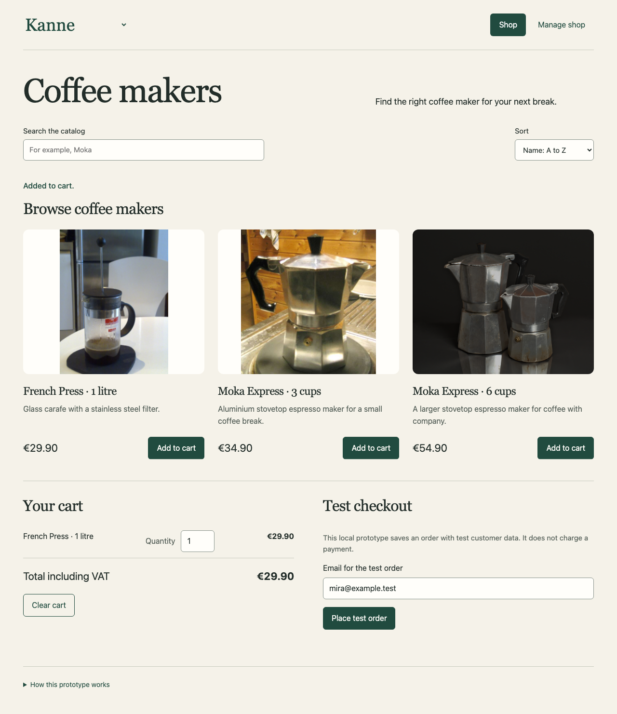
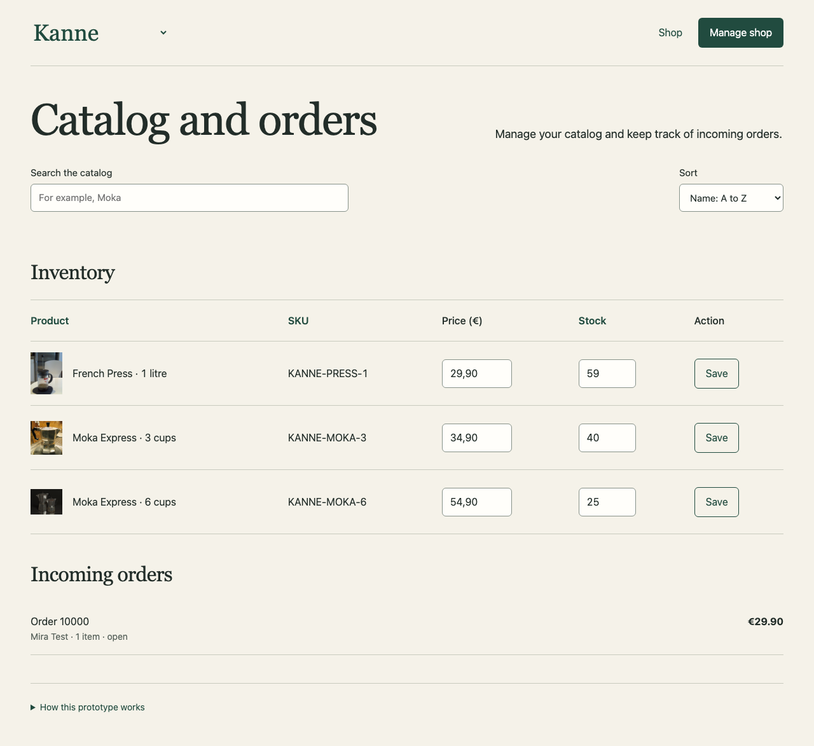

# Holoshop experiments with Shopware

**Current experiment.** The [joint deck](../../docs/joint-deck.md) runs four new shops with Shopware offline. The [published evidence](evidence/joint-deck/) includes its checkpoints and separate native training, holdout and regression traces. The [benchmark log](benchmark/README.md) records the controller comparisons, counterexamples, specialization and browser tests that led to it. The [Qwen adapter comparison](qwen/README.md) is a separate direct generation experiment.

The [interactive showcase](../../docs/showcase.md) runs the same order through generated surfaces and activates a service specialist on it. The optional [Strands experiment](../../docs/strands.md) measures intent selection and service program selection independently. [Film](https://github.com/sthamann/holodeck/releases/tag/holodeck-explainer) · [Strands comparison](evidence/joint-deck/strands-comparison.json)

[Marktlabor and the scaled corpus](../../docs/scaled-shopware-learning.md) cover 2,048 native Store and Admin API journeys for catalog edits, coupons, checkout and returns, plus native browser observations and independent two-line basket tests.

Shopware is the teacher for these commerce experiments. We ran an isolated Shopware Community Edition 6.7.15.1 installation with synthetic merchants and recorded selected state transitions. The published code replays those observations and runs a small native shop on the learned computation.

## Reproduce the published runs

From the repository root, use Python 3.11 or newer and `clang` on macOS or Linux.

```sh
python3 -m venv .venv
. .venv/bin/activate
python -m pip install -r requirements.txt
python experiments/shopware/replay.py
```

The replay runs in a disposable directory. It executes the rule experiment, both regression suites and the native trace export. It uses NumPy and Z3 and does not need a running Shopware server or a GPU. The VM itself uses NumPy. To refit the small checkpoints before running the same replay:

```sh
python -m pip install -r requirements-training.txt
python experiments/shopware/replay.py --train
```

## Experiment 1 · A rule that transfers

[core](core/) contains the typed interpreter, learner, checkpoints and synthetic traces. Thirty source trajectories supply 120 transitions. Twelve held-out trajectories from Werkraum supply 48 transitions.

The additional policy gives a service credit on a full refund. It applies a configured percentage to the goods value, rounds to cents and respects the configured cap. Three independent merchant examples teach the policy. The adapted model adds a small selection head and preserves the previous heads.

The unadapted model matches 0 of 12 complete journeys under the new policy. The adapted model matches 12 of 12. Restarting a worker at each of the 48 steps and switching the checkpoint during each trajectory preserves the result. In 1,000 additional numeric cases, both the learned rule and the separately generated Qwen expression match the reference in all 1,000 cases.

The Z3 check verifies equivalence of the selected credit expression on the documented bounded input domain. Its scope is arithmetic after an authorized full refund. Event ordering, authorization and the rest of Shopware have separate contracts.



## Experiment 2 · Compile, commit and project

[native](native/) compiles the selected typed expressions to C and uses SQLite for local records. The native outputs match all 168 recorded reference transitions. The regression suite exercises quote freshness, tenant isolation, checkout retries, contention for the last unit and two merchant configurations.

The original live comparison matched 120 selected HTTP checks, including six checkout journeys. Its reference was the isolated Shopware installation. The published replay checks the recorded traces and local regressions. It does not rerun the original live comparison. The scope and counts are captured in the [recorded evidence](evidence/recorded-local.json).

```sh
python experiments/shopware/native/api.py
# Open http://127.0.0.1:18778
```

The server installs the two bundled synthetic merchant packages on first use and binds to loopback. Choose Kanne or Werkraum and switch between the shopper and merchant views. The views use stored Qwen-generated component descriptions and current local data. Checkout is a test flow. The local demo uses fixture credentials.





The screenshots come from an English rendering of the experiment. The bundled demo retains its German labels. Product photograph credits are listed with the [illustrations](../../assets/README.md).

## What the experiments establish

- A small, inspectable program can be learned from examples and transferred to another configured shop.
- Exact arithmetic, durable records, repeatable effects and reusable projected views can coexist.
- The current host still makes some commercial decisions, including cart eligibility and parts of order formation. The experiment fits small categorical selection heads. It does not train Qwen weights.
- The reference covers a selected subset of commerce and API responses. The [standalone neural shop](../../docs/standalone-shop.md) is a separate experiment with a new set of Shopware traces and trained weights in the serving path.

## Data and source notes

The [oracle manifest](core/data/oracle-manifest.json) records the source, field projection and held-out cohort. [shopware.json](core/data/shopware.json) contains the normalized synthetic trajectories used by the replay. [merchant-examples.json](core/data/merchant-examples.json) contains the independent policy examples. [language-rule.json](core/data/language-rule.json) records the expression used for the direct-synthesis baseline. Native coverage is scoped in [coverage.json](native/inventory/coverage.json).

Shopware supplied reference behaviour. The repository contains experimental code and normalized synthetic observations. The article companion and the [general architecture](../../docs/architecture.md) distinguish these experiments from the target.
